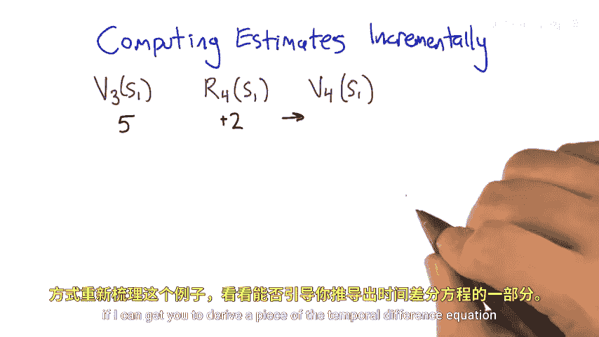
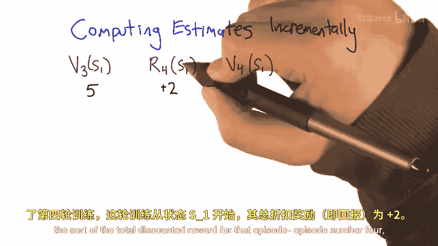
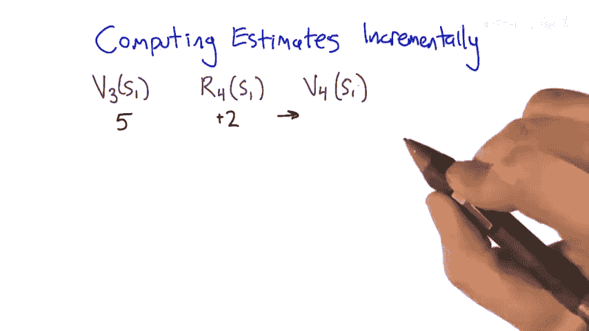
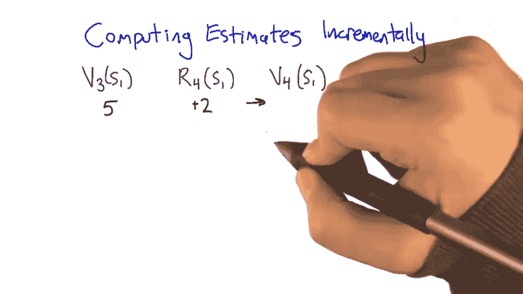

# 078：增量式计算估计值

在本节课中，我们将学习如何增量式地更新状态价值函数的估计值，而无需每次都重新计算所有历史回报的平均值。这是一种更高效的计算方法。

上一节我们介绍了通过多次试验的平均回报来估计状态价值。本节中我们来看看如何仅利用旧的平均值和新的回报数据，来增量式地更新这个估计值。

以下是推导增量式更新公式的步骤。

首先，回顾已知信息。在经历了三次试验后，状态 S1 的价值估计值 V(S1) 是 5。这意味着前三次试验回报的总和是 15。我们可以用公式表示：
`总和_旧 = 旧平均值 * 旧次数 = 5 * 3 = 15`

接着，我们进行了第四次试验，并得到了一个新的回报值，为 2。

现在，我们需要计算包含这四次试验在内的新平均值。新平均值等于所有试验回报的总和除以试验总次数。新的总和是旧的总和加上新的回报：
`总和_新 = 总和_旧 + 新回报 = 15 + 2 = 17`
试验总次数更新为 4。因此，新的平均值计算如下：
`新平均值 = 总和_新 / 新次数 = 17 / 4 = 4.25`

以上过程可以归纳为一个通用公式。设旧平均值为 `V_旧`，旧次数为 `N_旧`，新回报为 `G_新`。则新平均值 `V_新` 的计算公式为：
`V_新 = (V_旧 * N_旧 + G_新) / (N_旧 + 1)`

这个公式可以进一步调整，以更清晰地体现“更新”的概念。我们将公式变形：
`V_新 = V_旧 + (1 / (N_旧 + 1)) * (G_新 - V_旧)`
在这个形式中，`(G_新 - V_旧)` 是新回报与旧估计值之间的差值，可以理解为“误差”或“惊喜”。`1/(N_旧+1)` 是学习率（步长），它随着试验次数的增加而减小，确保估计值最终收敛。

因此，更新规则的核心是：**用旧估计值加上一个由学习率缩放的误差项，来得到新估计值。**

本节课中我们一起学习了增量式更新状态价值估计的方法。我们从一个具体例子出发，推导出了通用的更新公式 `V_新 = V_旧 + α * (G_新 - V_旧)`，其中 α 是学习率。这种方法无需存储所有历史数据，只需保留当前的估计值和计数（用于计算学习率），即可高效地进行在线学习。