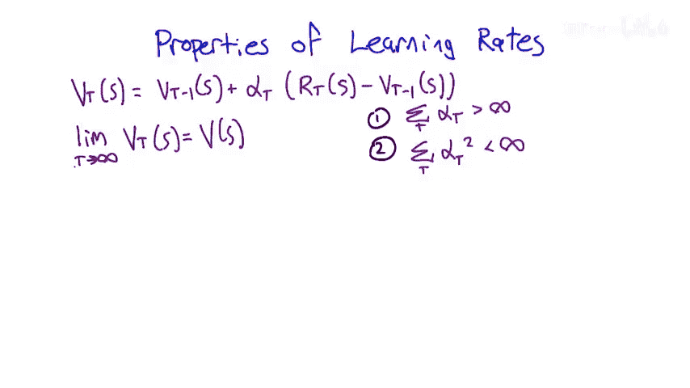
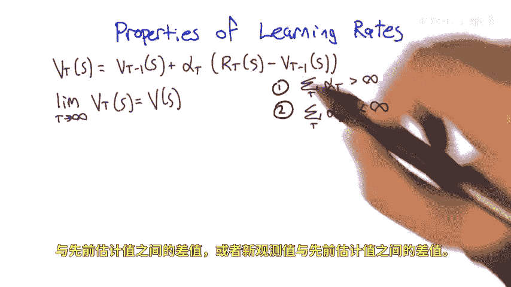
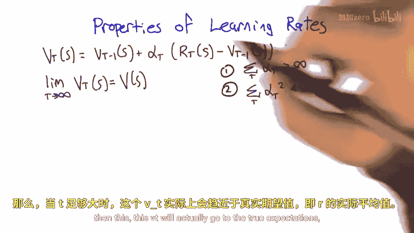
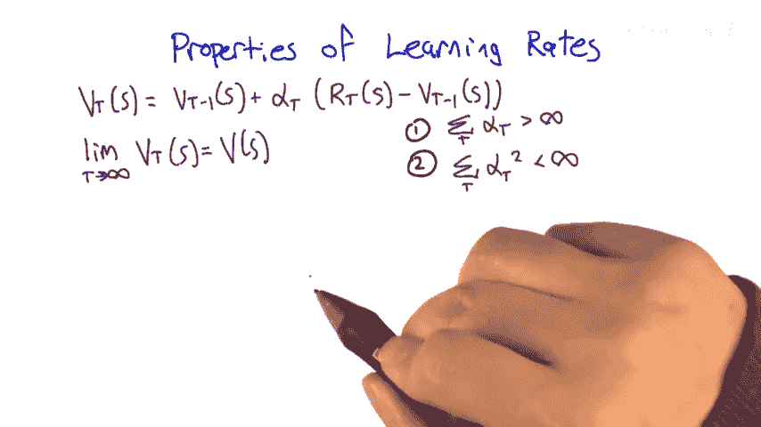
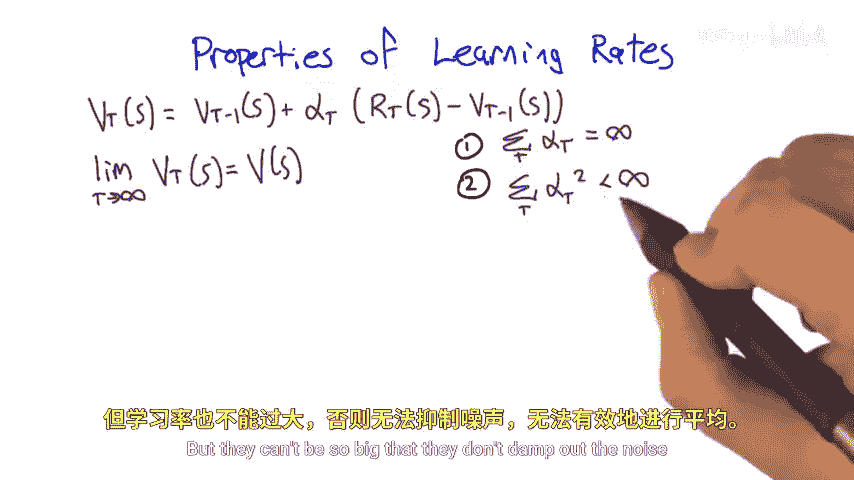

# 079：学习率的性质 📈

在本节课中，我们将要学习增量式学习算法中学习率序列需要满足的关键数学性质。这些性质保证了我们的估计值能够收敛到真实的期望值。

上一节我们介绍了增量式更新规则，本节中我们来看看为了保证学习算法的有效性，学习率序列必须满足哪些条件。

## 核心更新规则

我们讨论的增量式学习更新规则如下：

**公式：** `V_t = V_{t-1} + α_t * (R_t - V_{t-1})`

其中：
*   `V_t` 是时间步 `t` 的估计值。
*   `α_t` 是时间步 `t` 的学习率。
*   `R_t` 是时间步 `t` 观察到的新样本值。

这个规则的目标是让估计值 `V_t` 随着时间推移，收敛到所有观察值 `R` 的真实期望值，即当 `T` 足够大时，`V_T` 趋近于 `R` 的平均值。

## 学习率序列的收敛条件

为了使上述更新规则能够收敛到正确的期望值，学习率序列 `{α_t}` 必须满足两个关键条件。

以下是学习率序列 `{α_t}` 必须满足的两个数学条件：

1.  **无穷和条件：** 所有学习率之和必须发散至无穷大。
    **公式：** `∑_{t=1}^{∞} α_t = ∞`
    这个条件确保了学习算法有足够的“动力”去探索和修正估计值，无论初始值如何，最终都能移动到真实值。如果学习率之和是有限的，更新可能会在到达真实值之前就过早停止。

2.  **平方和有限条件：** 所有学习率的平方和必须收敛于一个有限值。
    **公式：** `∑_{t=1}^{∞} α_t^2 < ∞`
    这个条件确保了学习率足够小，能够逐渐“抑制”或“平均掉”观测数据中的随机噪声（方差）。如果学习率下降得太慢（平方和不收敛），噪声会导致估计值持续波动，无法稳定到真实期望。

## 条件背后的直观理解

这两个条件共同作用，为学习算法提供了理想的收敛行为。

*   **第一个条件（∑ α_t = ∞）** 保证了算法的**充分探索性**。它确保学习率不会衰减得太快，以至于算法在完全收敛前就“冻结”了。
*   **第二个条件（∑ α_t^2 < ∞）** 保证了算法的**稳定性**。它确保学习率最终会变得足够小，以平滑掉观测中的随机波动，实现稳定的平均。

一个常见的满足这两个条件的序列是 `α_t = 1/t`。其和（调和级数）发散，而其平方和（`∑ 1/t^2`）收敛。

本节课中我们一起学习了保证增量式学习算法收敛的两个核心条件。总结来说，学习率序列必须满足 **∑ α_t = ∞** 以确保充分探索和最终收敛，同时满足 **∑ α_t^2 < ∞** 以确保稳定并抑制噪声。理解这些性质是设计和分析强化学习及其他在线学习算法的基础。