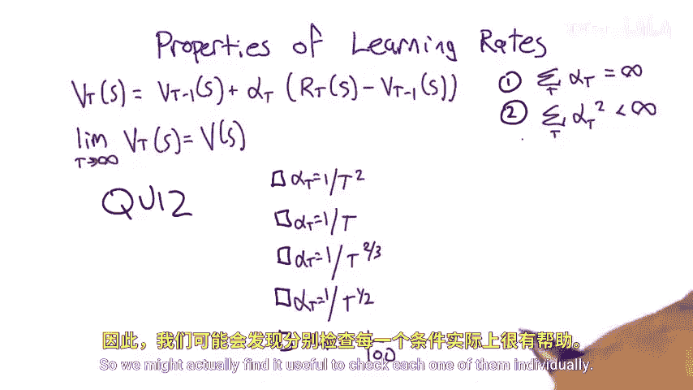
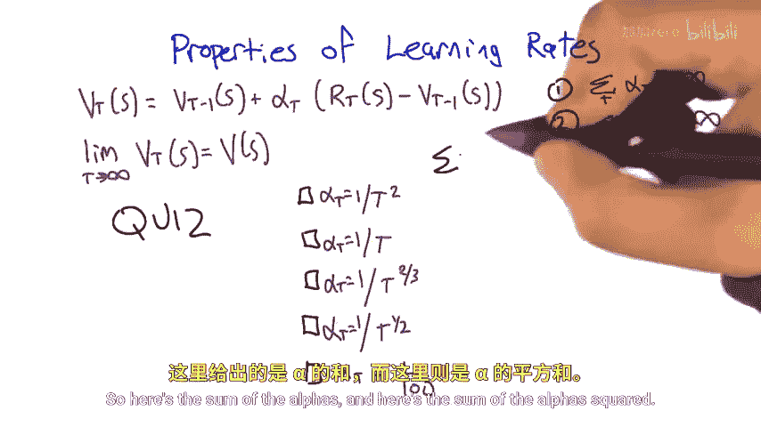
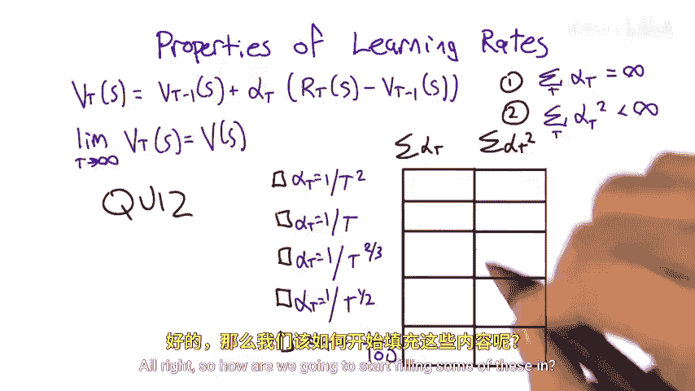
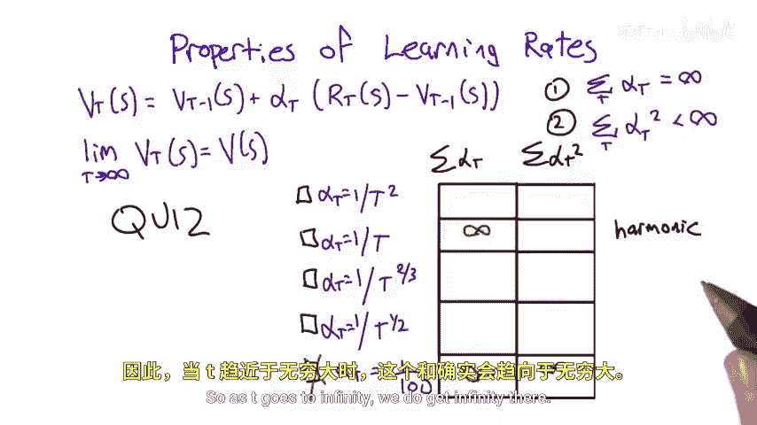

强化学习导论：P81：学习率选择方案解析 🎯

在本节课中，我们将学习如何为随机梯度下降（SGD）等算法选择合适的学习率序列。我们将通过分析五个具体的学习率候选方案，来理解保证算法收敛所需满足的数学条件。

为了确定一个学习率序列是否有效，我们需要验证两个关键条件。这两个条件共同确保了算法在理论上的收敛性。

以下是需要检查的两个核心条件：
1.  学习率序列之和必须发散至无穷大：`∑ α_t = ∞`
2.  学习率平方序列之和必须收敛：`∑ (α_t)^2 < ∞`

接下来，我们将逐一分析五个给定的学习率方案。我们将计算每个序列的和及其平方和，并根据上述条件判断其是否有效。

**方案五：α_t = 0.1**
这是最容易判断的方案。由于学习率是一个常数，其序列之和将无限累加，因此 `∑ 0.1 = ∞`。同时，其平方序列 `∑ (0.1)^2` 也是一个常数项的无限累加，同样发散至无穷大。这违反了第二个条件（平方和需收敛）。结论是：如果学习率不随时间减小，算法将无法保证收敛。

**方案二：α_t = 1/t**
这个方案是有效的，我们在之前的课程中已经讨论过。其序列 `∑ 1/t` 是著名的调和级数，其和随着项数 `T` 的增长近似于 `log(T)`，当 `T` 趋于无穷时发散。而其平方序列 `∑ 1/t^2` 是一个收敛级数（p-级数，p=2>1）。因此，它同时满足两个条件。

**方案一：α_t = 1/√t**
现在我们来分析第一个方案。其序列之和 `∑ 1/√t` 也是一个发散级数（p-级数，p=0.5<1）。而其平方序列 `∑ (1/√t)^2 = ∑ 1/t`，正是我们刚才讨论过的调和级数，是发散的。这违反了平方和需收敛的条件。因此，该方案无效。

**方案三：α_t = 1/t²**
对于此方案，其序列 `∑ 1/t²` 是收敛的（p-级数，p=2>1），这违反了第一个条件（和需发散）。其平方序列 `∑ 1/t⁴` 显然也是收敛的。由于第一个条件不满足，该方案无效。

**方案四：α_t = 1/log(t)**
最后，我们来看以对数函数为分母的方案。序列 `∑ 1/log(t)` 的发散速度比调和级数 `∑ 1/t` 更慢，但它仍然是发散的。然而，其平方序列 `∑ 1/(log(t))²` 虽然衰减更快，但通过积分判别法可知，它仍然是发散的。因此，它同样违反了第二个条件，该方案无效。

本节课中，我们一起学习了如何通过检验两个数学条件来判断学习率序列的有效性。我们分析了五个具体例子，最终确认只有方案二（`α_t = 1/t`）同时满足“序列和发散”与“序列平方和收敛”的条件，是理论上能保证随机梯度下降算法收敛的有效学习率方案。理解这些条件对于设计和调试机器学习算法至关重要。