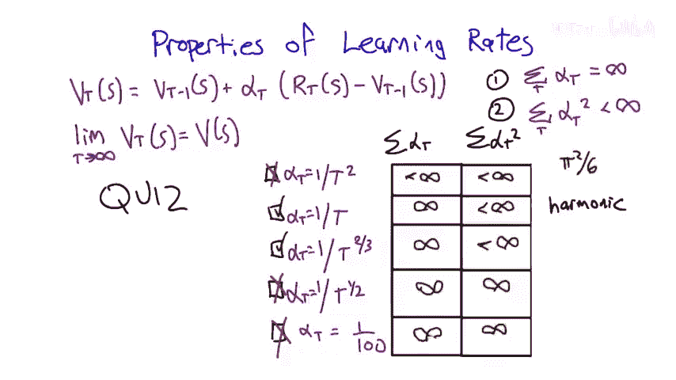
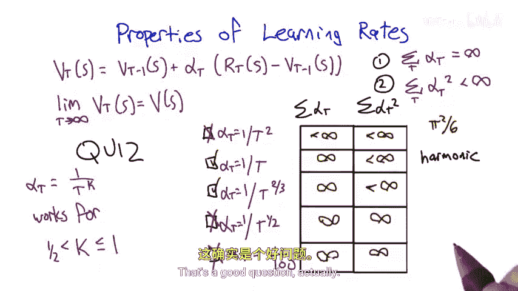
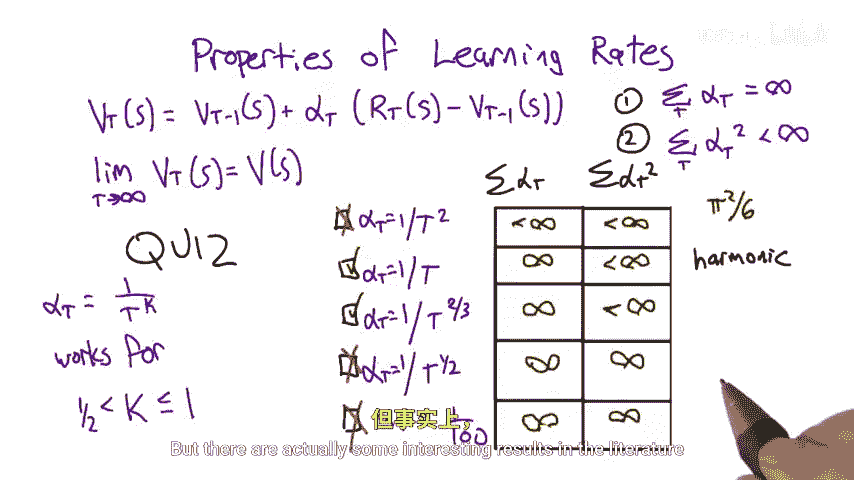

强化学习导论：P82：学习率选择 - 解决方案 - 2

在本节课中，我们将从上一节的讨论中提炼出一个关于学习率序列的通用规则。我们将探讨学习率序列形式为 **1/t^K** 时，指数 **K** 的取值范围如何影响算法的收敛性。

上一节我们分析了学习率序列求和的性质对算法收敛的关键作用。本节中，我们来看看如何确定指数 **K** 的有效范围。

我们可以从分析中总结出一个通用规则。如果学习率序列的形式是 **1/t^K**，那么 **K** 需要在某个特定范围内取值，算法才能收敛。

我们观察到，如果 **K** 值过大，序列和会收敛到一个有限值，这会导致算法失败。反之，如果 **K** 值过小，序列和会发散到无穷大，这同样会导致算法失败。

那么，**K** 的有效取值范围是多少？我们可以从两个条件推导出来。

首先，我们需要序列 **1/t^K** 本身的和是发散的（趋于无穷）。这要求指数 **K ≤ 1**。

其次，我们需要序列 **(1/t^K)^2** 的和是收敛的（有限值）。由于 **(1/t^K)^2 = 1/t^{2K}**，这要求指数 **2K > 1**，即 **K > 0.5**。

综合这两个条件，我们得到 **K** 的取值范围是 **0.5 < K ≤ 1**。需要注意的是，当 **K = 0.5** 时，平方项的和为 **1/t**，其和是发散的，因此 **K** 必须严格大于 0.5。

以下是 **K** 取值范围的总结：
*   **K > 0.5**：确保平方项序列 **1/t^{2K}** 的和收敛。
*   **K ≤ 1**：确保原始序列 **1/t^K** 的和发散。

在有效范围 **0.5 < K ≤ 1** 内，是否有理由偏好某个特定的 **K** 值？这是一个很好的问题。

就我们目前讨论的收敛性而言，**K** 在此范围内的任何值理论上都是可行的。然而，文献中有一些有趣的结果表明，像 **K = 1** 这样的边界值可能过于不稳定，选择稍低一些的 **K** 值（例如 0.6, 0.7）可能有助于更好地平滑学习过程。

这种不稳定性从何而来？它主要源于 **K = 1** 处于有效范围的边界。如果初始条件或噪声非常不利，边界值可能表现出更脆弱的特性。

本节课中，我们一起学习了如何为形式为 **1/t^K** 的学习率序列确定保证收敛的指数 **K** 的取值范围，即 **0.5 < K ≤ 1**。同时，我们也了解到在实践中，选择略低于 1 的 **K** 值可能有助于提高学习过程的稳定性。