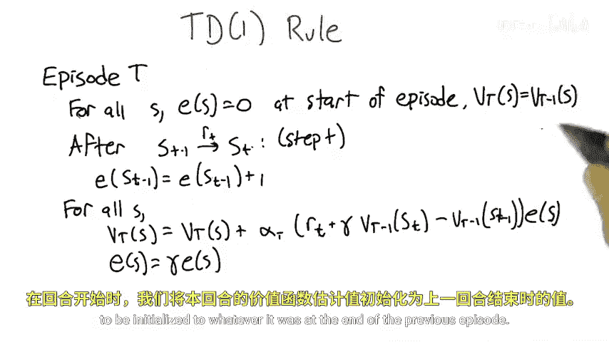
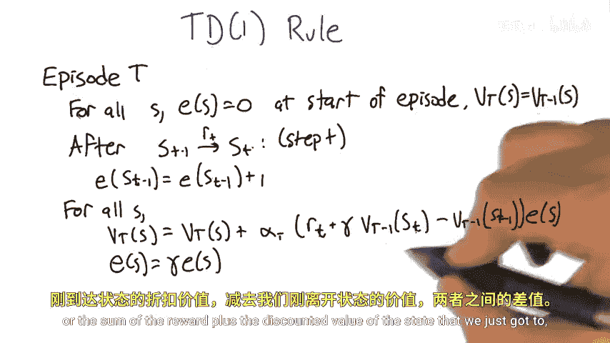
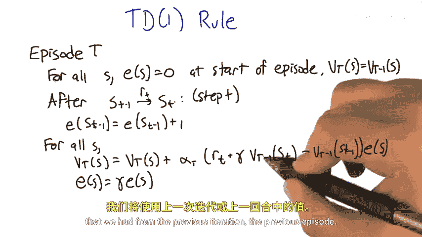
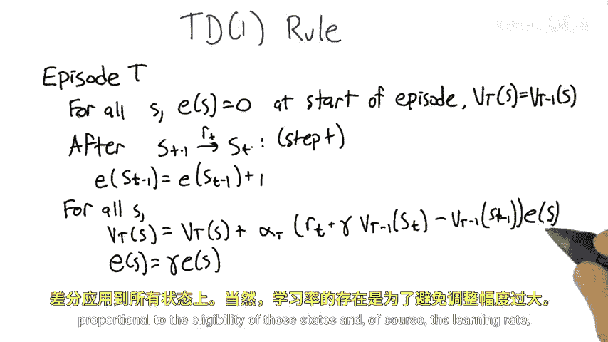
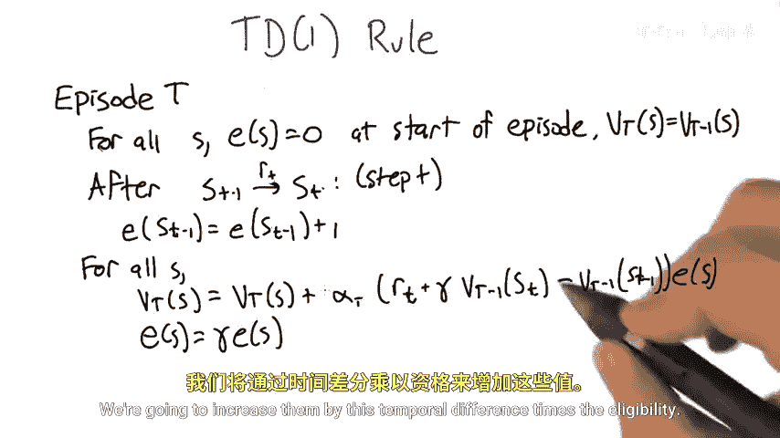

# 083：TD(1)规则 🧠

在本节课中，我们将学习TD(1)算法的更新规则。TD(1)是一种时序差分学习方法，它通过结合资格迹（eligibility trace）的概念，来更有效地更新状态的价值函数估计。我们将详细拆解其算法步骤，并理解其背后的逻辑。

## 概述

上一节我们讨论了时序差分学习的基本思想。本节中，我们来看看TD(1)的具体更新规则。该规则虽然看起来有些复杂，但我们将逐步分析，并理解其执行的是非常合理（或至少是部分合理）的操作。

## TD(1)规则的结构

以下是TD(1)规则的基本结构。对于每一次我们开始一个新回合（episode）时，都会执行以下流程。

### 回合初始化

在每个新回合开始时，我们需要进行两项初始化操作：

*   **初始化资格迹**：对于所有状态`s`，将其资格迹`E(s)`初始化为0。这意味着在回合开始时，所有状态都被视为“不具备资格”。
*   **初始化价值函数**：将本回合的价值函数估计`V(s)`初始化为上一回合结束时的值。这是合理的，因为我们希望基于之前的学习经验继续更新。

### 回合内单步更新

在回合内部，每当我们执行一步，从状态`S_{t-1}`转移到状态`S_t`并获得奖励`R_t`时，我们执行以下更新步骤。

以下是每一步的具体操作流程：

1.  **更新离开状态的资格迹**：首先，增加我们刚刚离开的那个状态`S_{t-1}`的资格迹。具体操作为：`E(S_{t-1}) = E(S_{t-1}) + 1`。
2.  **计算时序差分误差**：接着，计算一个对所有状态都相同的量——时序差分误差（Temporal Difference Error）。其公式为：
    `δ_t = R_t + γ * V(S_t) - V(S_{t-1})`
    其中，`γ`是折扣因子。这个误差代表了基于当前估计，所观测到的回报与预期回报之间的差异。注意，这里使用的价值函数`V`是来自上一轮迭代（即上一回合结束时的值）。
3.  **更新所有状态的价值函数**：我们将上一步计算出的时序差分误差`δ_t`，应用于**所有**状态。每个状态的价值函数更新量与其当前的资格迹`E(s)`成正比，同时乘以学习率`α`（以避免更新步伐过大）。更新公式为：
    `V(s) = V(s) + α * δ_t * E(s)`， 对所有状态`s`。
4.  **衰减资格迹**：在更新完价值函数后，我们需要对所有状态的资格迹进行衰减（decay）。衰减系数是折扣因子`γ`和另一个参数`λ`（此处λ=1）的乘积。更新公式为：
    `E(s) = γ * λ * E(s)`， 对所有状态`s`。
5.  **进入下一步**：完成以上步骤后，我们便准备进入下一个时间步`t+1`，重复上述过程。

## 总结

本节课中，我们一起学习了TD(1)的更新规则。我们了解到，该算法通过在回合开始时初始化资格迹和价值函数，并在每一步中结合即时奖励和后续状态的价值来计算出时序差分误差。随后，算法根据各状态的资格迹比例，用这个误差来更新所有状态的价值估计，并最终对资格迹进行衰减，为后续更新做准备。这个过程使得智能体能够更有效地利用历史经验来优化其决策。