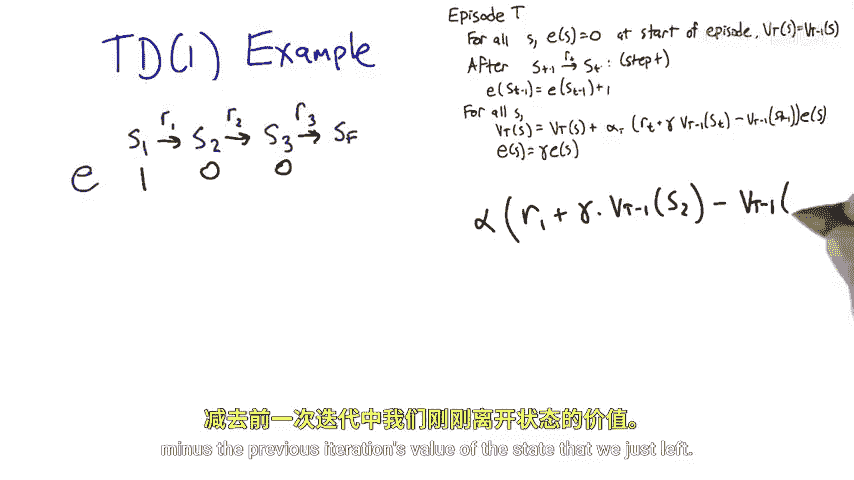
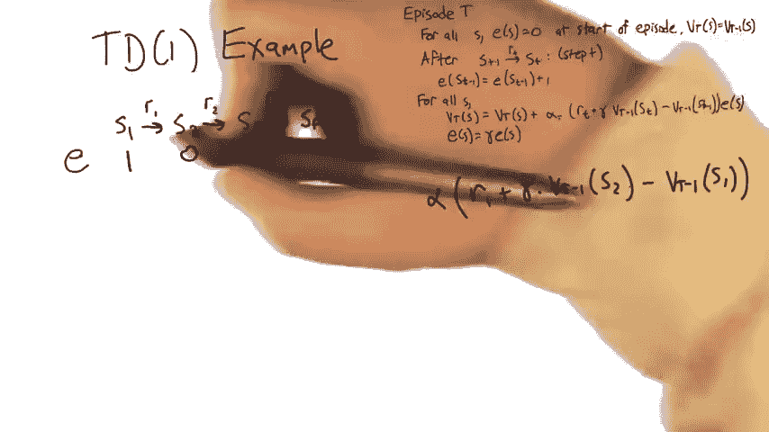
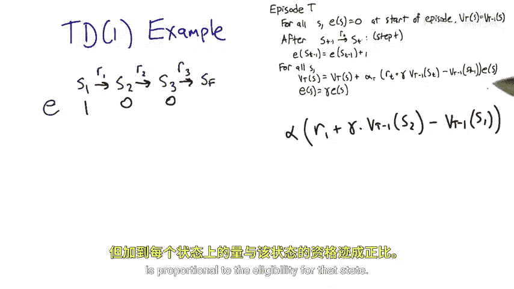

**强化学习导论：P84：TD(1) 算法示例详解 🧮**

在本节课中，我们将通过一个微小的示例，逐步解析TD(1)算法的伪代码，以直观地理解价值函数是如何更新的。

**概述**
我们将模拟一个简单的回合，从初始状态开始，跟踪每一步的状态转移、奖励以及价值函数的更新过程。核心在于理解资格迹（eligibility trace）如何影响每个状态的价值更新。

---

**算法初始化**

首先，在回合开始时，我们将所有状态的资格迹初始化为0。同时，新的价值函数将继承上一回合结束时的价值函数值。在本示例中，我们将主要关注价值函数的变化量，这些变化最终会累加到上一回合的价值函数基础上。

**第一步：状态转移与资格迹更新**

现在，我们进行第一次状态转移：从状态 **S1** 转移到状态 **S2**，并获得奖励 **R1**。

这次转移对资格迹有何影响？对于刚刚访问过的状态 **S1**，其资格迹被设置为1。而状态 **S2** 和 **S3** 的资格迹目前仍为0。

以下是当前各状态资格迹的示意图：

**第二步：价值函数更新**

接下来，我们将遍历所有状态，并对每一个状态应用相同的更新规则。更新量的计算公式如下：

`ΔV(s) = α * [R1 + γ * V_prev(S2) - V_prev(S1)] * e(s)`

其中：
*   **α** 是学习率。
*   **R1** 是刚刚获得的即时奖励。
*   **γ** 是折扣因子。
*   **V_prev(S2)** 是上一轮迭代中状态 **S2** 的价值。
*   **V_prev(S1)** 是上一轮迭代中状态 **S1** 的价值。
*   **e(s)** 是状态 **s** 当前的资格迹。

这个计算出的更新量 **ΔV** 将会被应用到所有状态上，但每个状态实际接收到的更新幅度，正比于它当前的资格迹 **e(s)**。

由于此时只有 **S1** 的资格迹为1，而 **S2** 和 **S3** 的资格迹为0，因此只有 **S1** 的价值会根据上述公式进行更新。**S2** 和 **S3** 的价值变化量为0。

更新后的状态价值示意图如下：

---

**总结**

本节课中，我们一起学习了TD(1)算法在一个简单步骤中的运行机制。我们看到了：
1.  状态转移会激活相应状态的资格迹。
2.  价值函数的更新基于时序差分误差（TD Error），即 `R + γ * V(s') - V(s)`。
3.  该误差会通过资格迹分配给所有状态，但只有资格迹不为零的状态其价值才会在当前步骤中发生实际改变。

这个示例清晰地展示了资格迹如何将当前时刻的奖励和信息“追溯”并分配给之前访问过的状态，这是时序差分学习算法的核心思想之一。