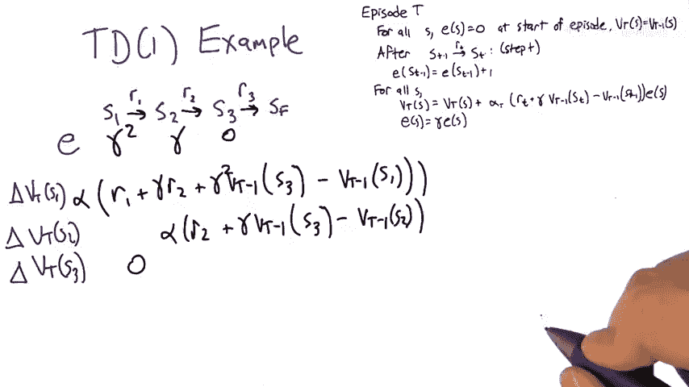
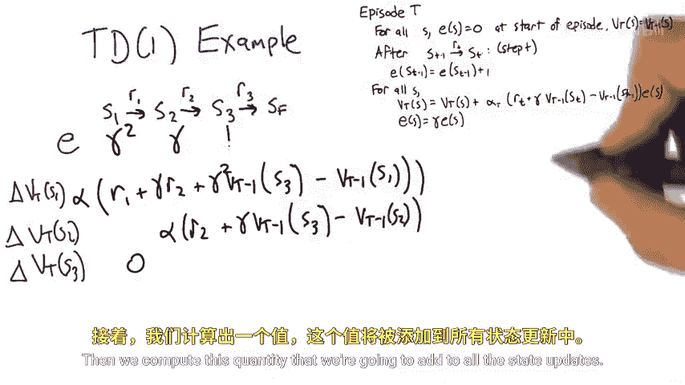
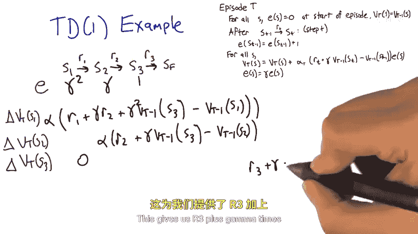
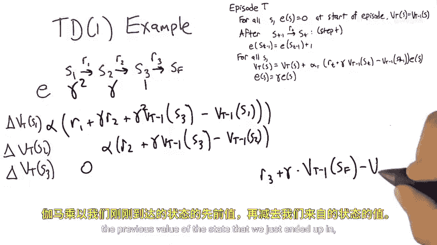
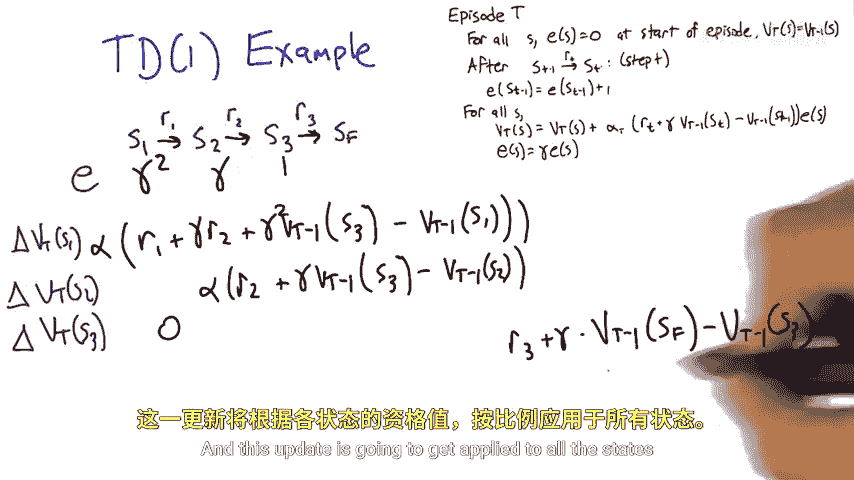
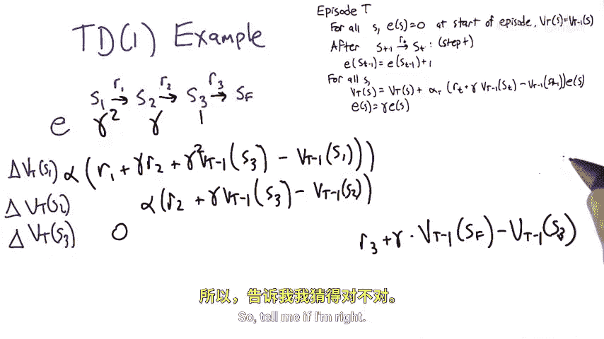

# 085：TD(1) 示例 - 2

在本节中，我们将继续通过一个具体示例，深入探讨TD(1)算法的更新过程。我们将一步步分析从状态S3到终止状态SF的更新，并理解其背后的数学原理。

上一节我们介绍了TD(1)算法中资格迹的更新规则，本节中我们来看看如何应用这些规则进行实际的价值函数更新。

下一步，我们从状态S3转移到终止状态SF，并在转移时获得奖励R3。

首先发生的是更新该状态的资格迹。

然后我们计算一个量，这个量将被加到所有状态的价值更新中。

这个量是 **r3 + γ * V(SF) - V(S3)**。

这个更新将按比例应用于所有状态，比例系数是它们各自的资格迹。

我们可以再次执行相同的操作。只需将这个量加到所有这些状态价值中，然后进行简化。

这听起来没问题。

这确实没问题，我想我终于明白这是怎么回事了。

以下是理解的关键：如果你看伪代码，它说“对于所有状态s，更新其价值”。被学习率α乘上的那部分，本质上就是你的**误差**。这正是TD学习的核心。

所以，它就是你想象的那样。它是你**预测的价值**与你**实际看到奖励后**的结果之间的差异。前提是你假设对未来状态价值的猜测是准确的。

正因为你刚才所做的那个巧妙紧凑的“望远镜式”推导，我想即使不把所有步骤写出来，我也能猜出下一个价值会是什么样子。

告诉我我猜得对不对。

对于状态S1的价值更新量δ，基本上会因为多看到一步信息，最终变成 **R1**。

本节课中我们一起学习了TD(1)算法在一个完整回合中的更新流程。我们看到了时序差分误差如何通过资格迹分配给路径上的所有状态，并理解了其更新最终会收敛到该回合所观测到的总奖励。这揭示了TD(λ)方法如何将蒙特卡洛方法和单步TD学习统一在一个框架内。