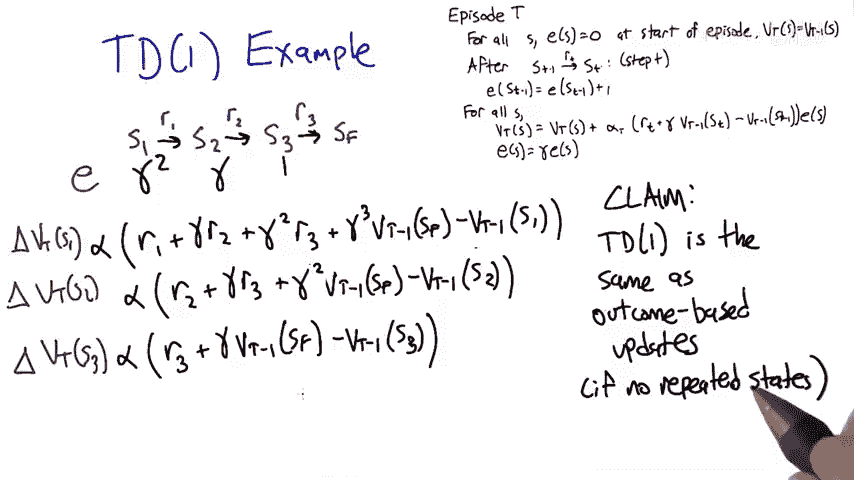
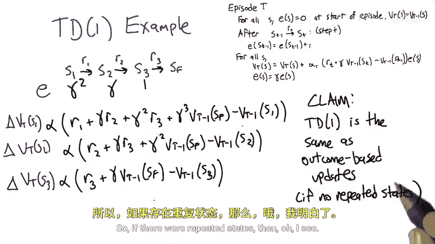
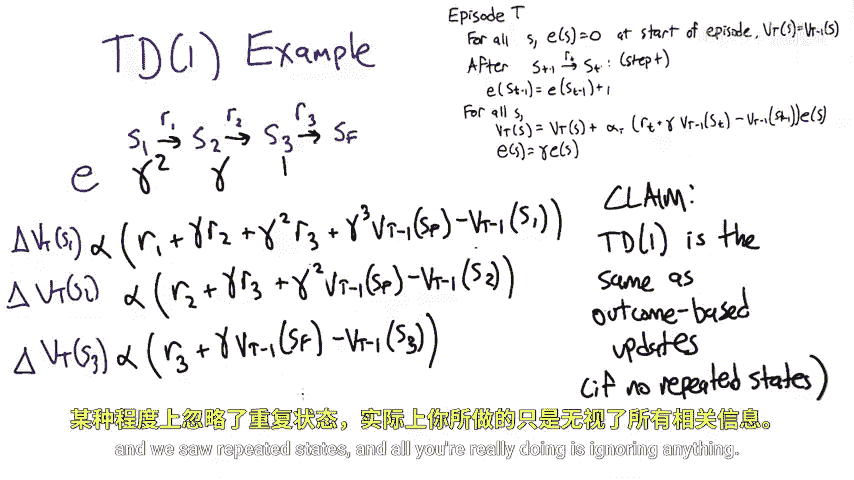
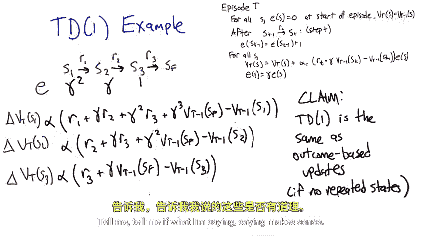
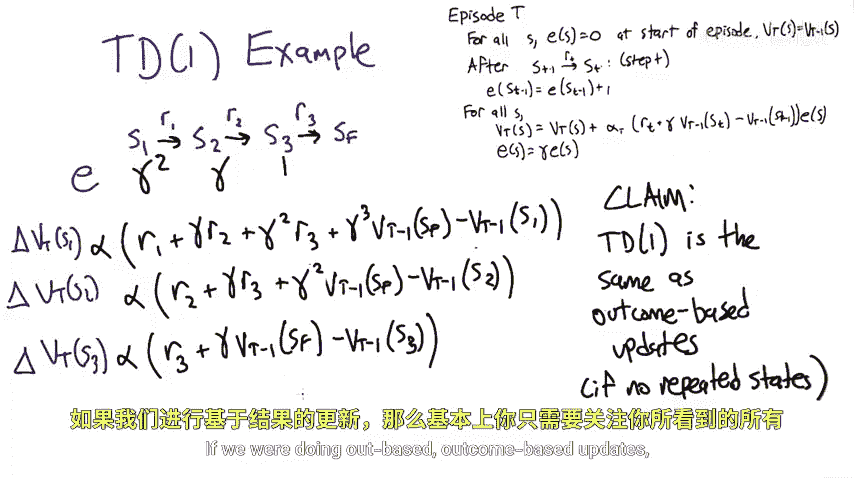
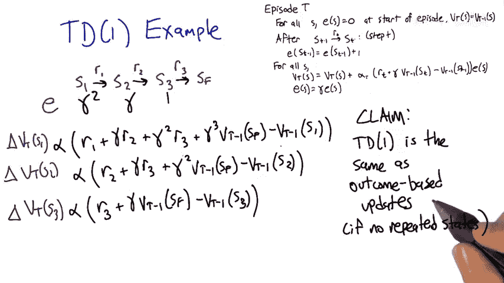
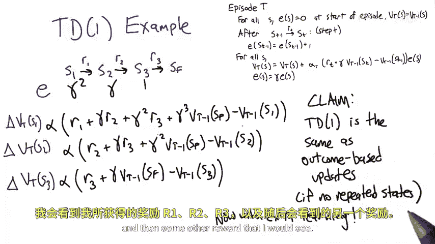

强化学习导论：P86：TD(1)示例 - 重复状态的影响

在本节中，我们将探讨在时序差分学习（特别是TD(1)算法）中，当状态序列中出现重复状态时会发生什么。我们将分析基于结果的更新方式如何处理这种情况，并理解其背后的逻辑。

上一节我们介绍了TD(1)的基本更新规则。本节中我们来看看一个特殊情况：状态序列中出现重复状态。

如果状态序列中存在重复状态，那么情况会有所不同。让我们设想一下，如果我们采用一种类似基于结果的更新方式，但在更新时忽略了序列中状态的重复性。

那么，你实际上做的是忽略在本次轨迹（episode）中已经学习到的任何中间信息。基于结果的更新方式规定，在本次轨迹进行过程中不进行学习。这意味着，所有学习都延迟到轨迹结束时，基于最终观察到的总回报来进行。

以下是基于结果更新的核心逻辑：
*   你只关注在整个轨迹中观察到的所有奖励。
*   你根据最终观察到的总回报来更新轨迹中访问过的所有状态的价值估计。
*   在轨迹进行期间，你不会利用已访问状态的中间估计值来更新其他状态。

现在，考虑一个出现重复状态的序列。假设状态序列不是 S1 -> S2 -> S3 -> SF（终止状态），而是 S1 -> S2 -> S3 -> **S1**（重复）-> ... -> SF。

在这种情况下，基于结果的更新会如何处理呢？我会看到一系列奖励：R1, R2, R3，以及从重复的S1出发后获得的另一个奖励（我们称之为R1‘）。然而，在进行价值更新时，我会**假装**自己对于第一次访问S1时（即从S1到S2并获得奖励R1）已经了解到的信息一无所知。

因为基于结果的更新在轨迹结束前“学习不到任何东西”，所以它不会利用“S1曾经转移到S2并获得R1”这个中间经验来即时更新S1的价值。它只会在轨迹完全结束后，使用整个轨迹的累计回报来一次性更新所有状态（包括S1）的价值。因此，从S1到S2的早期经验在本次轨迹的中间学习过程中被忽略了。

这正是TD(1)更新所做的事情。TD(1)可以看作是这种“基于结果更新”思想的一种实现。它的更新公式是：
`V(S_t) ← V(S_t) + α [ G_t - V(S_t) ]`
其中 `G_t` 是从时刻 `t` 开始到轨迹结束的**实际累计回报**。在计算 `G_t` 时，它只使用实际观察到的奖励，而不使用当前的价值估计 `V(s)` 进行自举（bootstrapping）。因此，在轨迹进行中，`V(S1)` 的值不会影响对后续状态（包括第二次出现的S1）的即时评估，直到最终用 `G_t` 进行更新。

本节课中我们一起学习了TD(1)算法在遇到重复状态时的行为。关键点在于，TD(1)作为一种等同于“基于结果更新”的方法，在轨迹进行期间会忽略已访问状态的中间信息，所有学习都延迟到轨迹结束时基于实际观察到的总回报进行。这导致即使状态重复出现，在本次轨迹内早期访问该状态的经验也不会被即时用于更新其价值估计。