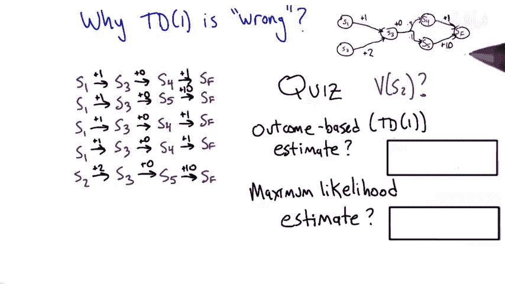
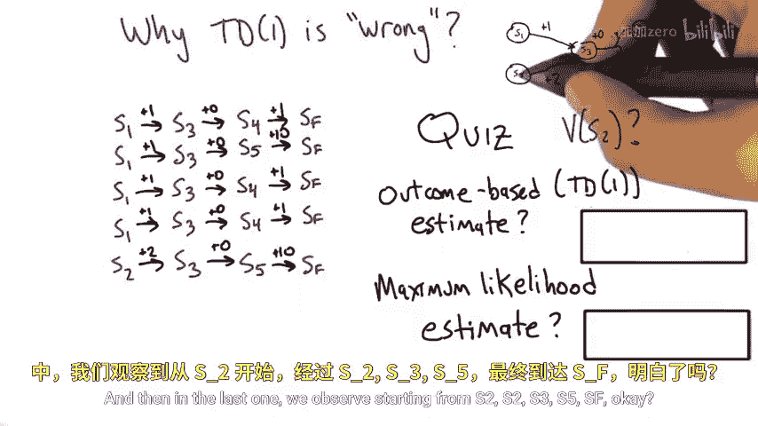
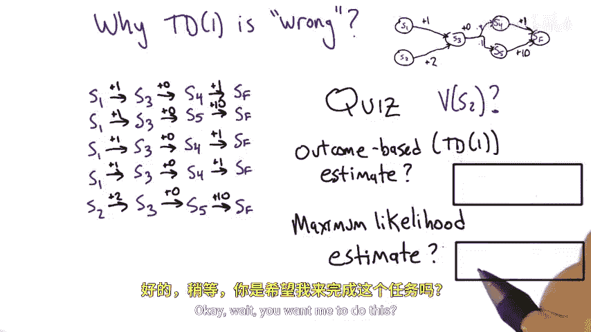
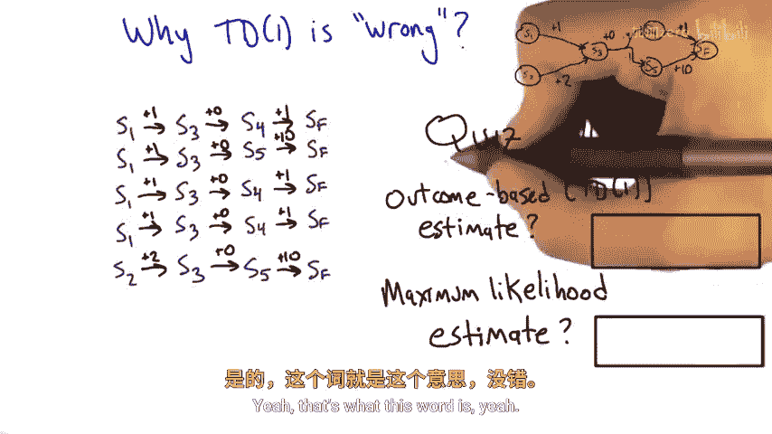
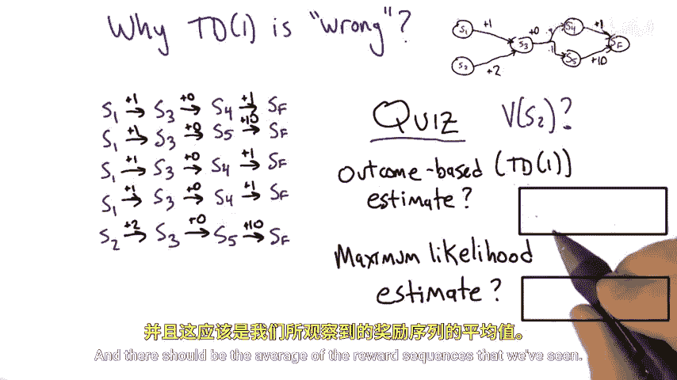

强化学习导论：P87：为何TD(1)有时是“错误”的

在本节课中，我们将探讨时间差分学习中的TD(1)方法，并分析为何在某些情况下它可能无法给出理想的估计结果。我们将通过一个具体的马尔可夫链示例，对比TD(1)的“基于结果”的估计与最大似然估计之间的差异。

---

上一节我们介绍了如何通过TD(1)方法计算基于结果的估计值。本节中，我们来看看为何这种方法有时并不完全符合我们的期望。

为了说明这一点，我们将回到之前分析过的一个马尔可夫链奖励模型示例。该模型包含多个状态和对应的即时奖励。

我们观测到多条状态转移轨迹。例如，我们观测到轨迹：S1 → S3 → S4 → S最终。此外，我们还观测到另一条轨迹：S2 → S3 → S5 → S最终。

现在，我们的目标是：基于这组观测数据，使用TD(1)或基于结果的估计方法来近似状态S2的价值，并将其与最大似然估计得到的结果进行比较。

以下是需要你思考的问题：根据观测到的轨迹，使用TD(1)的基于结果的估计方法，你认为状态S2的价值估计值应该是多少？这种估计本质上是遇到状态S2后所观测到的奖励序列的平均值。

为了确保概念清晰，我们可以现在讨论一些相关问题。核心在于理解TD(1)估计的计算方式。

---

本节课中，我们一起学习了TD(1)方法的基本思想，并通过一个具体场景引出了对其估计有效性的质疑。我们明确了问题：基于有限的轨迹数据，如何估计特定状态的价值，并指出了接下来将对比TD(1)与最大似然估计的结果。