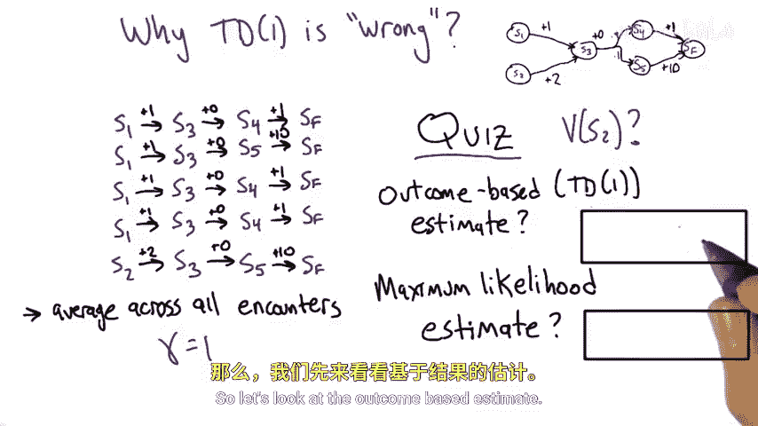
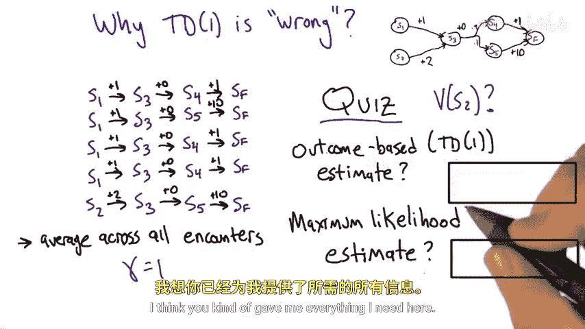
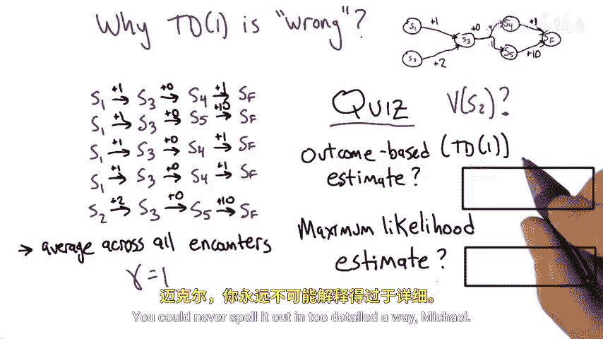
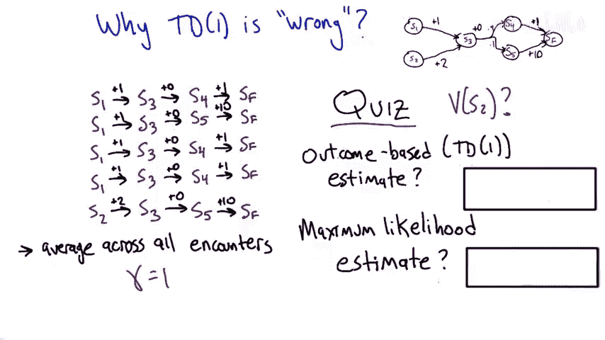
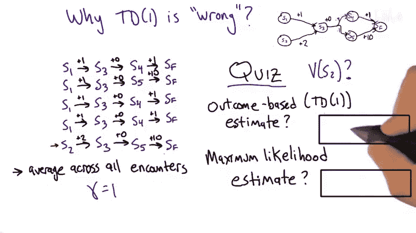
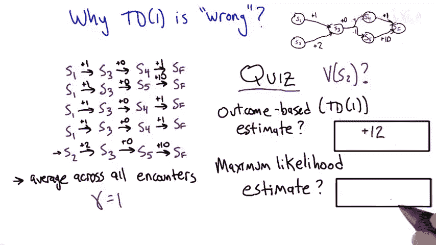
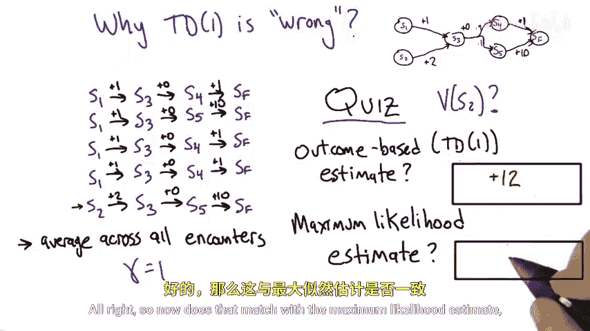
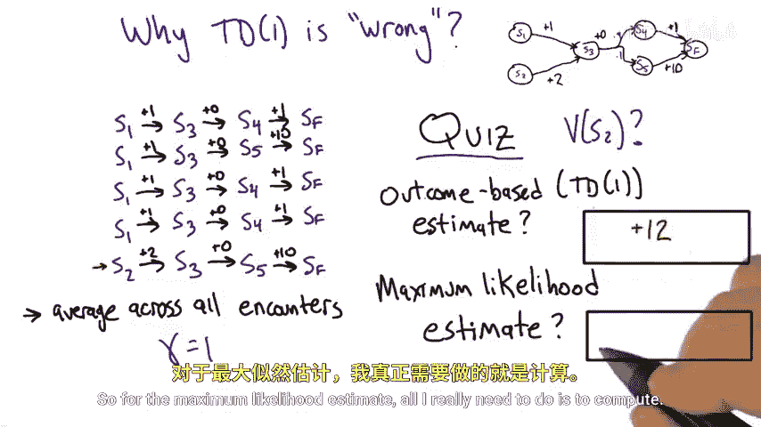
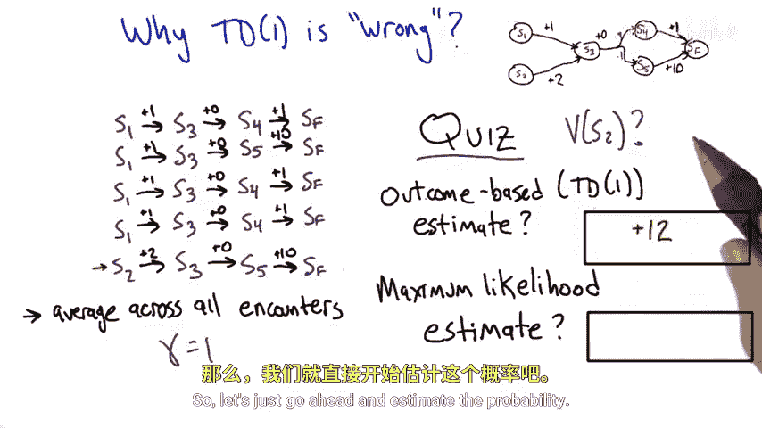

# 088：为什么TD(1)是“错误”的解决方案

在本节课中，我们将探讨基于结果的估计方法，并将其与最大似然估计进行比较，以理解为什么在某些情况下TD(1)算法可能得出不准确的解。

## 基于结果的估计分析

上一节我们介绍了价值估计的基本概念，本节中我们来看看一个具体的基于结果的估计例子。

我们观察状态S2。在给定的数据中，S2只出现了一次。因此，对它的估计平均值计算起来很简单，就是该次经历所获得的总回报。

以下是计算过程：
*   该次经历从S2开始，获得的即时奖励是2。
*   随后转移到S3，获得奖励0。
*   最后到达终止状态S5，获得奖励10。
*   因为折扣因子γ=1，所以总回报为 2 + 0 + 10 = 12。

因此，基于这唯一的一次观察，我们对状态S2的价值估计就是12。这正是TD(1)算法在考虑学习率和初始值等因素后，试图根据现有数据逼近的目标值。

## 最大似然估计对比

现在，我们来看看这个基于结果的估计是否与最大似然估计的结果一致。最大似然估计的方法是：先用数据构建一个环境模型，然后求解该模型。

在给定的数据中，除了从S3出发的转移，其他状态转移都是确定性的。在全部五次状态转移经历中，我们观察到了所有状态和奖励，因此拥有构建完整模型所需的一切信息。

以下是构建模型的关键步骤：
*   我们需要估计从S3转移到S4和S5的概率。
*   通过统计数据中从S3出发的转移次数和各自的目的地，可以计算出这些概率。

通过这种基于模型的方法计算出的状态价值，将与单纯基于单次结果平均的TD(1)估计形成对比，从而揭示后者可能存在的局限性。

## 总结

本节课中我们一起学习了基于结果的估计方法，并以状态S2为例进行了计算。我们看到，TD(1)算法在数据有限（如某个状态只出现一次）时，其估计完全依赖于单次采样结果。接着，我们引入了最大似然估计作为对比，该方法通过数据构建统计模型来求解价值。这种对比帮助我们理解，为什么在某些数据场景下，TD(1)可能不是最优或“正确”的解决方案。