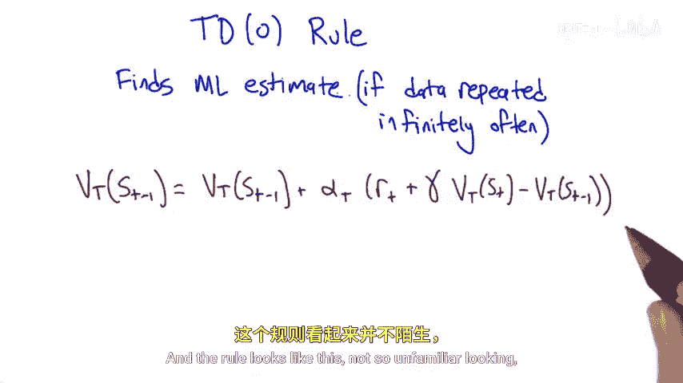
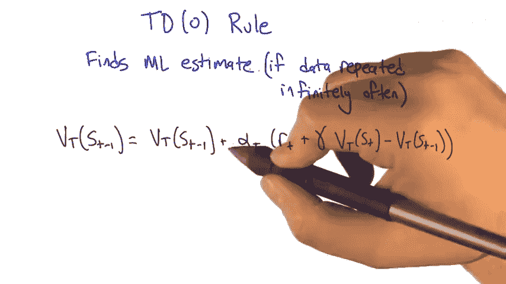
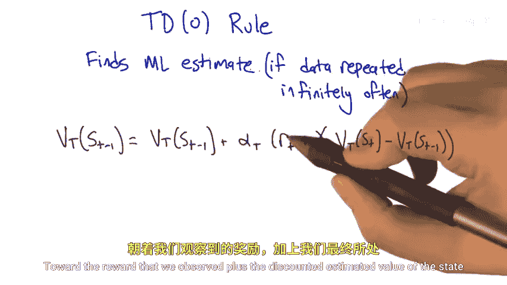
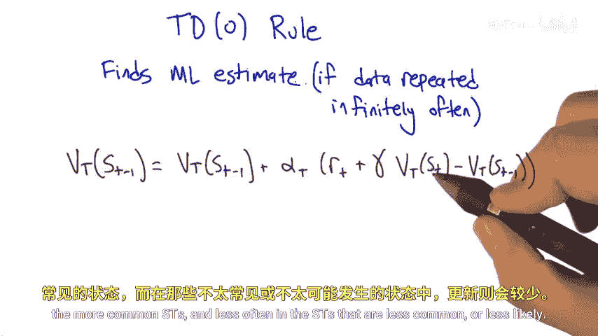
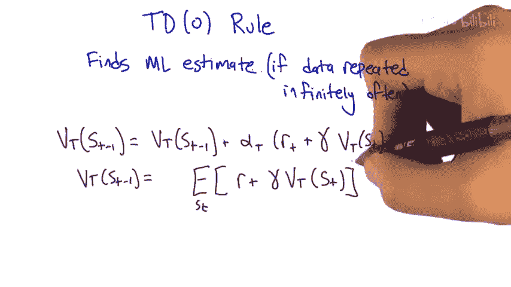
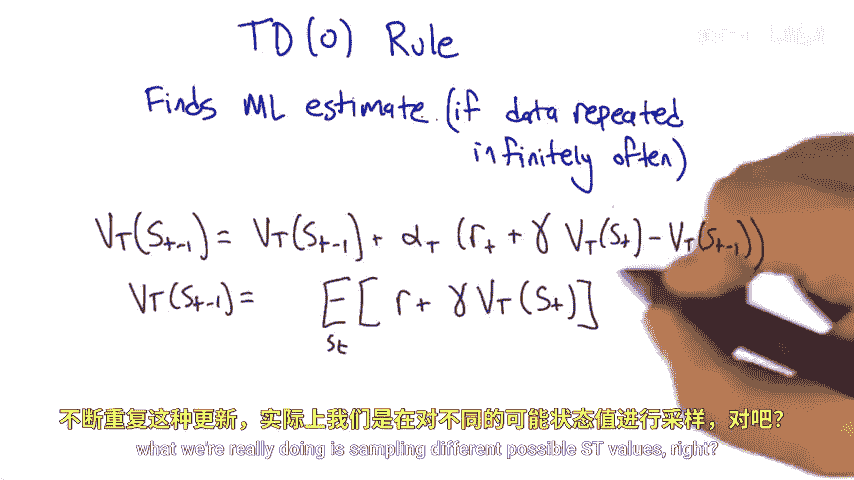

**强化学习导论：P89：TD(0)规则** 🎯

在本节中，我们将学习一种称为TD(0)的规则。这个名称与TD(1)有所区别，但后续我们会将这两者联系起来。TD(0)规则用于在智能体进行状态转移时，更新其离开状态的价值估计。

---

TD(0)规则的形式如下，它用于计算当我们进行一次状态转移后，对刚刚离开的状态的价值估计进行更新。

在时间步T（或轨迹T），`V(S_{T-1})` 是状态 `S_{T-1}` 之前的价值估计。我们将根据学习率 `α`，朝着一个目标方向移动一小步。这个目标方向是：观察到的即时奖励 `R_T`，加上转移后新状态 `S_T` 的折扣估计价值 `γV(S_T)`，再减去离开状态 `S_{T-1}` 的当前估计价值 `V(S_{T-1})`。

**公式表示如下：**
`V(S_{T-1}) ← V(S_{T-1}) + α [ R_T + γV(S_T) - V(S_{T-1}) ]`

这个公式看起来熟悉吗？它包含了价值函数V、奖励R和学习率α。确实，它与我们之前见过的更新形式有相似之处。但让我们更精确地理解它的行为。

---

上一节我们介绍了TD(0)规则的具体形式，本节中我们来看看这个更新规则在平均意义上的表现。

在这个更新中，随机性主要来源于：当我们处于某个状态 `S_{T-1}` 并执行动作后，我们不确定会转移到哪个具体的下一个状态 `S_T`，转移是由环境动态（概率）决定的。因此，这个更新规则实际上是在对不同可能出现的 `S_T` 进行采样。

从期望的角度来看，如果我们反复进行这个更新，我们实际上是在对可能的下一个状态及其奖励取期望。更常见（出现频率更高）的状态 `S_T` 会对更新产生更大的影响，而不太常见（出现概率较低）的状态 `S_T` 影响则较小。

**其数学期望可以表示为对下一个状态 `S'` 的求和：**
`E[更新量] = Σ_{S'} P(S' | S_{T-1}) * [ R(S_{T-1}, S') + γV(S') - V(S_{T-1}) ]`

这个期望形式将我们引向一个更深入的理解：TD(0)更新在期望上是在推动价值估计朝着贝尔曼方程所定义的真实价值函数方向移动。

---

**总结**

本节课中我们一起学习了TD(0)规则。
*   我们首先看到了TD(0)规则的具体更新公式，它利用当前状态的估计价值、即时奖励以及下一个状态的估计价值来调整价值函数。
*   接着，我们分析了该更新规则的期望行为，认识到它本质上是在对环境转移概率进行采样，并在平均意义上依据贝尔曼方程进行更新。
*   理解TD(0)的期望形式是连接其与蒙特卡洛方法及其他时序差分算法（如TD(λ)）的重要桥梁。