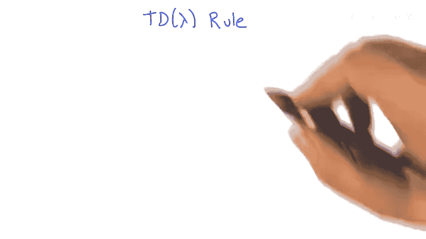
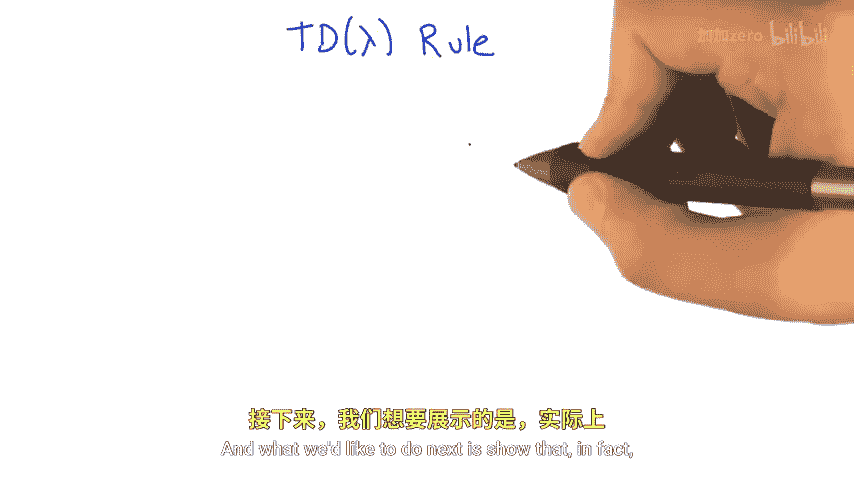
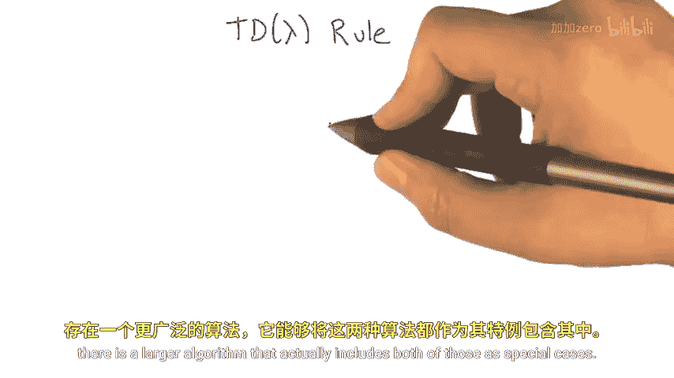
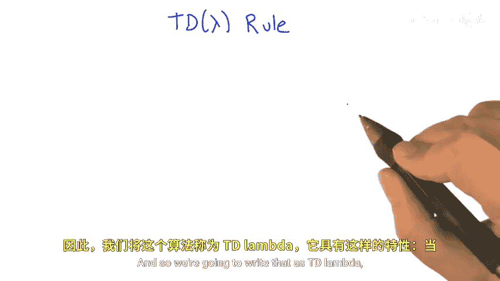
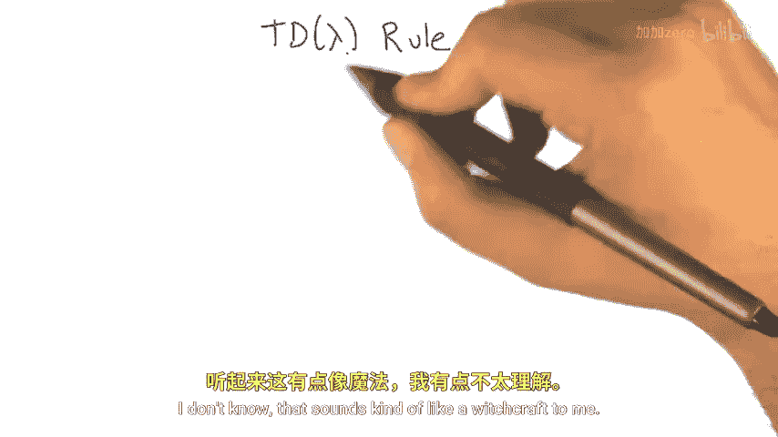
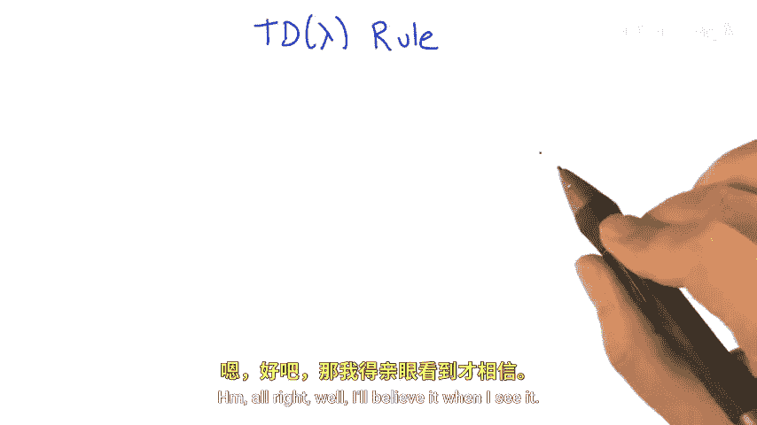
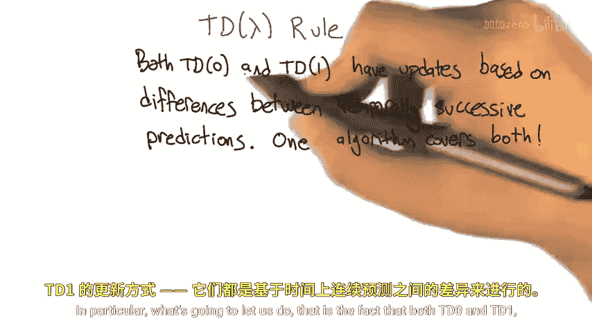
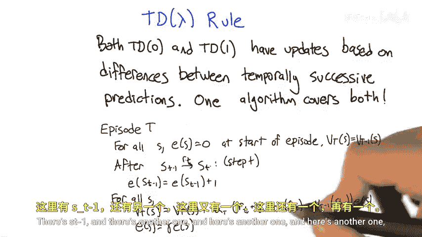

# 090：TD(λ) 规则 🧠

在本节课中，我们将学习如何将之前介绍的两种时序差分算法——TD(0) 和 TD(1)——统一到一个更通用的框架中，即 TD(λ) 算法。我们将看到，通过调整一个名为 λ 的参数，TD(λ) 可以涵盖从 TD(0) 到 TD(1) 的整个算法谱系。

---

上一节我们介绍了 TD(0) 和 TD(1) 两种算法。本节中，我们将探讨如何将它们统一为一个更通用的算法。

TD(0) 和 TD(1) 的更新规则都基于“时序差分”（Temporal Differences），即基于连续时间步预测值之间的差异。正是这个共同点，使得将它们统一起来成为可能。

如果我们仔细观察 TD(0) 和 TD(1) 的算法公式，会发现它们看起来非常相似，但确实存在关键区别。

以下是 TD(0) 和 TD(1) 更新规则的核心部分，它们结构相近：

**TD(0) 更新规则**（简化示意）：
`V(S_t) ← V(S_t) + α [R_{t+1} + γV(S_{t+1}) - V(S_t)]`

**TD(1) 或蒙特卡洛更新规则**（简化示意）：
`V(S_t) ← V(S_t) + α [G_t - V(S_t)]`
其中 `G_t` 是从时间步 `t` 开始的实际回报总和。

它们的共同点是都包含一个“预测误差”项，用于更新价值函数。TD(0) 使用一步后的估计，而 TD(1) 使用整个回合的实际回报。

为了统一它们，我们引入一个参数 λ (0 ≤ λ ≤ 1)。TD(λ) 算法的核心思想是，对从当前状态开始，未来所有 n 步的估计回报进行加权平均，并将此作为更新目标。λ 控制着这些不同步数估计的权重。

具体而言，TD(λ) 定义了一个新的目标，称为 **λ-回报** `G_t^λ`。其公式如下：

`G_t^λ = (1 - λ) * Σ_{n=1}^{∞} λ^{n-1} * G_t^{(n)}`

其中，`G_t^{(n)}` 是 **n 步回报**：
`G_t^{(n)} = R_{t+1} + γR_{t+2} + ... + γ^{n-1}R_{t+n} + γ^n V(S_{t+n})`

这个公式的含义是：
*   当 **λ = 0** 时，`G_t^λ` 退化为一步回报 `G_t^{(1)}`，此时 TD(λ) 等价于 **TD(0)**。
*   当 **λ = 1** 时，`G_t^λ` 退化为整个回合的实际回报（若回合有限），此时 TD(λ) 等价于 **TD(1)** 或蒙特卡洛方法。
*   当 **λ 介于 0 和 1 之间** 时，`G_t^λ` 是所有 n 步回报的加权平均，越近的步数（n 小）权重越高，实现了在一步引导和完全采样回报之间的平滑折衷。

因此，TD(λ) 的更新规则可以统一地写为：
`V(S_t) ← V(S_t) + α [ G_t^λ - V(S_t) ]`

---

本节课中我们一起学习了 TD(λ) 算法。我们了解到，通过引入一个参数 λ，可以创建一个统一的框架，将 TD(0) 和 TD(1) 作为其特例包含在内。λ 的值控制着算法在“基于即时估计的引导”和“基于长期实际回报的更新”之间的权衡，为强化学习智能体提供了更灵活的学习机制。