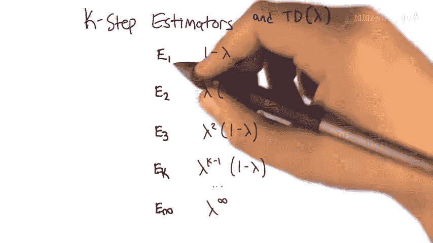
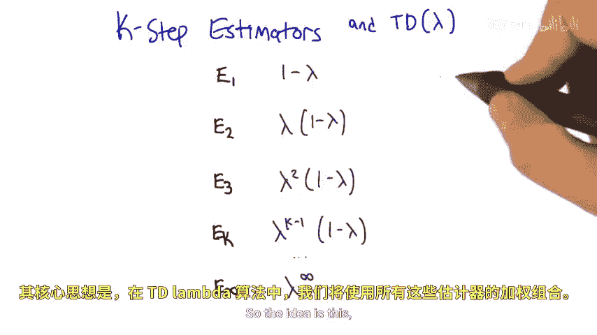
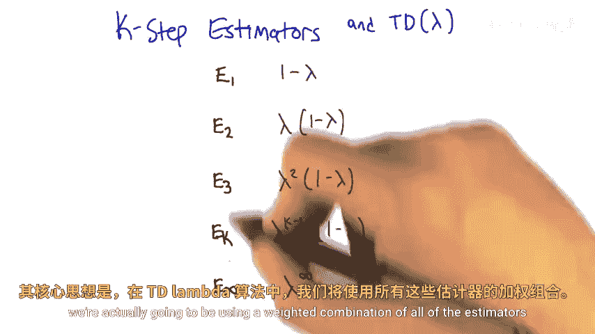
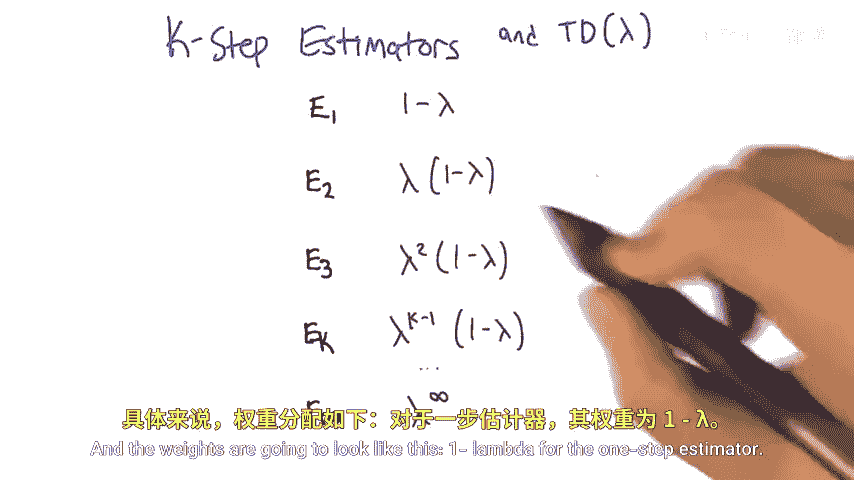
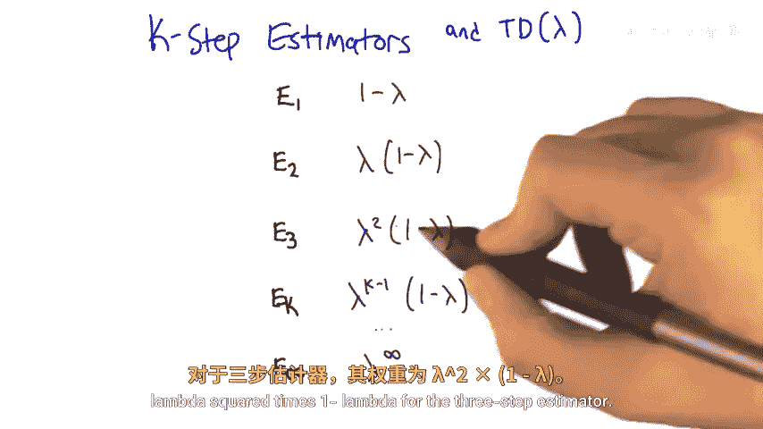
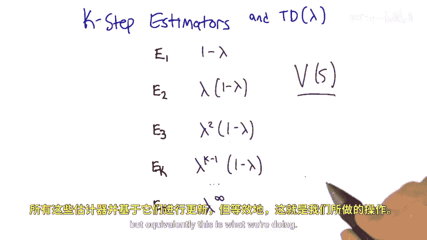
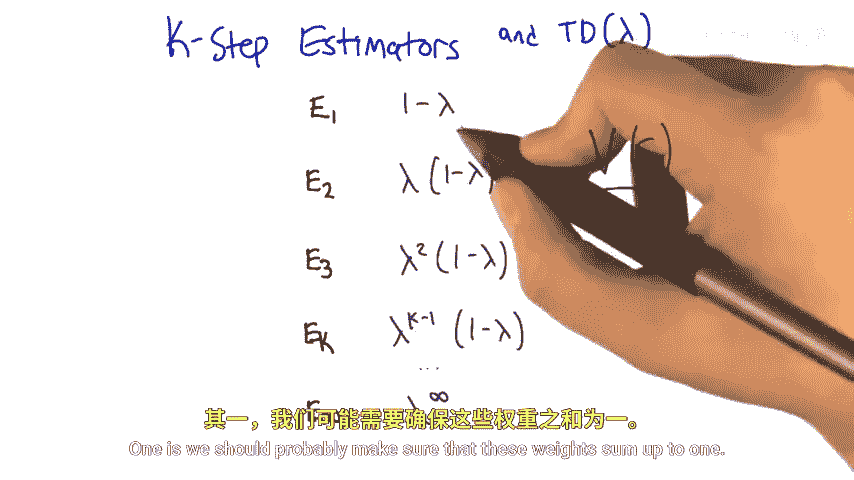

强化学习导论：P92：K步估计器与TD(λ)

在本节课中，我们将学习如何将之前讨论的K步估计器与TD(λ)算法联系起来。我们将看到，TD(λ)实际上是所有K步估计器的一个加权组合。

上一节我们介绍了不同的K步估计器，本节中我们来看看如何将它们统一起来。

核心思想是，在任何一种TD(λ)算法中，我们实际上会使用所有K步估计器的一个加权组合。每次更新一个状态的价值时，所有不同的估计器都会给出它们认为价值应该移动的方向，而我们则取这些方向的一个凸组合（加权平均）。

以下是分配给各个K步估计器的权重：
*   **1步估计器**的权重是 `(1 - λ)`
*   **2步估计器**的权重是 `λ(1 - λ)`
*   **3步估计器**的权重是 `λ²(1 - λ)`
*   **K步估计器**的权重是 `λ^(K-1)(1 - λ)`
*   以此类推，直到无穷步估计器。

这里有一个重要的点需要检查：这些权重之和必须为1，以确保这是一个有效的凸组合。我们可以验证这一点，因为这是一个几何级数求和：

`(1 - λ) + λ(1 - λ) + λ²(1 - λ) + ... = (1 - λ) * (1 + λ + λ² + ...) = (1 - λ) * (1 / (1 - λ)) = 1`

因此，所有权重之和确实为1。

你可能注意到，公式中似乎没有明确包含无穷步估计器（即蒙特卡洛估计）的权重。实际上，当K趋向于无穷大时，`λ^(K-1)`项会趋向于0（只要λ < 1），所以无穷步估计器在加权组合中获得的权重趋近于0。这正是我们期望的：λ控制着我们对近期估计（小K）和远期估计（大K）的信任程度。λ越小，越信任近期估计；λ越大，远期估计的影响也越大，但当λ<1时，无穷远处的估计影响微乎其微。

本节课中我们一起学习了TD(λ)算法的核心构成。它通过一个参数λ，以几何衰减的权重`λ^(k-1)(1-λ)`，巧妙地融合了从1步到无穷步的所有估计器。这使得我们可以在偏差（使用小K）和方差（使用大K）之间进行平滑的权衡，而不是像之前那样只能在离散的K值中进行选择。