# 093：TD(λ) 算法的经验性能 📊

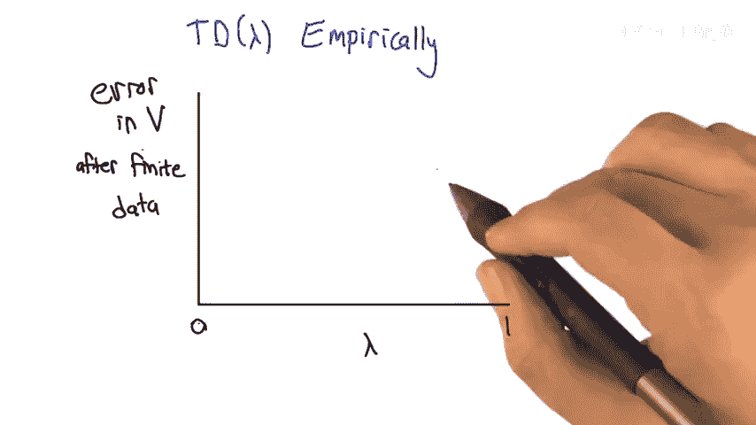

在本节课中，我们将探讨 TD(λ) 算法在有限数据上的经验性能表现。我们将分析不同 λ 值如何影响价值函数估计的准确性，并理解为何在某些情况下，中间 λ 值能提供比 TD(0) 或 TD(1) 更好的结果。

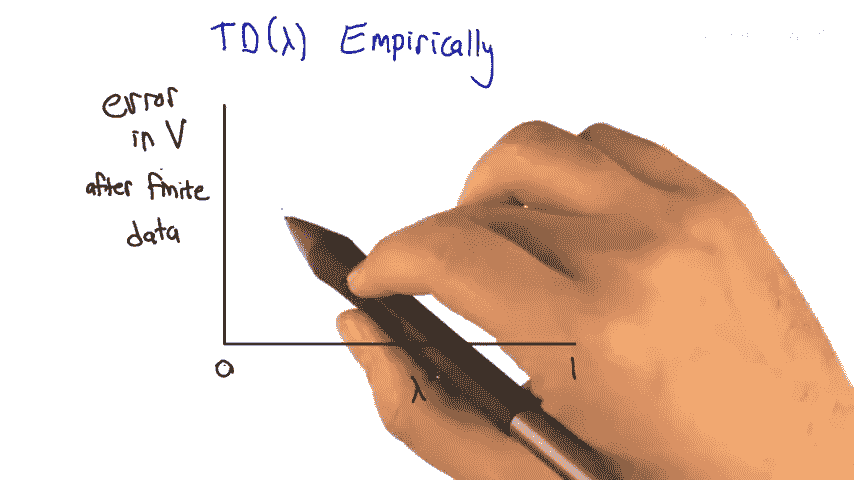

---

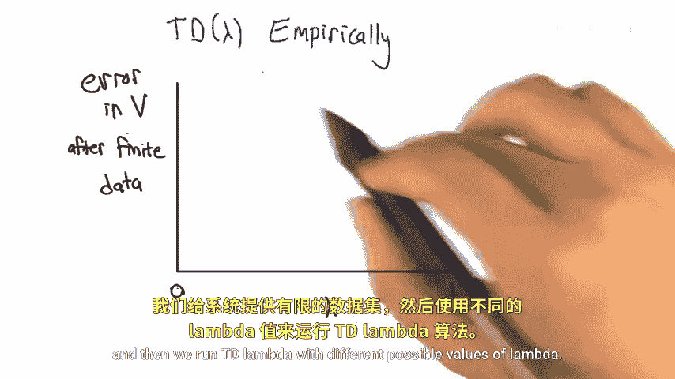

上一节我们介绍了 TD(λ) 算法的概念，本节中我们来看看它在实际应用中的表现。

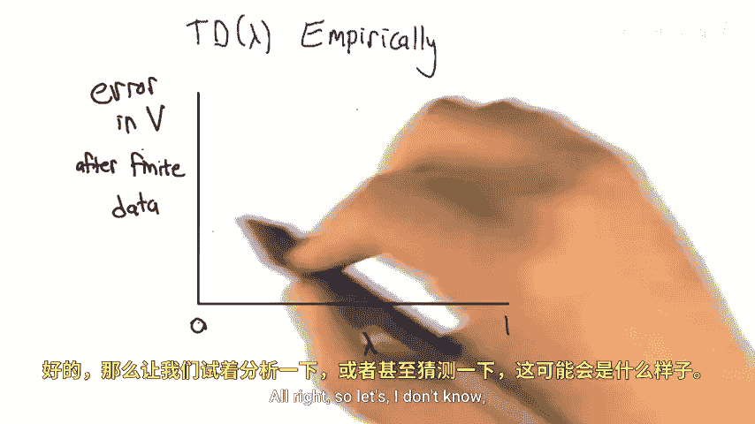

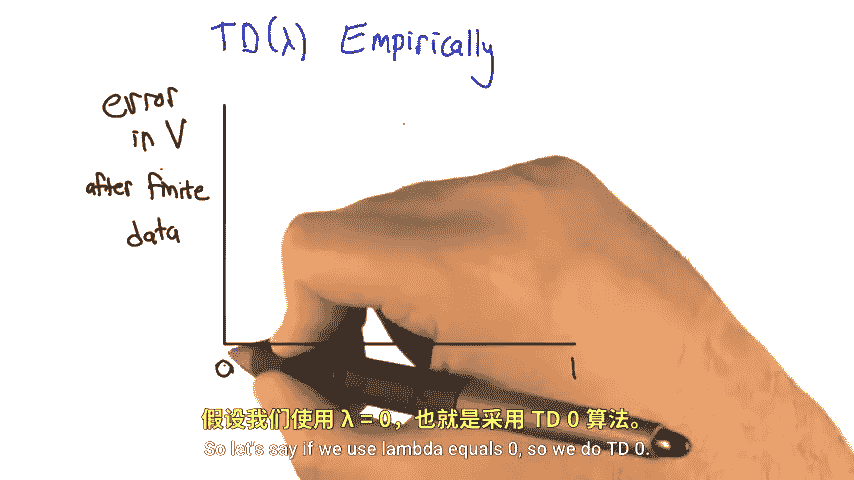

假设我们给系统提供有限数量的数据，然后使用不同的 λ 值运行 TD(λ) 算法。接着，我们提出一个问题：你学习到的价值函数 V，与拥有无限数据时应得的 V 相比，误差有多大？

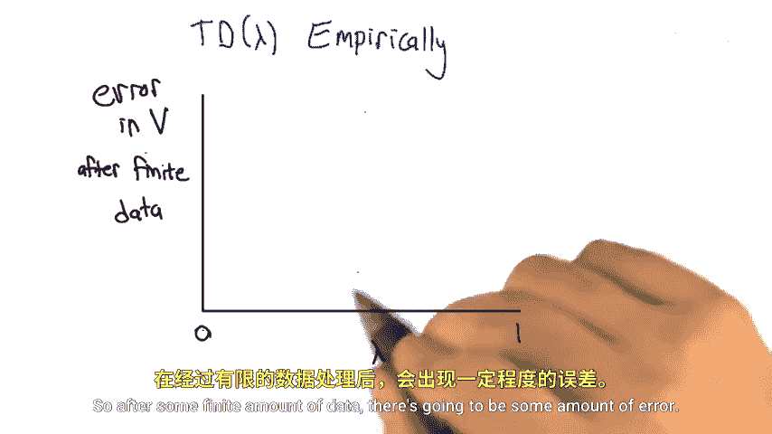

以下是不同 λ 值下误差变化的典型情况：

*   **λ = 0 (TD(0))**：在有限数据下，TD(0) 会产生一定量的误差。
*   **λ = 1 (TD(1))**：经验表明，在有限数据下，TD(1) 通常会产生比 TD(0) **更差**的误差。
*   **中间 λ 值**：关键在于 λ 在 0 和 1 之间时会发生什么。误差变化曲线可能是一条直线，也可能向上凸起，但典型的经验结果是曲线**向下凹陷**。

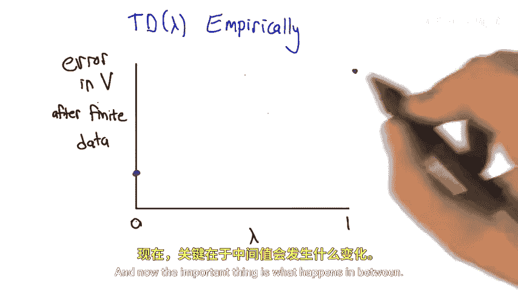

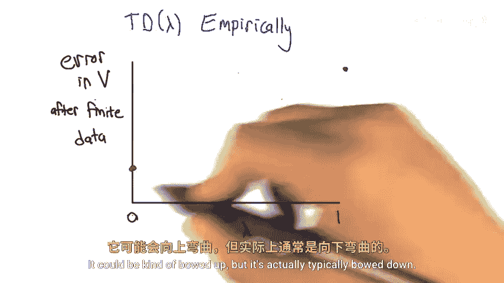

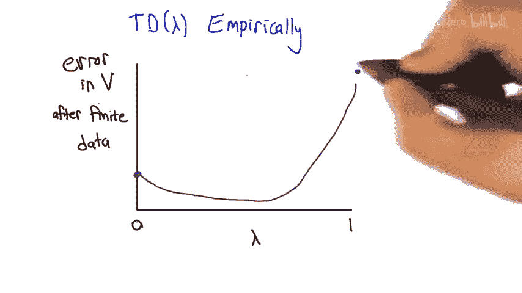

因此，我们通常会看到一条类似下图的误差曲线。随着 λ 增加到某个中间值（例如 0.7，具体取决于问题本身），误差量会减小，性能变得更好。之后，误差会再次开始上升，并最终在 λ 趋近于 1 时达到 TD(1) 的误差水平。

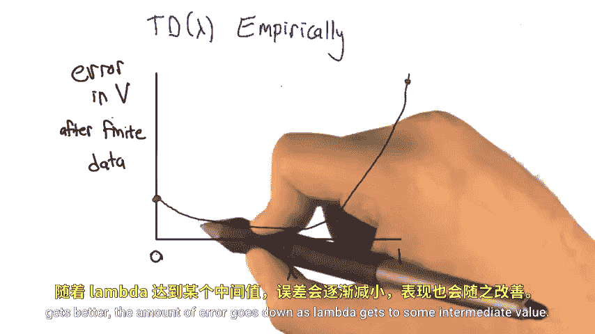

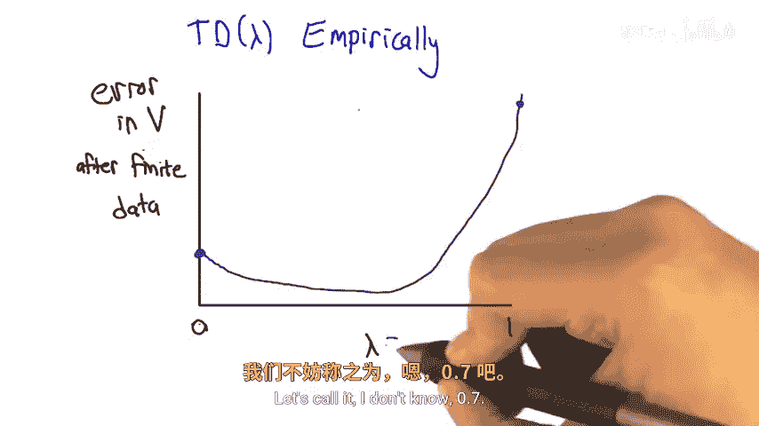

这个现象正是我们考虑使用 TD(λ) 算法的理由。它实际上结合了 TD(0) 的快速在线更新和 TD(1)（或蒙特卡洛方法）在有限数据下可能更稳定的特性，通过调整 λ 参数，我们可以在两者之间找到一个最佳的平衡点，从而在有限数据条件下获得更优的性能。

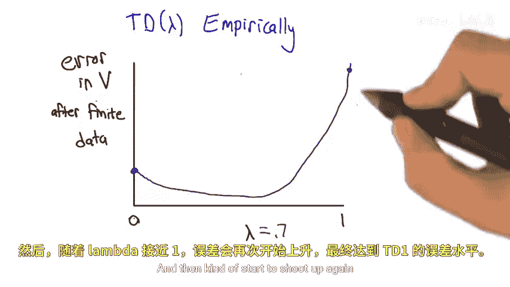

---

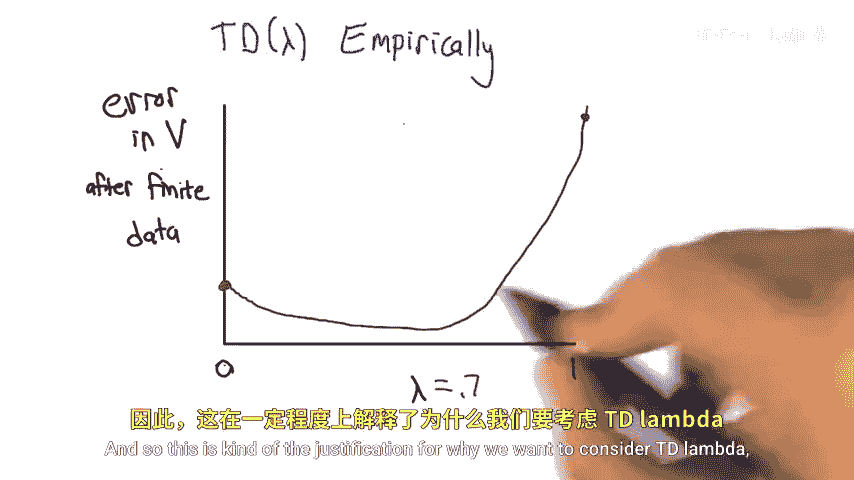

本节课中我们一起学习了 TD(λ) 算法在有限数据下的经验性能。我们了解到，λ 参数的选择对学习效果有显著影响，一个中间的 λ 值（如 0.7）往往能在有限数据下提供比 λ=0 或 λ=1 更小的估计误差。这证明了 TD(λ) 作为一种混合方法的实用价值。