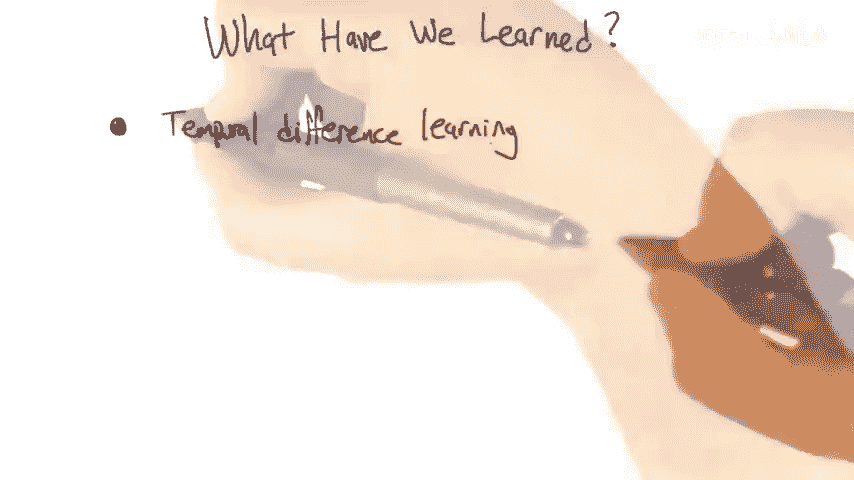
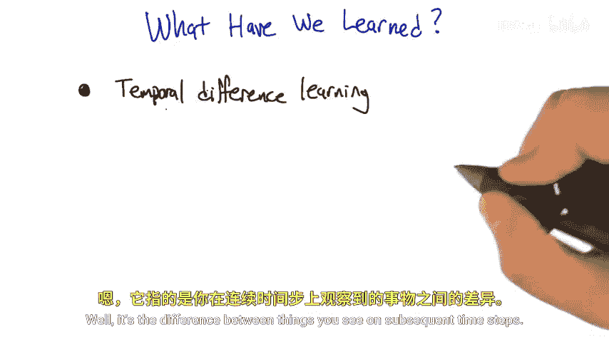
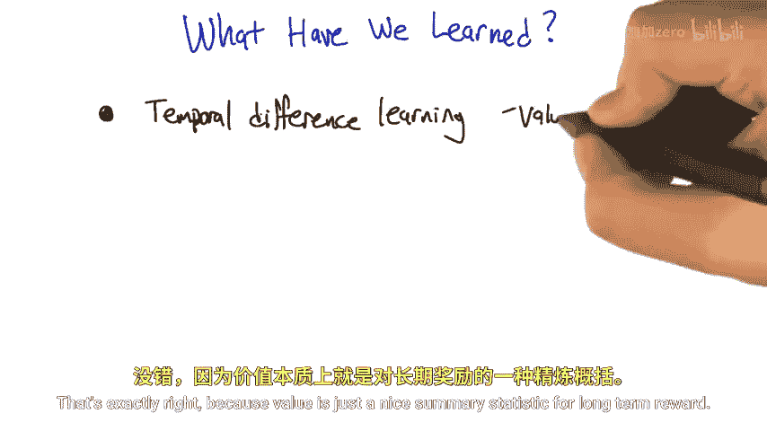
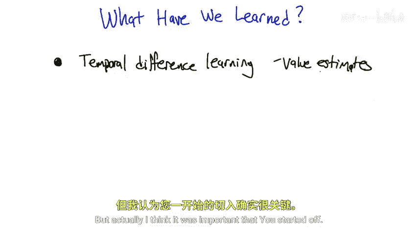
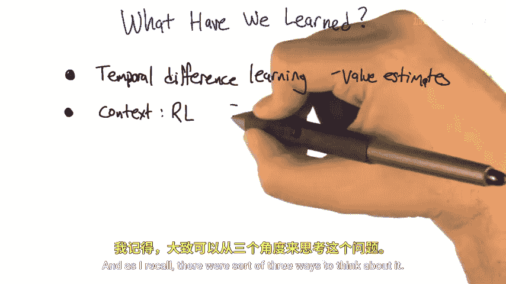
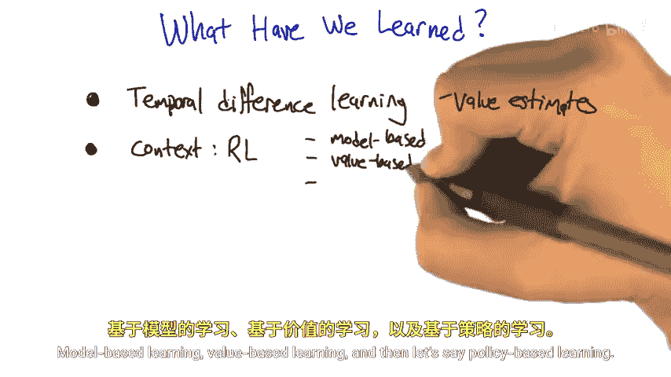
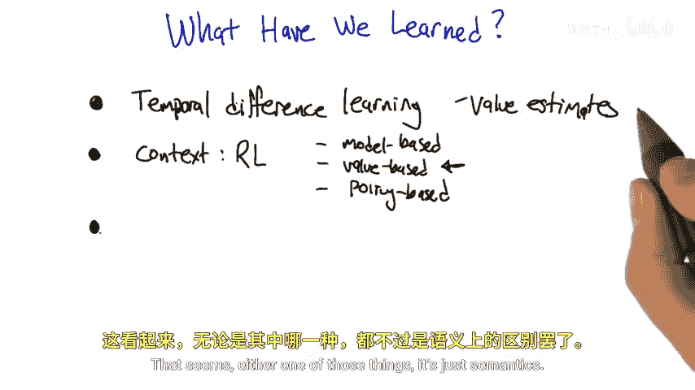

强化学习导论：P94：本章总结

在本节课中，我们将回顾并总结关于时序差分学习，特别是TD(λ)算法的核心内容。我们将梳理讨论过的关键概念，并理解它们在整个强化学习框架中的位置。

上一节我们介绍了TD(λ)算法的各种变体，本节中我们来看看本章讨论的核心要点。

**什么是时序差分？**
时序差分指的是在不同时间步之间观测值的差异。在强化学习中，这通常指的是从一个状态转移到下一个状态时，价值估计值之间的差异。因为价值函数本身就是对长期回报的一个良好概括。

**强化学习方法的分类**
在深入时序差分方法之前，我们首先将其置于更广阔的强化学习问题解决框架中。以下是三种主要的解决思路：
*   **基于模型的学习**：学习环境模型，然后基于模型进行规划。
*   **基于价值的学习**：直接学习价值函数，通过价值函数来推导策略。
*   **基于策略的学习**：直接学习或优化策略本身。

时序差分方法主要属于**基于价值的学习**范畴。

**时序差分更新规则**
我们深入探讨了时序差分方法的核心——更新规则。其本质是一种增量式更新价值估计的方法。我们也可以将其理解为一种**基于结果**的学习方式，即利用实际观测到的后续状态和回报来更新当前状态的估计。

本节课中我们一起学习了时序差分学习的核心思想，明确了它在基于价值学习框架中的位置，并理解了其更新规则的本质是通过比较不同时间步的估计差异来逐步优化价值函数。