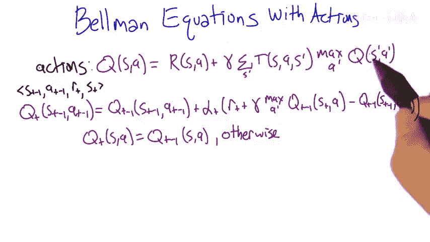
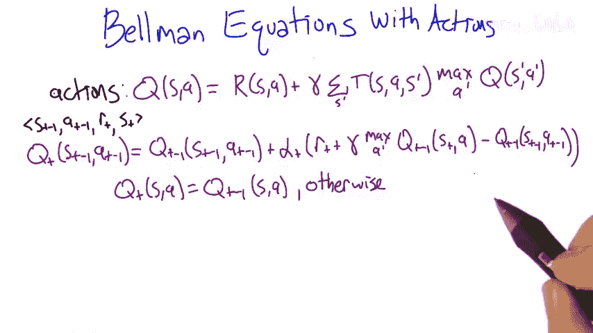
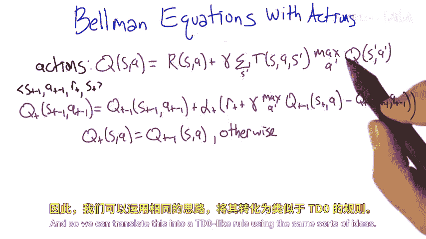
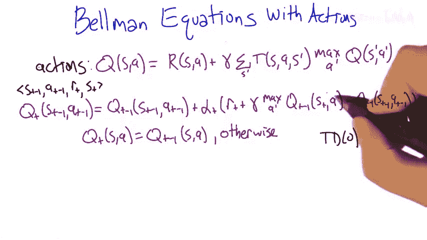
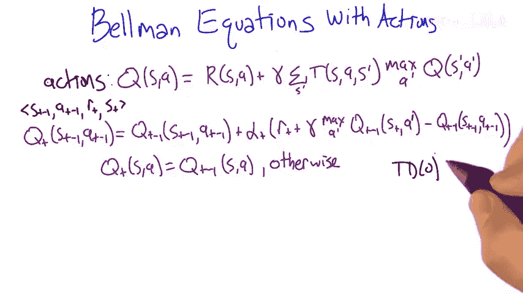
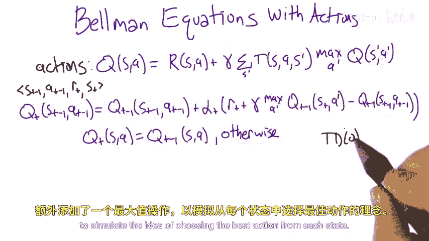

强化学习导论：P96：带动作的贝尔曼方程

在本节课中，我们将学习强化学习中一个核心概念——带动作的贝尔曼方程，并了解其对应的时序差分更新规则，即Q学习算法。我们将看到，这个公式如何同时处理对价值函数的估计和对最优策略的逼近。

上一节我们介绍了状态价值函数的贝尔曼方程，本节中我们来看看当环境中包含智能体可以执行的动作时，情况会如何变化。

核心思想依然是贝尔曼方程和对应的学习更新规则，但这次引入了动作。在包含动作的形式中，我们得到的是贝尔曼方程的Q函数形式。Q函数 **Q(s, a)** 定义为：在状态 **s** 下采取动作 **a** 后，所能获得的**即时奖励**，加上**折扣后**的、在后续状态 **s'** 中采取**最佳动作**所能获得的期望价值。

其数学公式表达如下：

**Q(s, a) = R(s, a) + γ * Σ [ P(s' | s, a) * max_{a'} Q(s', a') ]**

或者，在从环境中采样得到单次转移 **(s, a, r, s')** 的情况下，其期望形式可以写作：

**Q(s, a) = r + γ * max_{a'} Q(s', a')**

这与之前的更新思想本质相同。因此，我们可以用同样的思路将其转化为类似TD(0)的更新规则。我们将得到一个价值函数的新估计值，更新方式是从一个时间步到下一个时间步逐步调整。

更新规则适用于所有状态-动作对，但只有我们刚刚离开的那个状态-动作对（即上一步在状态 **s_{t-1}** 执行的动作 **a_{t-1}**）会得到更新。对于这一对，我们会朝着“即时奖励”加上“到达状态 **s_t** 的折扣后价值”的方向移动一小步。这里的状态价值是相对于从该状态能采取的**最佳动作**来计算的。

其更新公式为：

**Q(s_{t-1}, a_{t-1}) ← Q(s_{t-1}, a_{t-1}) + α * [ r_t + γ * max_{a} Q(s_t, a) - Q(s_{t-1}, a_{t-1}) ]**

这同样是相同的更新规则。唯一的区别是，公式中多了一个 **max** 操作，用以模拟从每个后续状态中选择最佳动作的思想。

接下来，我想说明的是，这个Q学习更新规则实际上同时处理了两种不同的近似。

以下是Q学习规则同时完成的两项任务：
1.  **价值估计**：它通过时序差分学习，逐步更新并逼近每个状态-动作对 **(s, a)** 的真实Q值。
2.  **策略改进**：在更新目标中，它使用了 **max_{a} Q(s_t, a)**。这意味着它假设并学习的是**最优策略**下的价值函数，即在每个状态都选择能带来最大未来回报的动作。因此，它在学习价值函数的同时，也隐式地定义了贪婪最优策略。

本节课中我们一起学习了带动作的贝尔曼方程（即Q函数贝尔曼方程）及其对应的在线学习算法——Q学习。我们看到，Q学习通过一个简洁的更新规则，巧妙地结合了价值评估和策略改进，使其能够直接学习最优动作价值函数，是强化学习中无模型算法的基石之一。