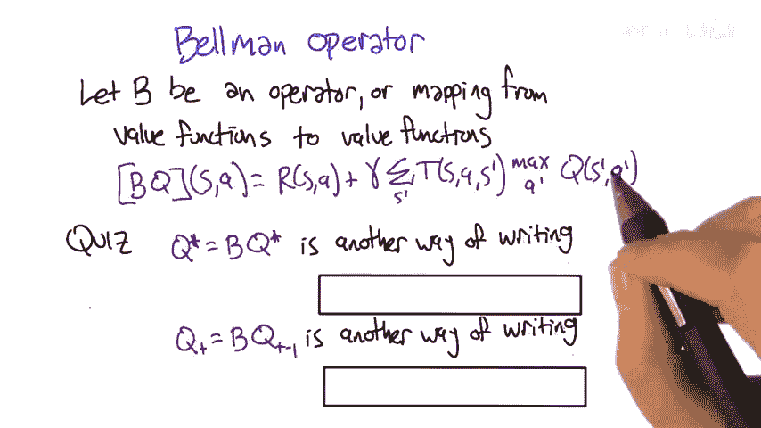
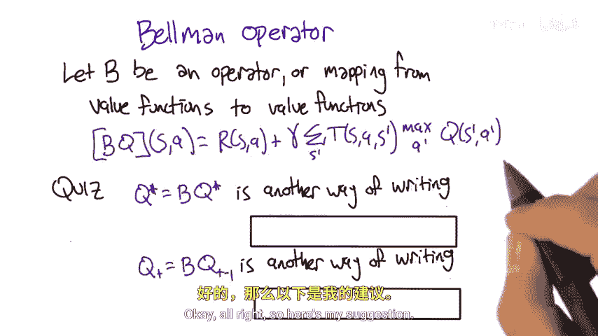
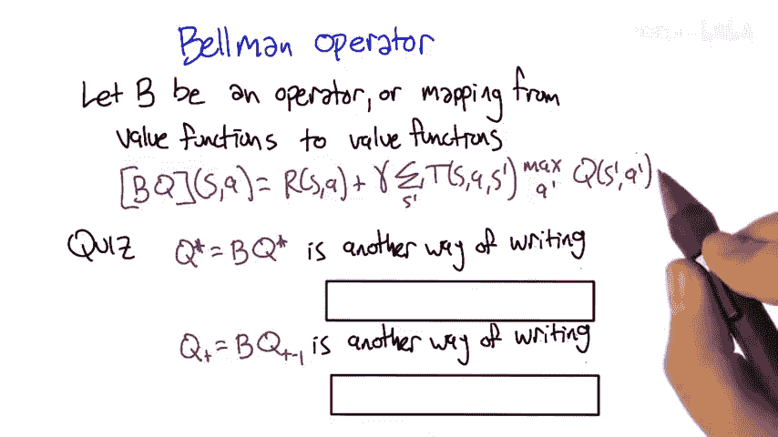
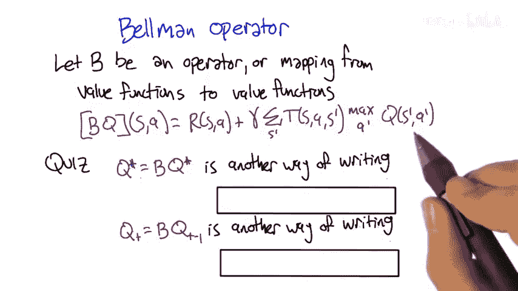
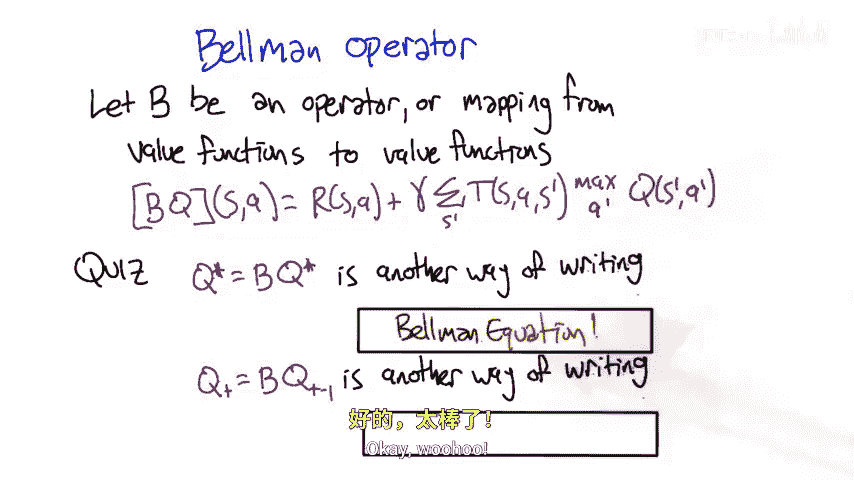
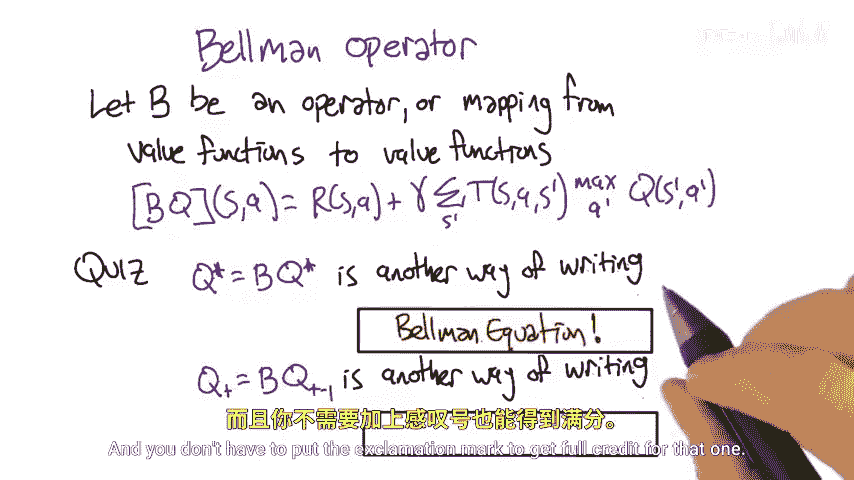
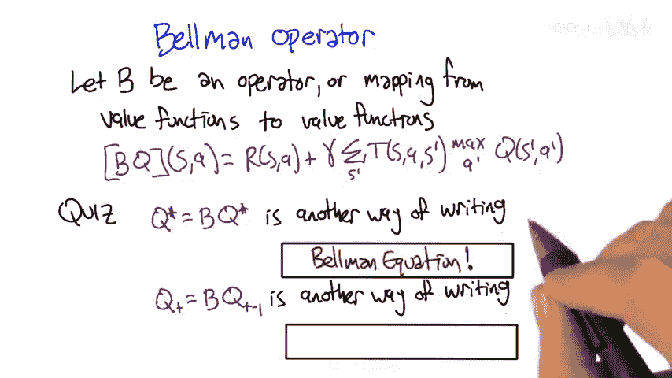
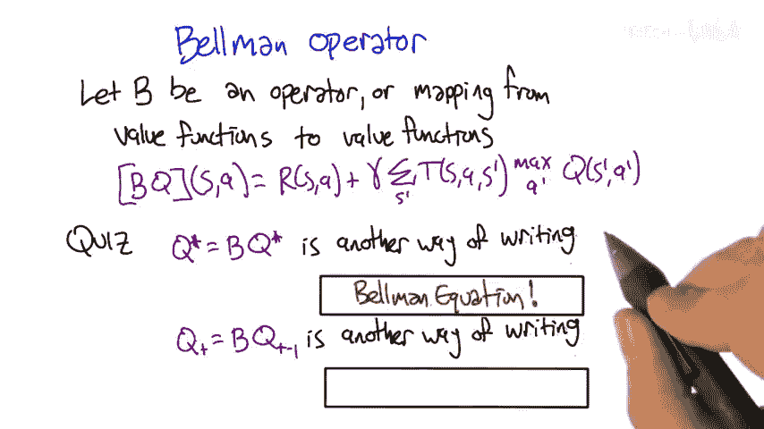
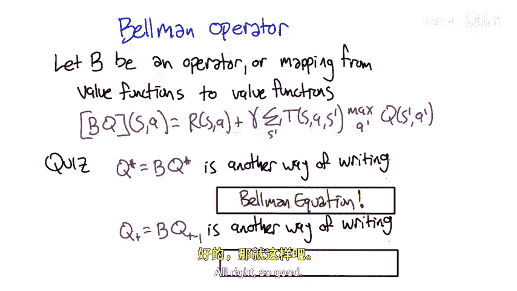

强化学习导论：P99：贝尔曼算子与最优解

在本节课中，我们将学习贝尔曼算子的定义，并探讨如何利用它来简洁地表示和求解最优Q函数。

上一节我们介绍了贝尔曼算子的概念，本节中我们来看看如何用它来求解最优Q函数。

**贝尔曼算子的定义**

贝尔曼算子 **B** 是一个数学运算符，它作用于一个Q函数，并产生一个新的Q函数。其定义如下：

对于任意给定的Q函数 **Q(s, a)**，应用贝尔曼算子后得到的新Q函数 **BQ(s, a)** 为：
**BQ(s, a) = R(s, a) + γ * Σ_{s'} P(s' | s, a) * max_{a'} Q(s', a')**

其中：
*   **R(s, a)** 是在状态 **s** 下执行动作 **a** 获得的即时奖励。
*   **γ** 是折扣因子。
*   **P(s' | s, a)** 是从状态 **s** 执行动作 **a** 后转移到状态 **s'** 的概率。
*   **max_{a'} Q(s', a')** 表示在下一个状态 **s'** 下，选择能最大化Q值的动作 **a'**。

**最优Q函数的性质**

最优Q函数 **Q\*(s, a)** 有一个关键性质：它是贝尔曼算子的一个“不动点”。这意味着，如果你将最优Q函数 **Q\*** 代入贝尔曼算子 **B**，得到的结果仍然是 **Q\*** 本身。

用公式表示即为：
**BQ\* = Q\***

**推导与验证**

现在，让我们验证这个性质。根据贝尔曼算子的定义，将 **Q\*** 代入：

**BQ\*(s, a) = R(s, a) + γ * Σ_{s'} P(s' | s, a) * max_{a'} Q\*(s', a')**

观察等式的右边，这正是最优Q函数 **Q\*** 自身的定义方程，即贝尔曼最优方程。

因此，我们得出结论：
**BQ\* = Q\***

这个等式简洁地表明，最优Q函数 **Q\*** 是贝尔曼算子 **B** 的一个固定点。

**贝尔曼更新**

基于上述思想，我们可以理解值迭代算法的核心步骤。当我们有一个当前的Q函数估计值 **Q** 时，对其应用一次贝尔曼算子，就完成了一次“贝尔曼更新”，从而得到一个改进的（更接近最优的）Q函数估计值 **Q'**。

用公式表示这个更新过程为：
**Q' = BQ**

这个过程会不断重复，直到Q函数收敛到不动点 **Q\***。

**总结**

本节课中我们一起学习了贝尔曼算子的核心应用。我们了解到，最优Q函数 **Q\*** 是贝尔曼算子 **B** 的不动点，满足 **BQ\* = Q\***。这一性质为强化学习中的值迭代算法提供了理论基础，该算法通过反复应用贝尔曼算子（即进行贝尔曼更新）来逐步逼近最优Q函数。