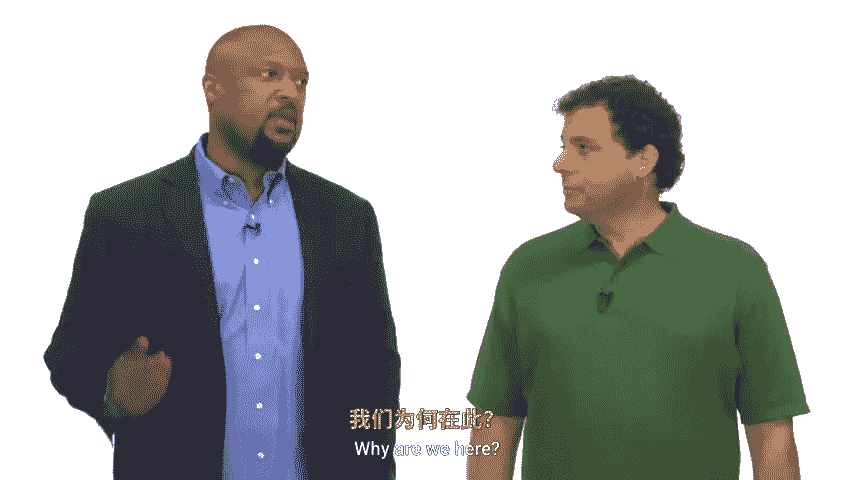
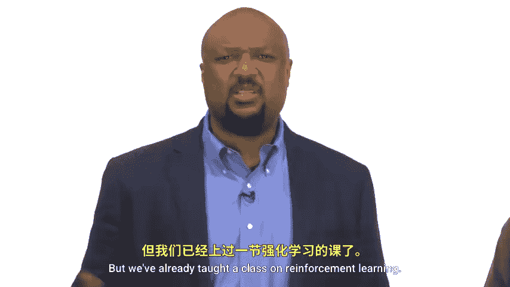
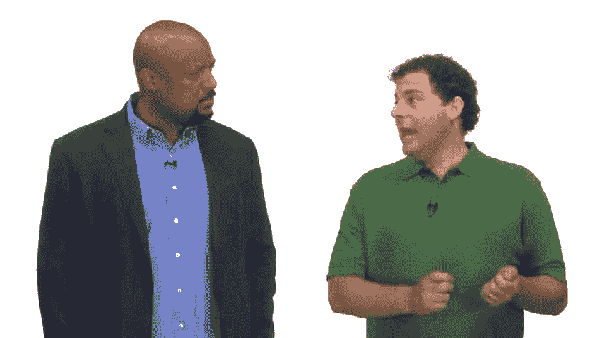
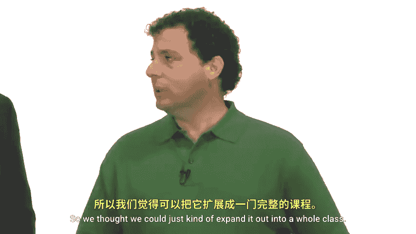
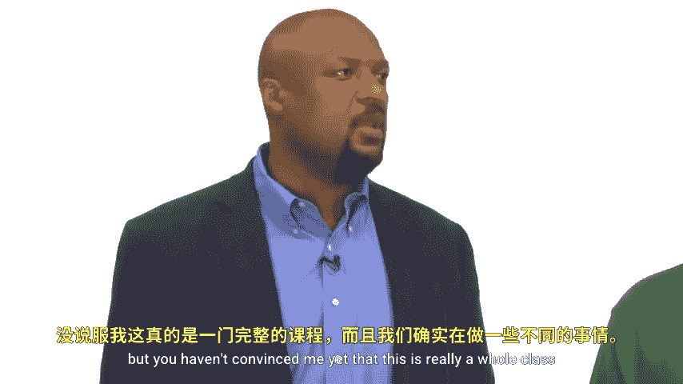
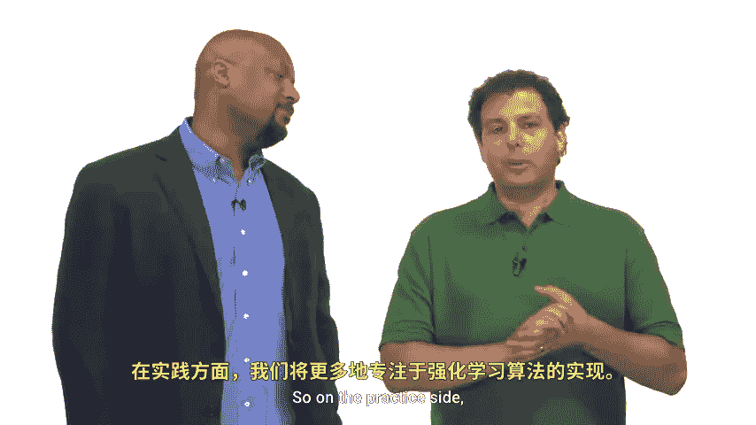
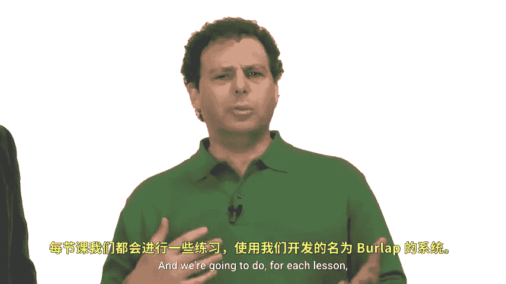
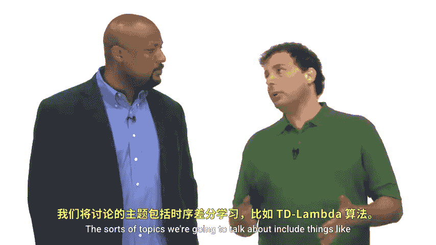

# 佐治亚理工【中英⚡强化学习导论｜CS8803 Introduction to Reinforcement Learning】 p01 P1 Introduction to Reinforcement Learning -BV1cJnfzTEBt_p1-

Oh， hey， Charles， hi， Michael， how are you doing today？ I'm doing well， Thank you。 How are you。

 I'm doing just fine。 Thank you so much for asking。 but I do have a question。 And what is that。😊。

Why are we here， Why are we here， Why are we here， Because we're teaching a class on reinforcement learning。

 Well we've already taught a class on reinforcement learning。 We taught a class on machine learning。

 and there was a section of that class on reinforcement learning。 So it's kind of a mini course。

 Okay， but we've done this already， So why would we be doing this again。

 The idea was that when we were doing the mini course last time。

 there was all sorts of topics that we didn't get to go into depth on。

 and it's a topic that's really interesting to us。 So we thought we could just kind of expanded out into a whole class。

 Okay， that seems reasonable， but you haven't convinced that this is really a whole class and that we're doing something different。

 So what are we doing this different So well， mostly we're going to just be going more deeply into the theory and practice of reinforcement learning。

 well， half of that sounds interesting Oh good So on the theory side。

 we're gonna to be studying things like the convergence of algorithms。

 how how long it takes them to converge， whether you can put bounds on how many mistakes It's going make before it converges situations in which you don't have convergence。

 These are all sorts of。

い？don't want to hear so much about Oh are you talking I'm sorry what about the practice side All right so on the practice side we're going to be doing a lot more in terms of implementations of reinforcement learning algorithms and we're going to do for each lesson some kind of exercise we're use a system that we built called burla the sorts of topics we're going to talk about include things like temporal difference learning like the TD Lambda algorithm I。

