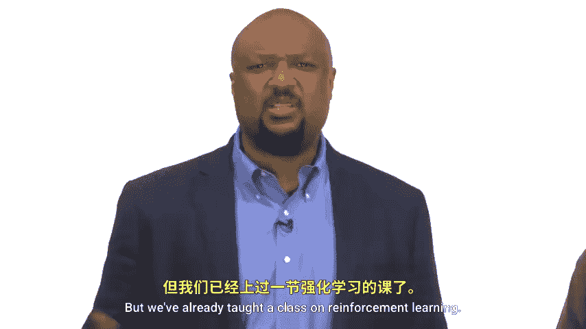
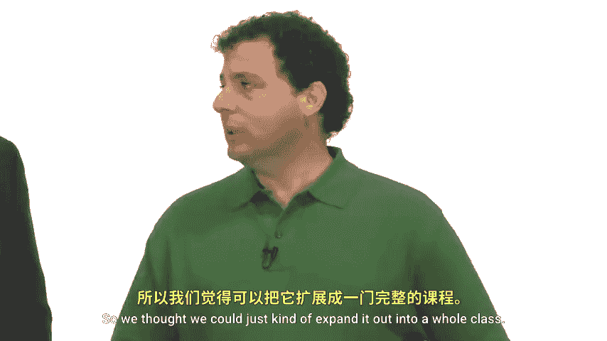
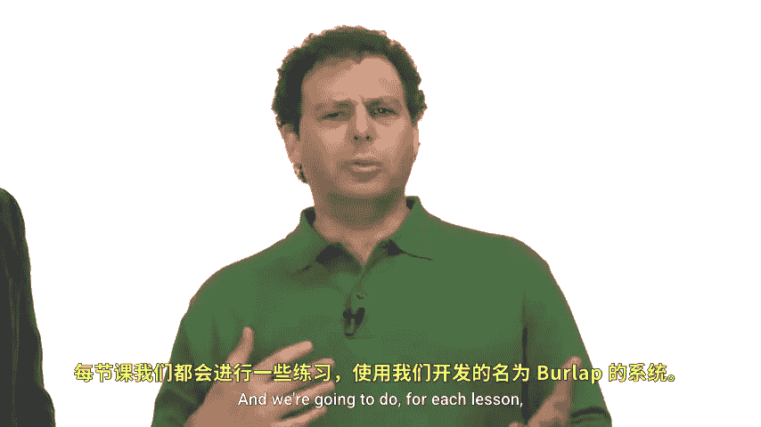

# 强化学习导论：P1：课程介绍 🎯

在本节课中，我们将要学习佐治亚理工学院《强化学习导论》课程的第一讲内容。本节将介绍开设这门课程的原因、课程目标以及将要涵盖的核心主题。

## 课程背景与动机

上一节我们介绍了课程的基本信息，本节中我们来看看开设这门课程的背景与动机。

我们之前已经教授过一门包含强化学习内容的机器学习课程。那门课程中的强化学习部分是一个小型专题课程。

然而，在教授那个小型课程时，我们发现有许多主题未能深入探讨。由于强化学习是一个我们非常感兴趣的领域，因此我们决定将其扩展为一门完整的独立课程。

## 课程核心内容：理论与实践

在了解了课程背景后，本节我们将深入探讨本课程的两个核心组成部分：理论部分与实践部分。

### 理论部分

理论部分将深入研究强化学习算法的数学基础与理论性质。以下是理论部分将涵盖的核心主题：

*   **算法收敛性**：研究算法是否以及如何收敛到最优解。
*   **收敛速度与样本复杂度**：分析算法收敛所需的时间或步数，并为其可能犯的错误次数设定界限。其核心思想可以用**遗憾界（Regret Bound）** 来描述，即算法累积奖励与最优策略累积奖励之间的差值上限。
*   **非收敛情形**：探讨在哪些情况下算法可能无法收敛。

### 实践部分

实践部分将侧重于强化学习算法的具体实现与应用。以下是实践部分将涉及的主要内容：

*   **算法实现**：我们将更多地动手实现各种强化学习算法。
*   **练习系统**：每节课都会配有练习，我们将使用一个名为“Burla”的自建系统来完成。
*   **核心算法**：课程将深入讲解如**时序差分学习（Temporal Difference Learning）** 和 **TD(λ) 算法**等关键主题。TD(λ)算法的更新公式可以表示为：
    `V(S_t) ← V(S_t) + α [R_{t+1} + γV(S_{t+1}) - V(S_t)] e_t`
    其中，`e_t` 是资格迹，`α` 是学习率，`γ` 是折扣因子。

## 总结

本节课中，我们一起学习了开设这门《强化学习导论》课程的原因。本课程旨在对强化学习进行更深入、更全面的探讨，其内容将均衡地覆盖**理论分析**（如收敛性、性能边界）与**实践应用**（如算法实现、编程练习）两大方面，为初学者系统性地掌握强化学习奠定基础。