# 佐治亚理工【中英⚡强化学习导论｜CS8803 Introduction to Reinforcement Learning】 p02 P2 Let's Do the Time Warp Agaaaain! -BV1cJnfzTEBt_p2-

Hi， Michael， hey， Charles， how's it going， It's going fantastically well。

 How are things going with you， I've been told I can't complain。😊，You could always complain， Michael。

 I'd rather not。 Okay， well， fair enough。 Okay， well， guess what we're going to talk about today。

 I'm reading decision making and reinforcement learning。 That's correct。 Is that the class sure。😊。

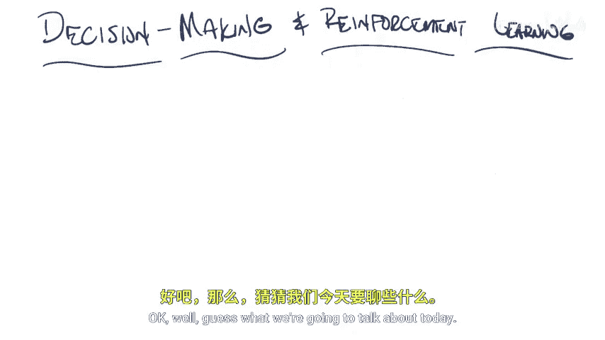

I feel like the class has an actual name。Yeah， decision making reinforcement learning。

 How do you feel about that， I like it a lot， except there is kind of an extra hyphen in there。😊。

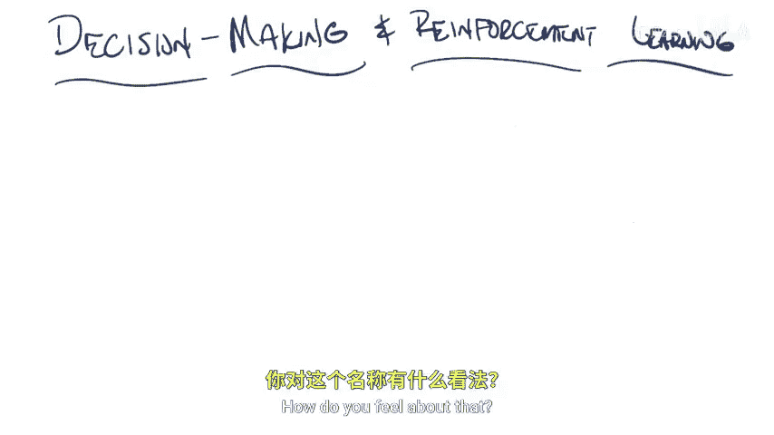

Where that between decision and making， you only put that in if it， if it's modifying another noun。

 Wait， haven't we had this conversation before， It does seem vaguely familiar。

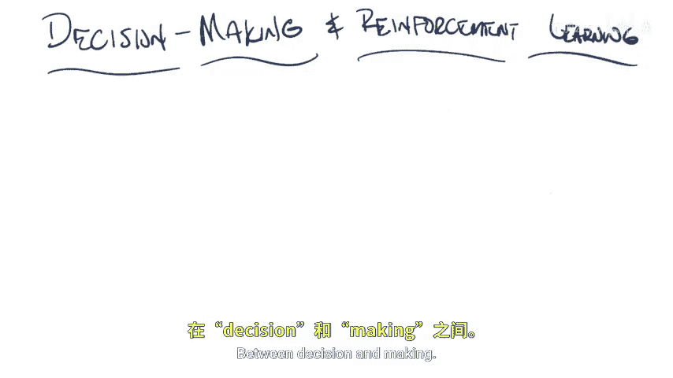

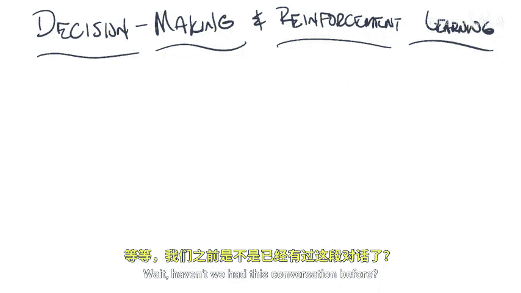

Oh， you know what it was when we did our introduction in the machine learning class for decision making and reinforcement learning as a subpiece。

 we had a very similar conversation。 Oh， so why are we doing it again？ Well， I mean。

 do we need to cover the same material。

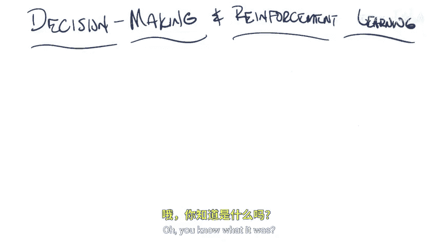

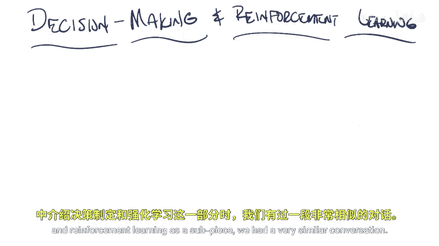

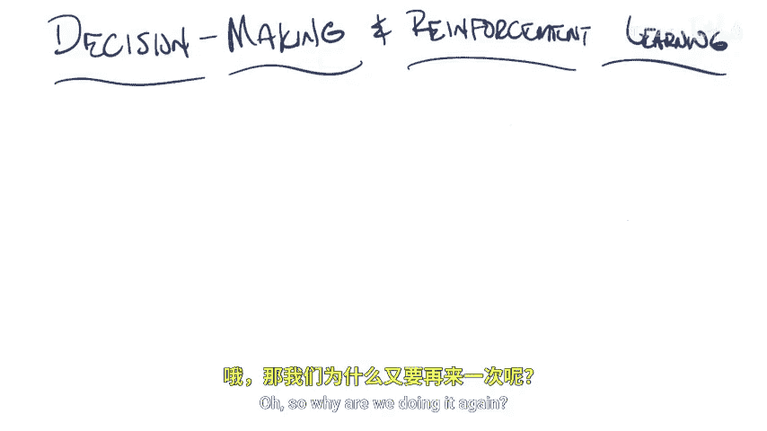

Yeah， absolutely important that we cover some of the same material in the beginning。 So。

 so maybe we shouldn't do it again。 Maybe we should kind of like cut and paste from the other class。

 Oh， I like that。 We can fix it in post。 That's fantastic。 Let's do that。

 So why don't we just pretend that somebody's put all the right video stuff in the right place and go do that How' does that sound to you。

 That sounds like it saves everybody a lot of time except for the people actually watching the videos。

 That works for me。 Okay， so let's do a flashback。 You want to do the flashback sounds。 Sure。

 I't do that。 Okay， let's go。😊。

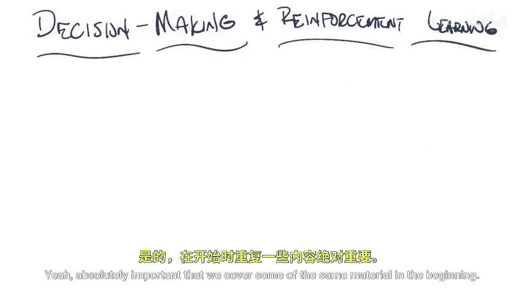

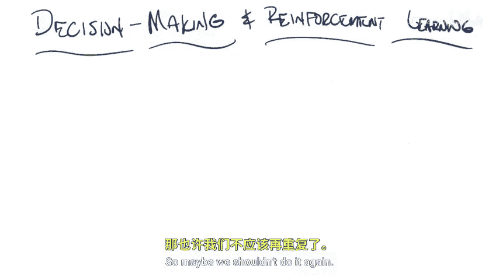

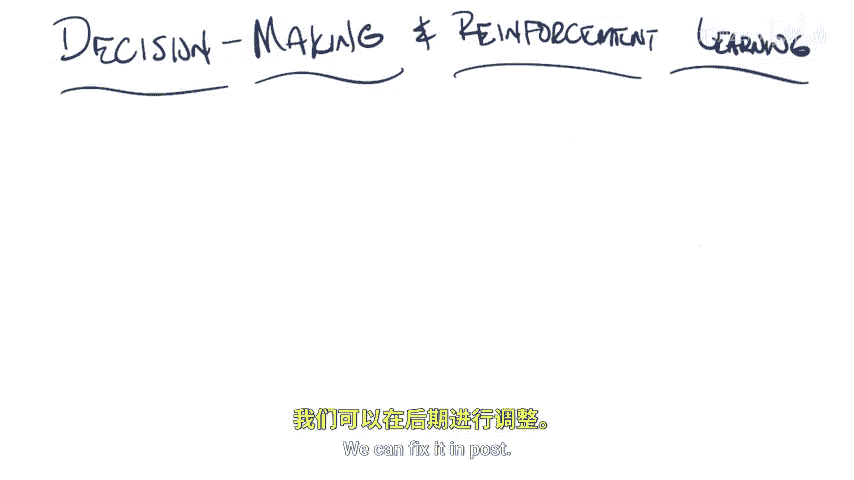

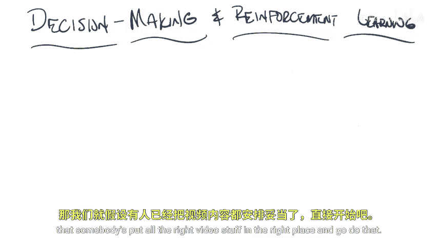

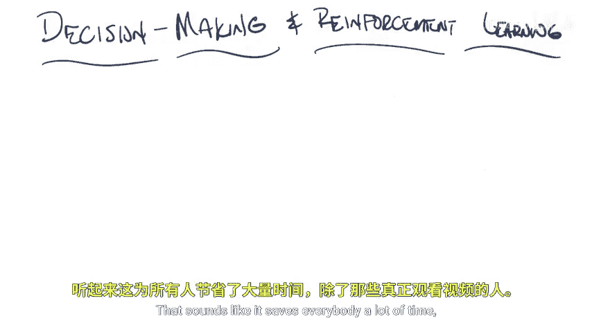

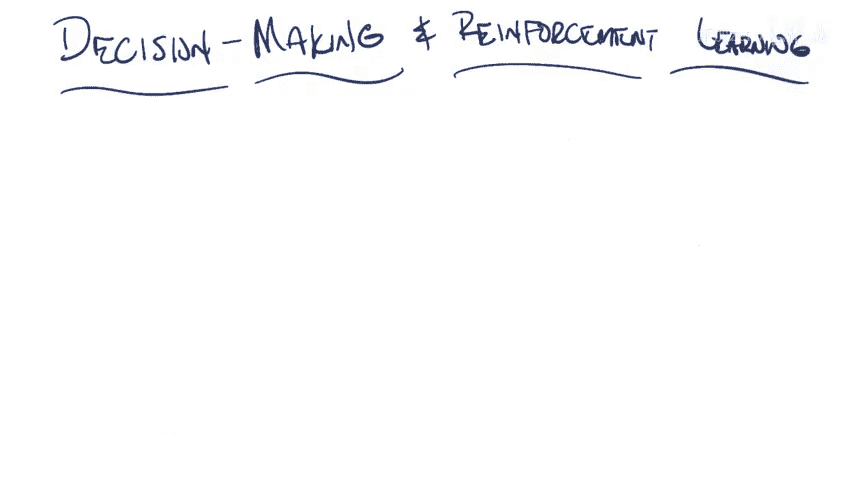