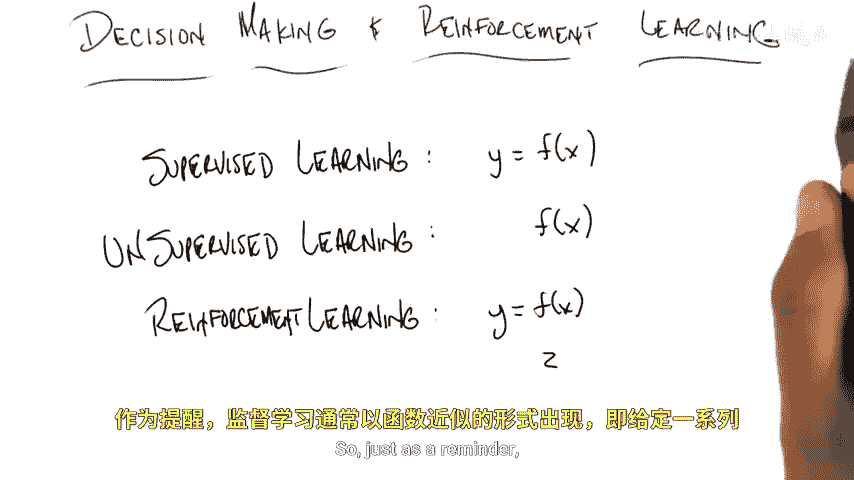
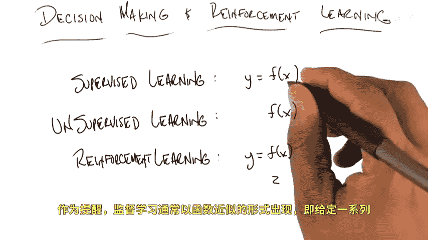
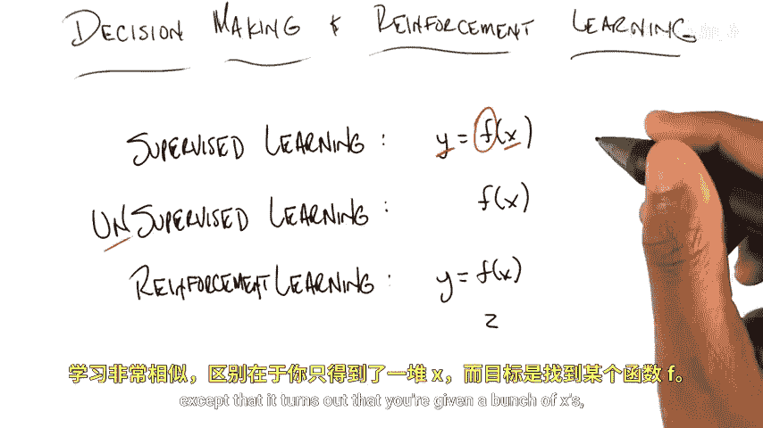
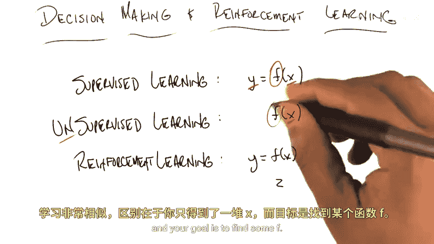
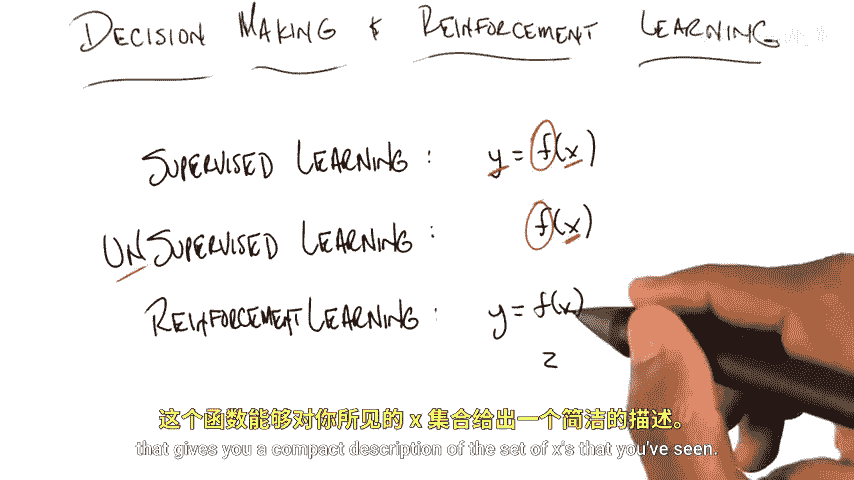
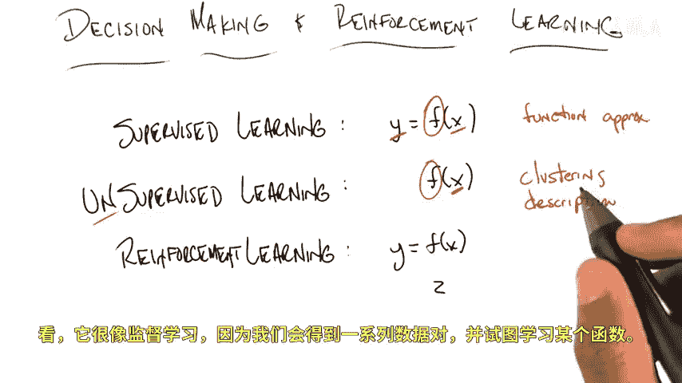

# 佐治亚理工【中英⚡强化学习导论｜CS8803 Introduction to Reinforcement Learning】 p04 P4 Decision Making & Reinforcement Learning -BV1cJnfzTEBt_p4-

Okay， Michael， so before we get started， diving into a particular formalism or framework that I want to talk about that we're going to use for most of this mini course。

 or at least the first half or so of it。 I want to remind everybody what the differences are between the three types of learning that we said we were gonna look at over this entire course。

 you recall what they are。 Well， reading off the slide， supervised， unsupervised and reinforcement。

 That's right。 And， you know， again， these things are all strongly related to one another。

 but it's very useful to think about them as being very separate。 So just as a reminder。

 supervised learning sort of。

Takes the form of function approximation where you're given a bunch of X Y pairs。

 and your goal is to。

Find the function F that will map some new X to a proper Y。You recall that？Y。

 unsupervised learning is very similar to supervised learning。

 except that it turns out that you're given a bunch of x's。

And your goal is to find some F。

That gives you a compact description of the set of x's that you see。

 So we call this clustering or description， as opposed to function approximation。 And finally。

 we're getting to reinforcement learning。 Now reinforcement learning is actually a name that means many things in different fields。

 And here we tend to talk about in a relatively specific way。 And superficially。

 it looks a lot like supervised learning。 and that we're going to be given。

A string of pairs of data。 And we're going to try to learn some function。

 But in the function approximation case， the supervised learning case， we are。

