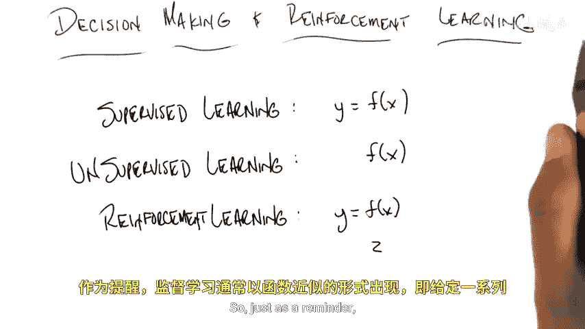
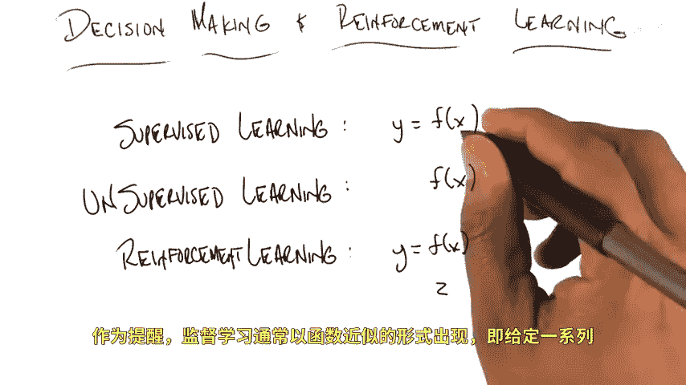
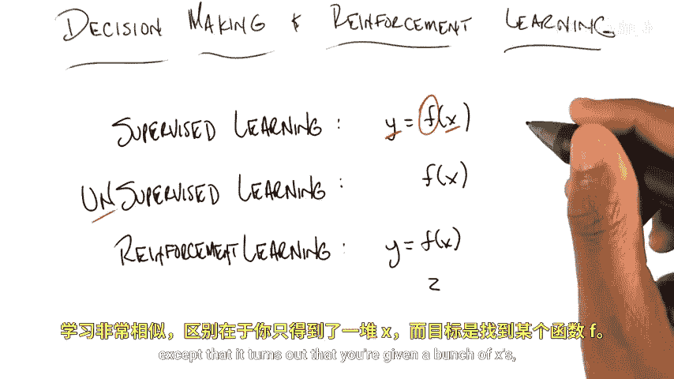
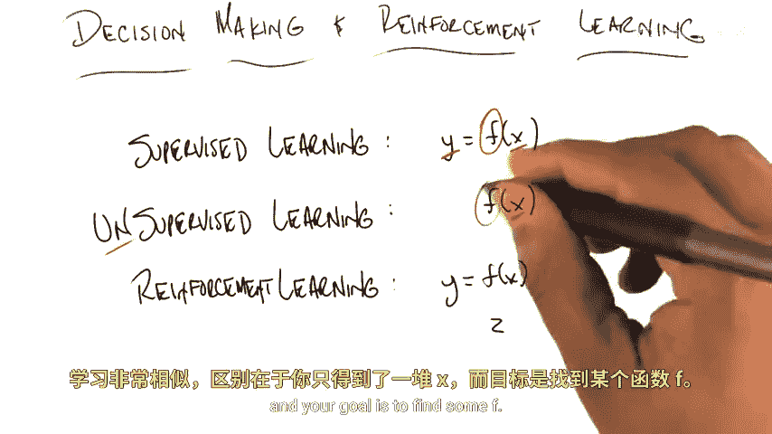
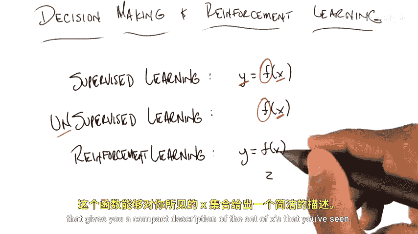
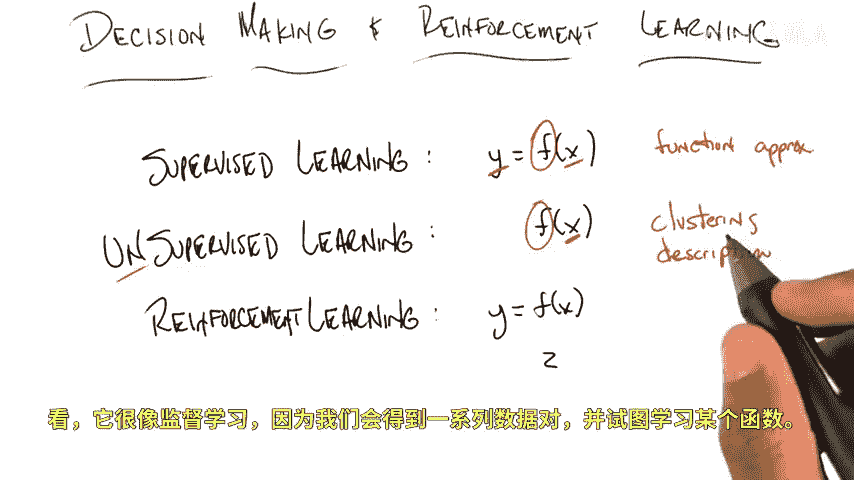

# 强化学习导论：P4：决策制定与强化学习 🧠

在本节课中，我们将学习三种主要机器学习范式之间的核心区别，并重点介绍强化学习的独特之处。我们将从监督学习和无监督学习的回顾开始，然后深入探讨强化学习的基本形式。

## 三种学习范式概述

上一节我们介绍了课程的整体框架，本节中我们来看看三种核心学习范式的具体区别。它们分别是监督学习、无监督学习和强化学习。虽然它们彼此相关，但将其视为独立的类别进行思考非常有帮助。

### 监督学习 📊

监督学习通常表现为函数逼近的形式。

其核心过程是：给定一组输入X和对应输出Y的配对数据。

**公式表示**：
`给定数据：{(X1, Y1), (X2, Y2), ..., (Xn, Yn)}`

学习的目标是找到一个函数F，使得该函数能够将新的输入X映射到正确的输出Y。

**目标公式**：
`学习函数 F，使得 F(X_new) -> Y_new`

### 无监督学习 🔍

无监督学习与监督学习形式相似，但关键区别在于输入数据。

其核心过程是：只给定一组输入X，而没有对应的标签Y。

**公式表示**：
`给定数据：{X1, X2, ..., Xn}`

学习的目标是找到一个函数F，该函数能对你所见的X数据集给出一个紧凑的描述或结构。

**目标公式**：
`学习函数 F，用于描述或聚类 {X}`

我们通常称此为聚类或描述任务，而非函数逼近。

### 强化学习 🎮

现在，我们进入强化学习。强化学习这个术语在不同领域有多种含义，但在此课程中，我们将在相对特定的语境下讨论它。

从表面上看，强化学习与监督学习很像。

其核心过程是：我们同样会被给予一串配对数据。

**公式表示**：
`给定数据：某种形式的配对序列`

并且，我们同样需要尝试学习某个函数。

然而，在函数逼近（即监督学习）的情况下，我们的目标是明确的映射。

**监督学习目标**：
`学习从 X 到 Y 的映射关系`

---

本节课中我们一起学习了机器学习中监督学习、无监督学习和强化学习三种范式的基本定义与形式区别。我们明确了监督学习是带有标签的映射学习，无监督学习是对无标签数据的结构描述，而强化学习则涉及在特定序列数据中学习决策函数，为后续深入其具体框架奠定了基础。