# 佐治亚理工【中英⚡强化学习导论｜CS8803 Introduction to Reinforcement Learning】 p05 P5 The World - 1 -BV1cJnfzTEBt_p5-

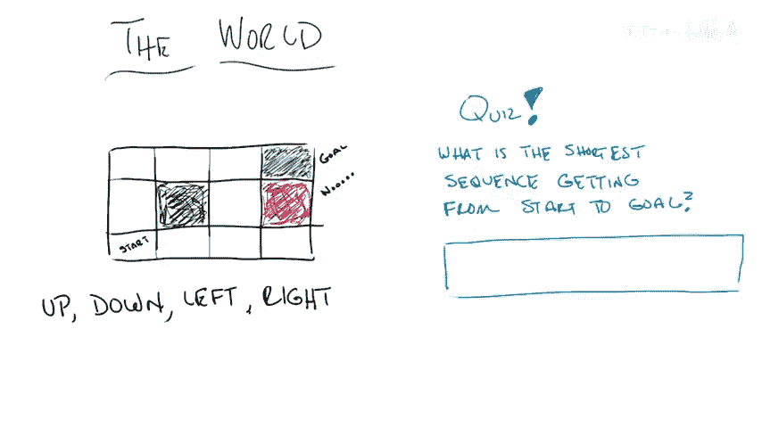

Michael， here is a world。 In fact， for the purposes of this discussion， it is the world。 Okay。

 so imagine the entire universe is well described by this picture over here。 Okay， now。

 this is called a grid world， which is something that people in reinforcement learning love to think about because it's a nice approximation for all the complexity of the entire universe。

 Now， this particular world is a 3 by 4 grid。😊。

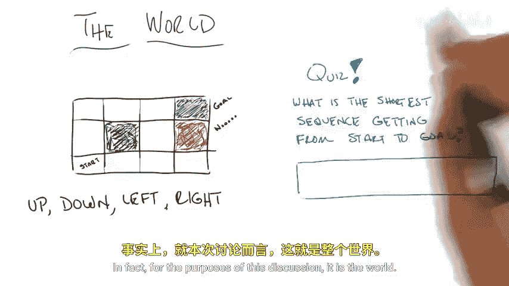

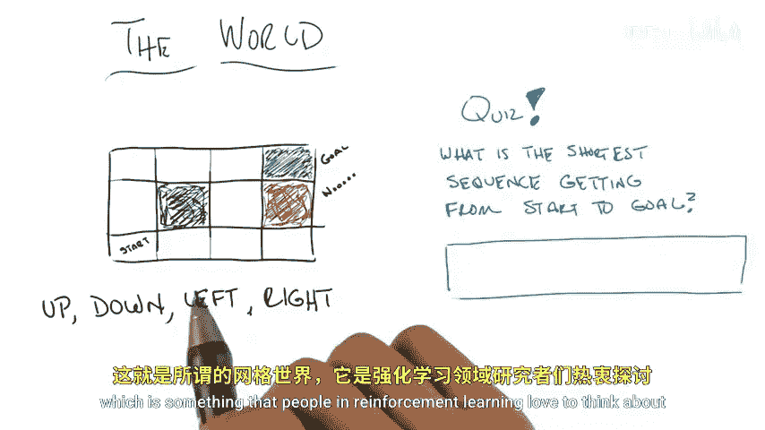

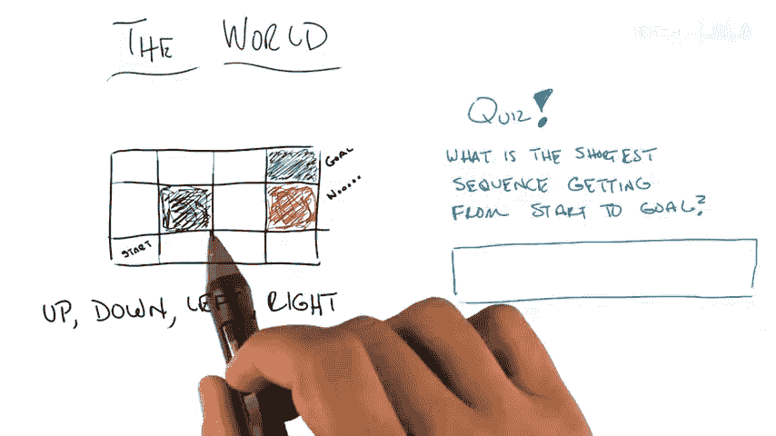

So you have you know， one comma1， two comma1， three comma 1， four comma 1， you have one comma  two。

 one comma  three， and so on and so forth。For the purposes of this discussion。

 we can think of the world as being a kind of game where you start out in a state。

 which we're going to call the start state。 and you're able to execute actions。

 One of these four up down， left or right。 And the purpose is to wander around this world in such a way that eventually you make it to this goal over here。

 this little green spot。 you see that， Michael。 And under all circumstances。

 you must avoid the red spot。 exactly。 Now， for this particular example up does what you think it does down。

 does what you think it does， as do left and right。 But if you find yourself at a boundary。

 such as right appear in this upper left hand corner。 And you try to go up。

 you just stay where you are。😊。

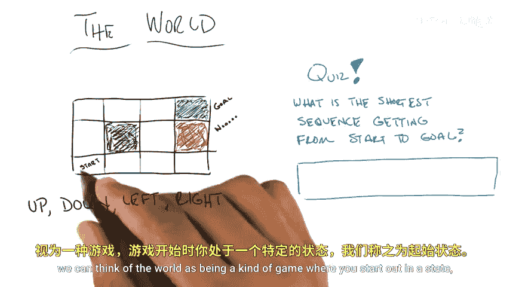

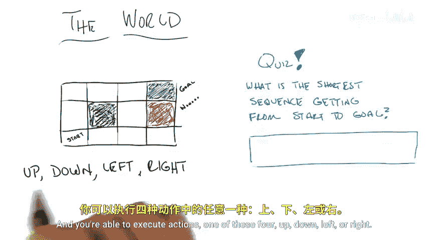

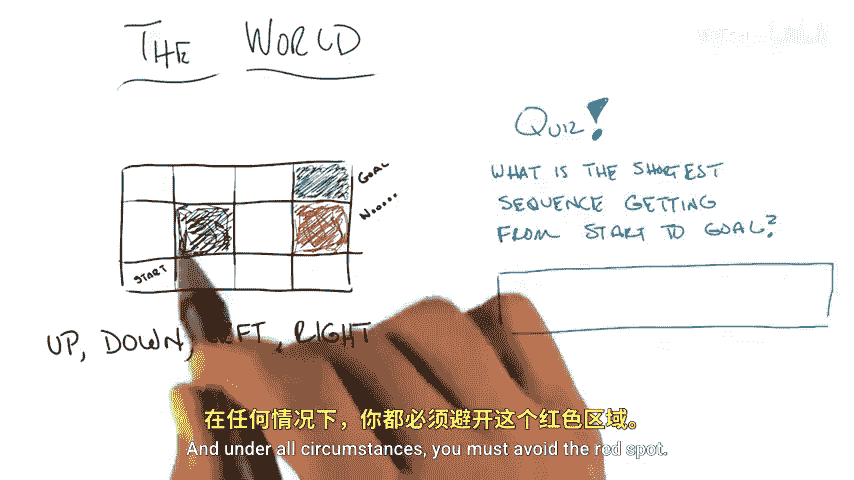

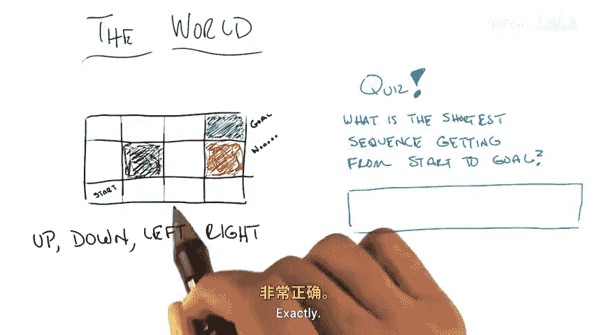

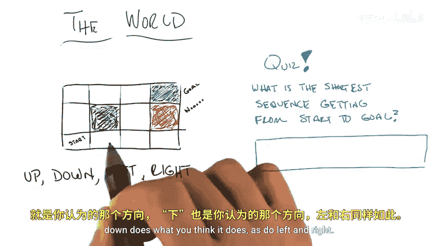

If you try to go left， you just stay where you are， but if you go right。

 you do actually end up in the next square。

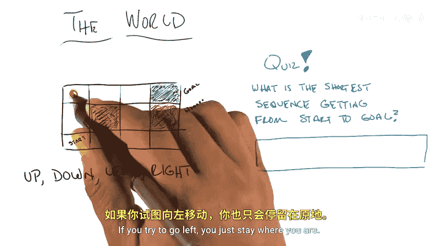

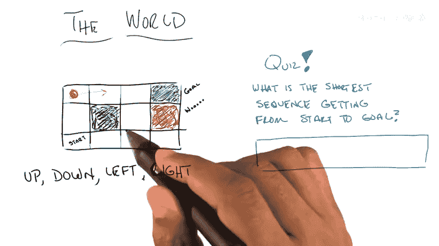

Got it。 I think so。 Okay， three last things。 One， this little black space here is a place you can't enter into。

 So it acts just like a wall。 This green space is the goal。

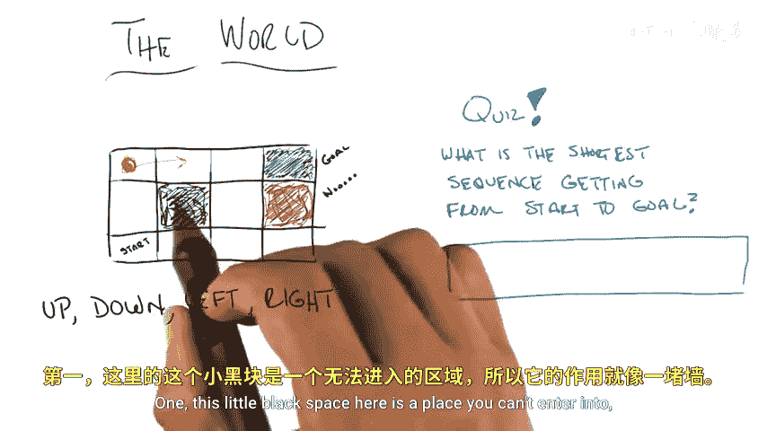