# 强化学习导论：P5：世界 - 1

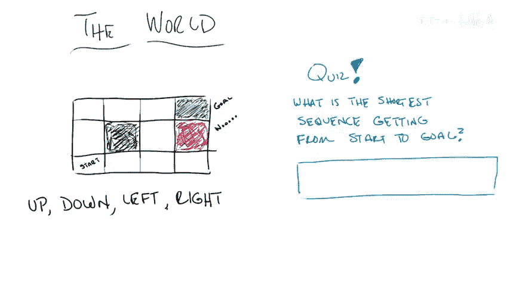

在本节课中，我们将学习强化学习中的一个核心概念：**世界**。我们将通过一个具体的例子——网格世界——来理解智能体如何与环境交互，以及如何定义状态、动作和目标。

---

Michael，这是一个世界。事实上，为了本次讨论的目的，它就是整个世界。可以想象，整个宇宙都能用这张图很好地描述。

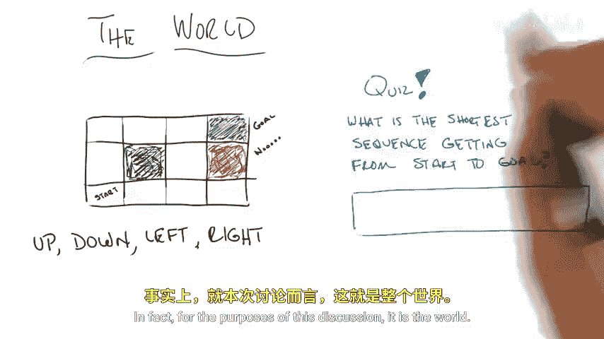

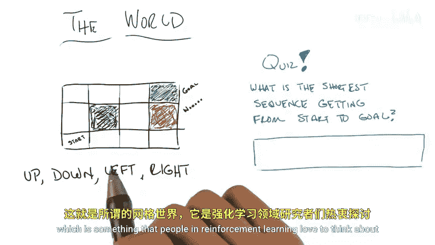

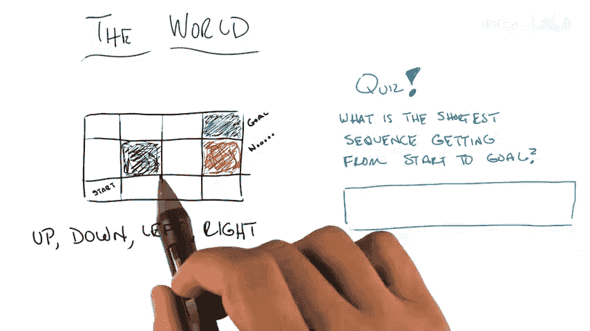

这被称为**网格世界**，强化学习领域的研究者喜欢用它来思考，因为它能很好地近似整个宇宙的复杂性。

这个特定的世界是一个3行4列的网格。

网格中的每个位置可以用坐标表示，例如 `(1,1)`， `(2,1)`， `(3,1)`， `(4,1)`， `(1,2)`， `(1,3)` 等等。

为了本次讨论，我们可以将这个世界视为一种游戏。你从一个**状态**开始，我们称之为**起始状态**。你可以执行**动作**，即上、下、左、右四个方向之一。目的是在这个世界中游走，最终到达这里的**目标**，也就是这个绿色小点。Michael，你看到了吗？在任何情况下，都必须避开红色点。

在这个特定例子中，向上、向下、向左、向右的动作效果符合直觉。但如果你发现自己处于边界，例如左上角这个位置，然后尝试向上移动，你会停留在原地。

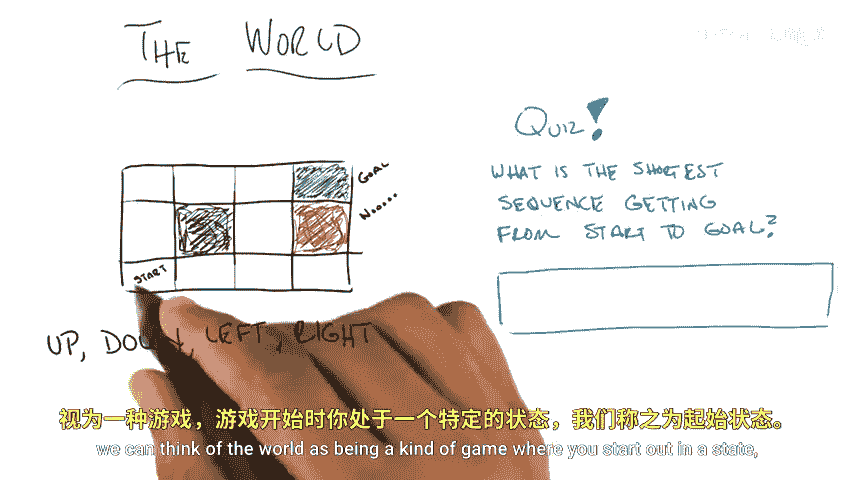
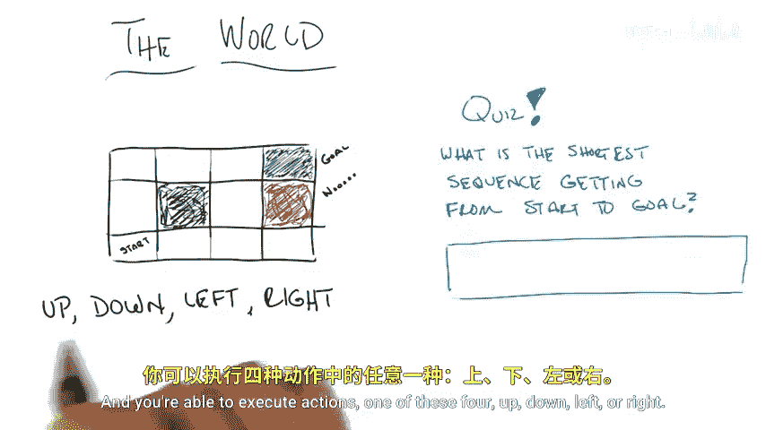
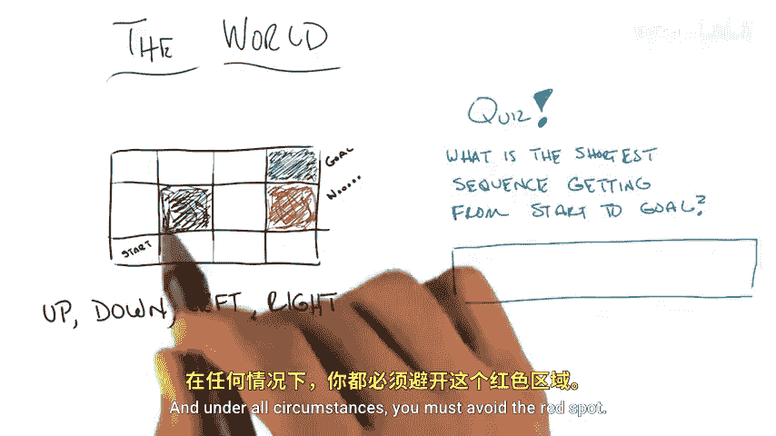
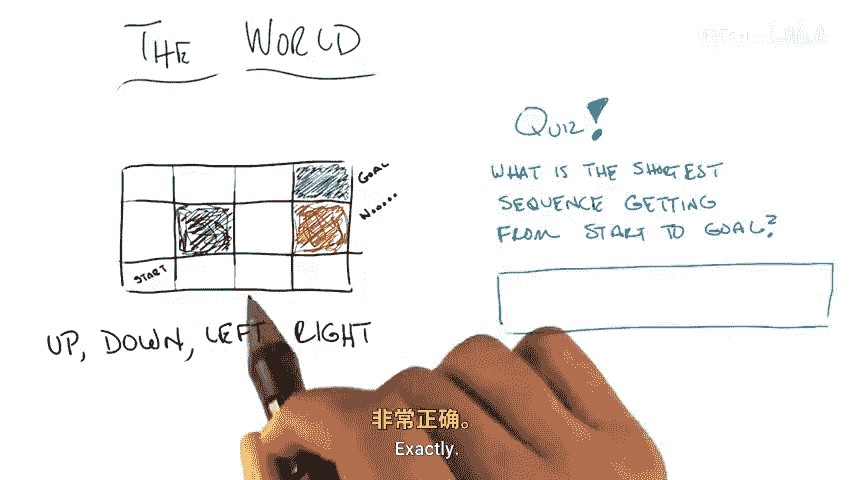
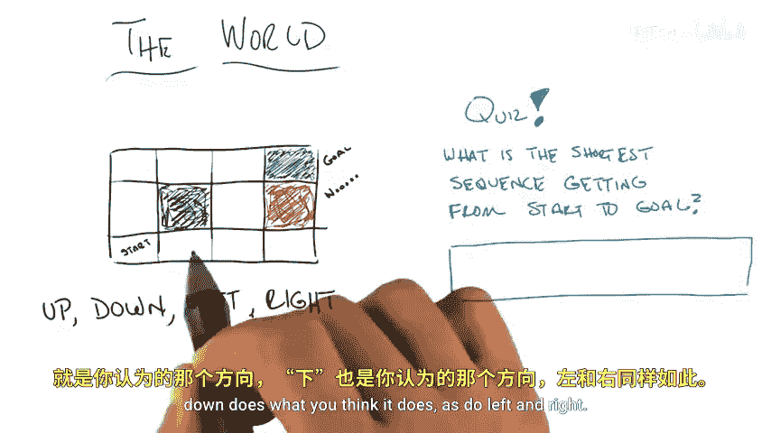

如果你尝试向左移动，也会停留在原地。但如果你向右移动，你确实会到达下一个方格。

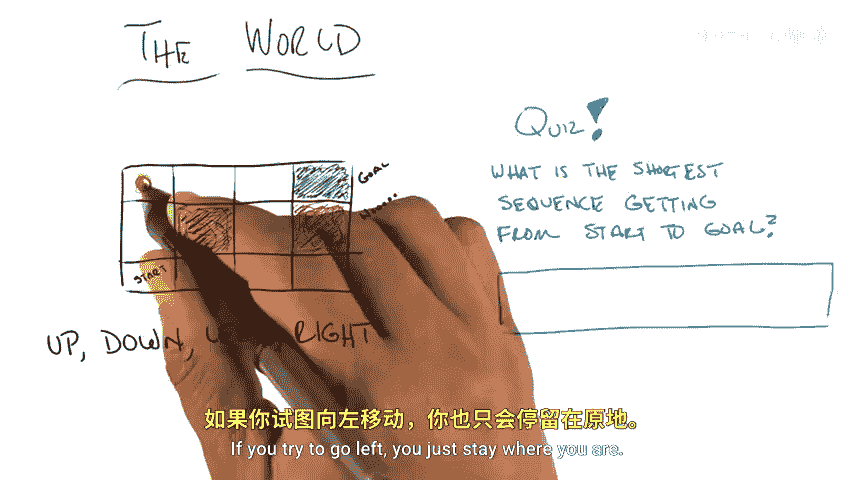
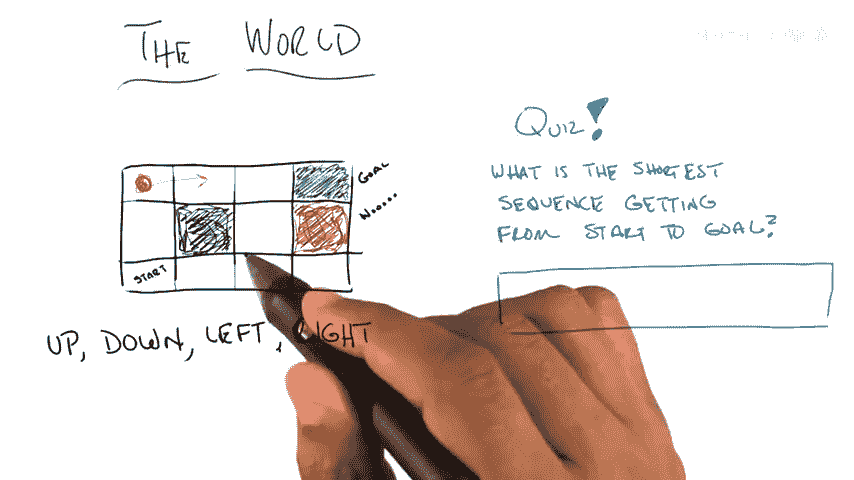

明白了吗？我想是的。最后还有三点需要注意。

第一，这里的黑色小方格是一个你无法进入的区域，它的作用就像一堵墙。

第二，绿色方格是目标。

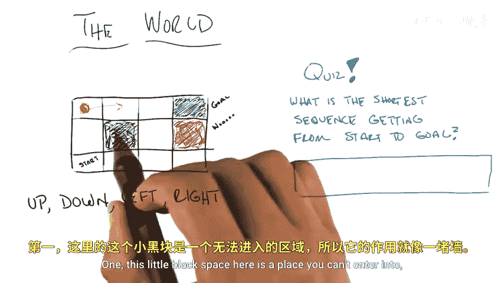

---

本节课中，我们一起学习了强化学习中的“世界”概念。我们通过一个3x4的网格世界例子，定义了**状态**（网格位置）、**动作**（上、下、左、右）、**起始状态**、**目标状态**（绿色格子）以及需要避开的**危险状态**（红色格子）和**障碍**（黑色格子）。我们还了解了在边界处执行动作的规则。下一节，我们将在这个世界的基础上，探讨智能体如何通过试错来学习最优策略。