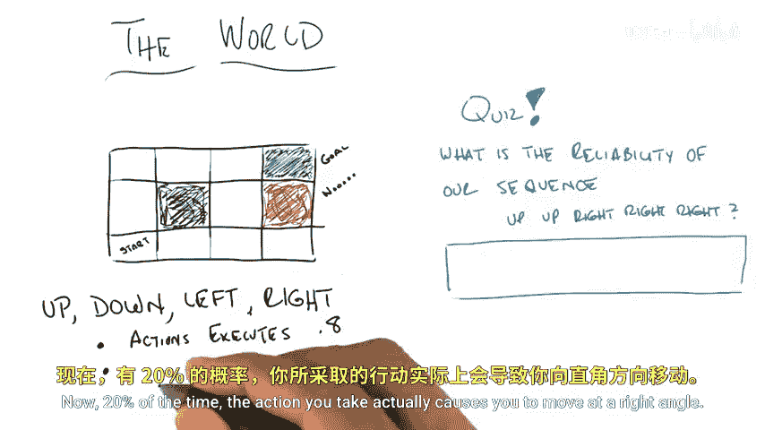
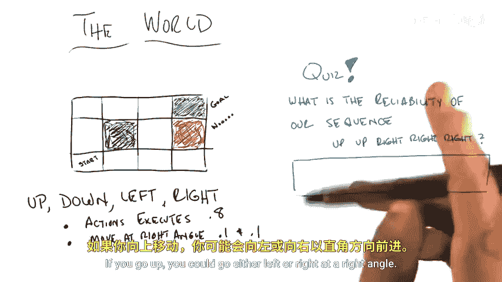
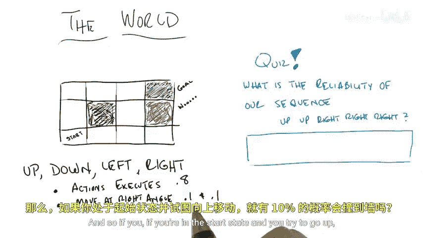
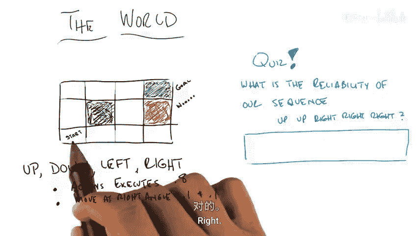
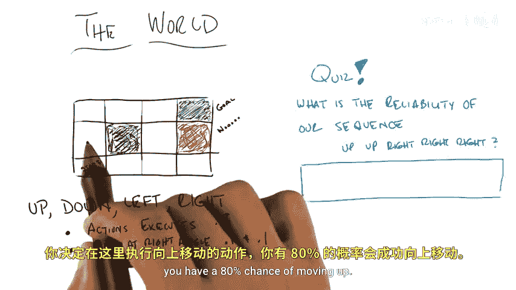
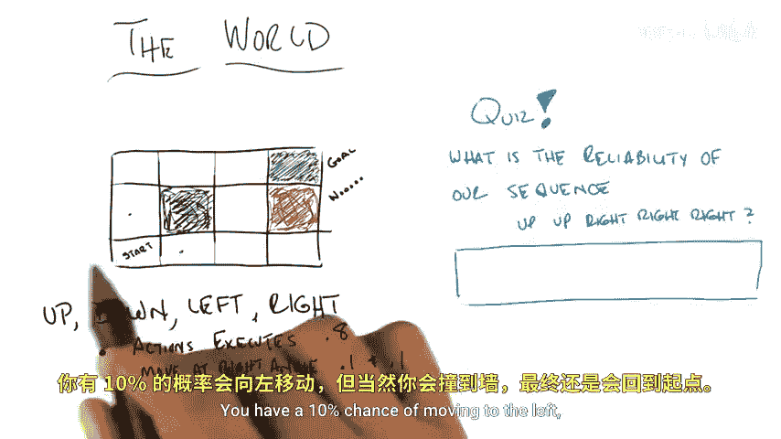
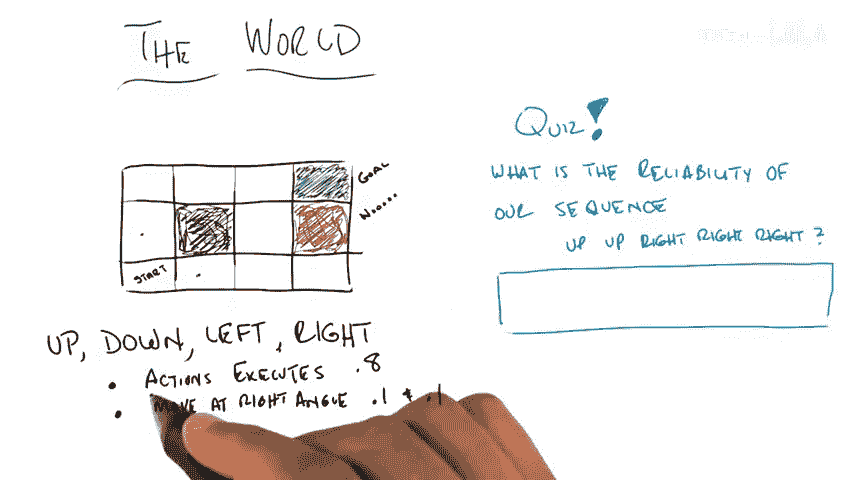
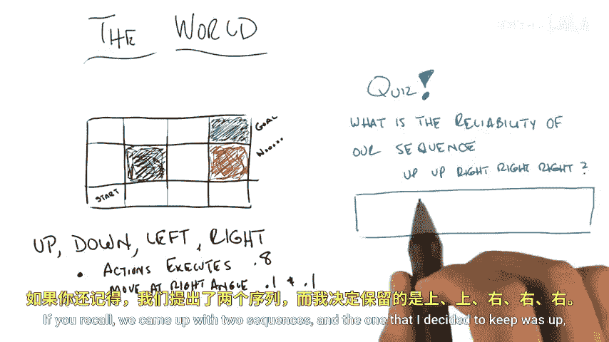

# 佐治亚理工【中英⚡强化学习导论｜CS8803 Introduction to Reinforcement Learning】 p07 P7 The World - 2 -BV1cJnfzTEBt_p7-

I'm going change the world just a little bit。 Michael。 Okay， that last one was really easy。

 and it was easy for a bunch of reasons。 but one of the reasons it was easy is that every time you took an action。

 it did exactly what you expected it to do。 Now， I want to introduce a little bit of uncertainty or stochasticity into the world。

 So let me tell you exactly what that means。 when you execute an action。

 it executes correctly with probability of 0。8。 So 80% of the time。 if you go up， it goes up。

Assuming you can go up it goes， if you say down， it goes down， assuming you can left， it goes left。

 right， it goes right， Go it。Now，20% of the time， the action you take actually causes you to move at a right angle。

 Now， of course， there are two different right angles you could go to。 if you go up。

 you could go either left or right at a right angle。 And so that 20% gets distributed uniformly。

 Okay that makes sense Yeah I think so。 And so if you if you're in the start state and you try to go up。

 then there's a 10% chance that you would attempt to bump into the wall。 Yes。

And then you just stay where you are， I guess right。

 so if you if you decide to execute the up action here， you have a 80% chance of moving up。

 you have a 10% chance of moving to the right and you have a 10% chance of moving to the left but of course you would bump a wall and you would end up right back where you started Got it。

Yeah， okay， good。 So heres my quiz question for you， Michael。

 do you recall we came up with two sequences and the one that I decided to keep was up up， right。

 right， right。

