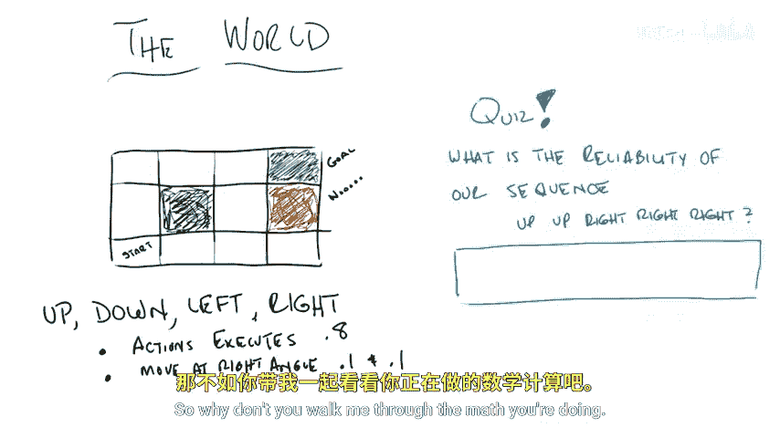
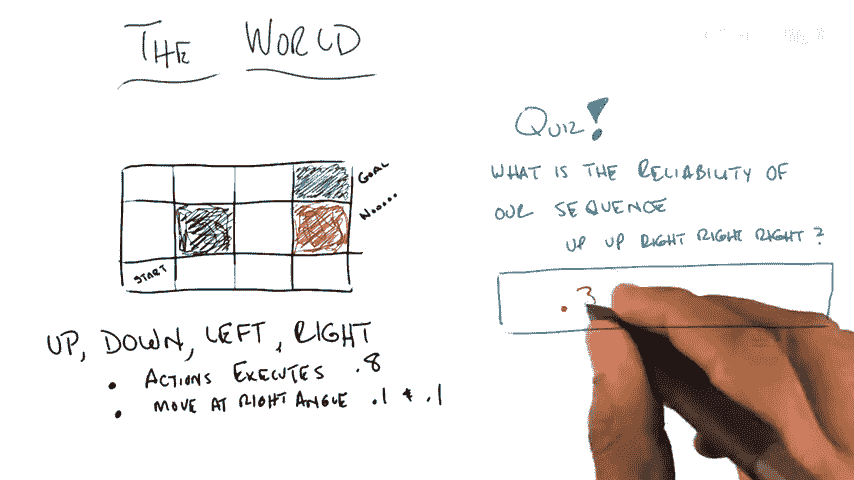
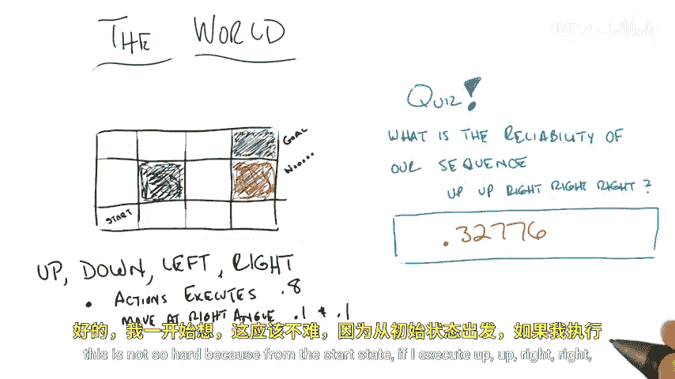
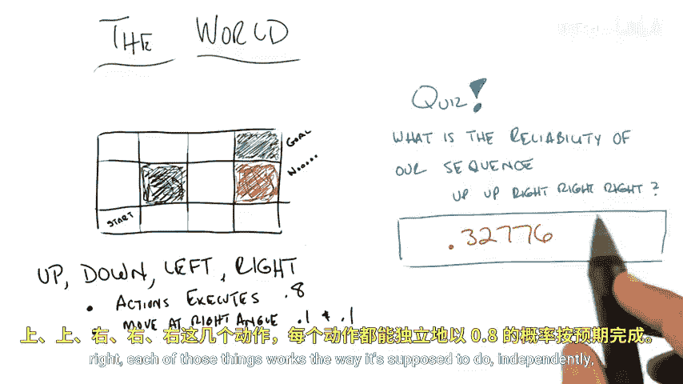
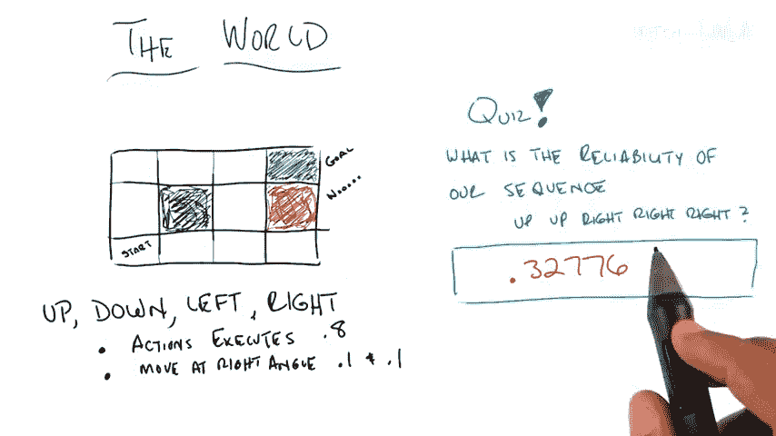
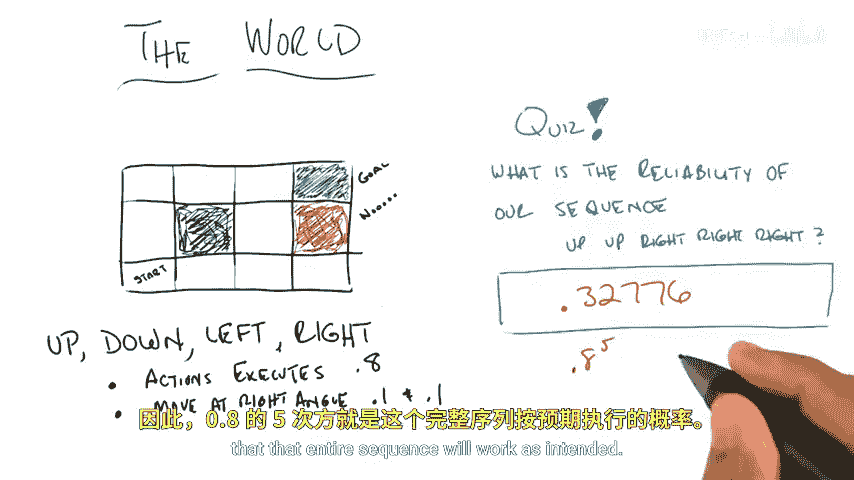
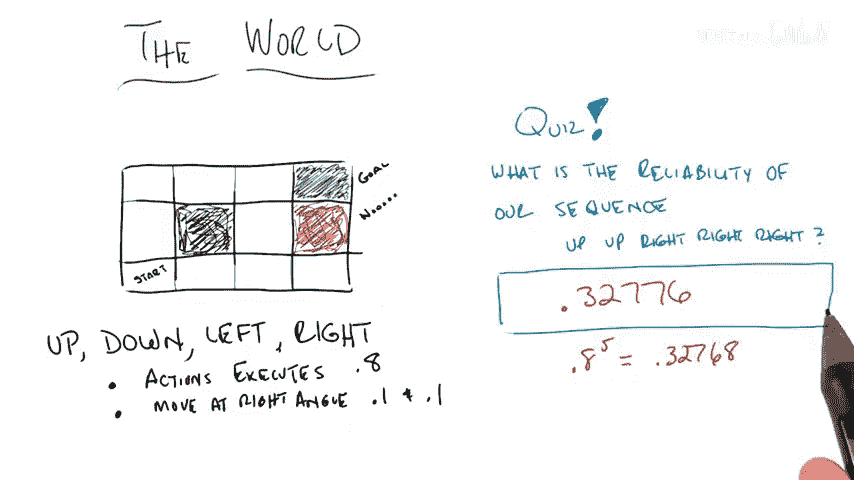

# 佐治亚理工【中英⚡强化学习导论｜CS8803 Introduction to Reinforcement Learning】 p08 P8 The World - 2 Solution -BV1cJnfzTEBt_p8-

Okay， Michael， do you have an answer， I have an answer Indeed。 Okay， what's the answer， Okay。

 maybe I don't have an answer indeed， But I have， I have the ability to compute1。 Okay。

 I'm doing some math。 So why don't you walk me through the math you're doing。 I got 。32776。

 That is correct， Michael。

O。

That was trickier than I thought。 Okay， well show me what you did。 All right。

 so the first thing I did as I said， okay， well， this is not so hard because from the start state。

 if I execute up， up， right， right， right， each of those things works the way it's supposed to do independently with probability 0。

8， y。

And so，0。8 raised to the fifth power。

Gives me the probability that that entire sequence will work as intended。 Exactly， what is 。

8 to the fifth， Do you know，32768 with a decimal point in front of it because， you know， powers it2。

Wow。That is correct。 But I noticed that 3，2，7，6，8 is not 3，2，7，7，6。 No。

 they differ by a little smiiddge。 So this is what occurred to me next is is there any way that you could have ended up falling into the goal from that sequence of commands。

 not following the intended path。 So since actions can have unintended consequences as they often do I was going to ask。

 okay， so if I go up in the first step， there's a probability 。1 that I'll actually go to the right。

From there， if I go up， there's a 10% probability that I'll actually go to the right。

