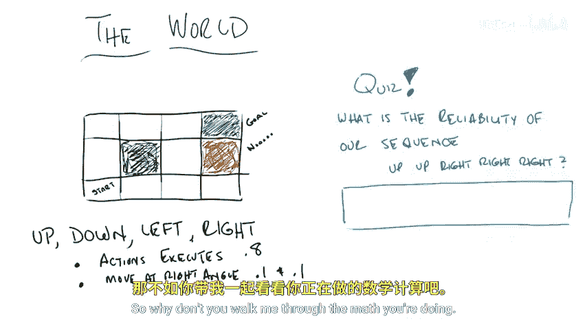
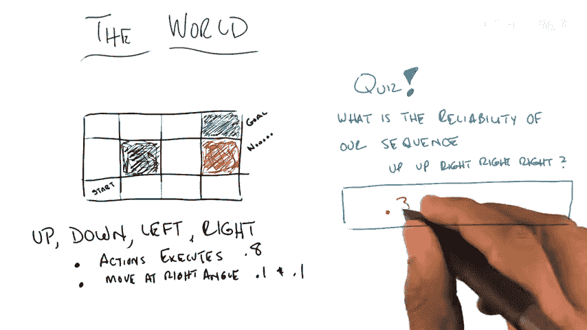
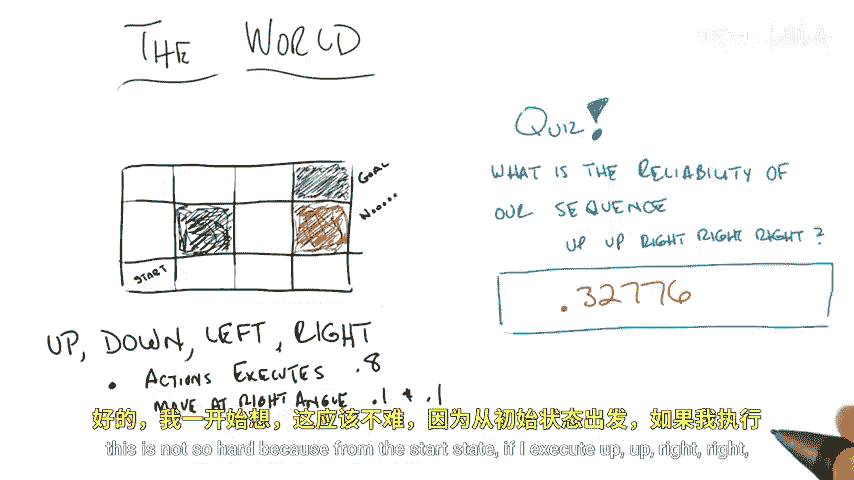
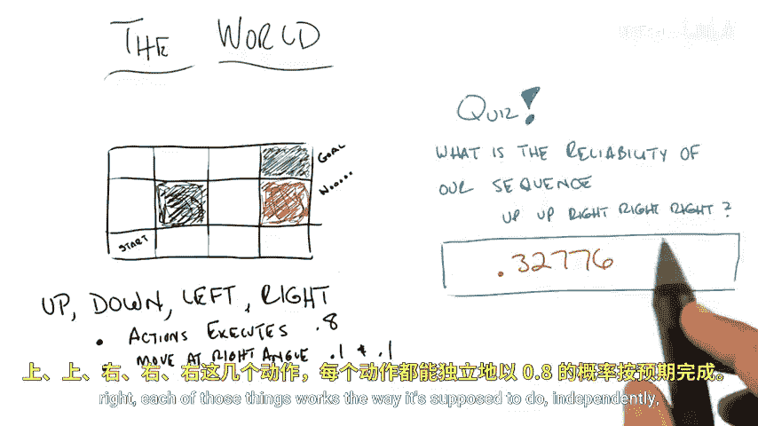
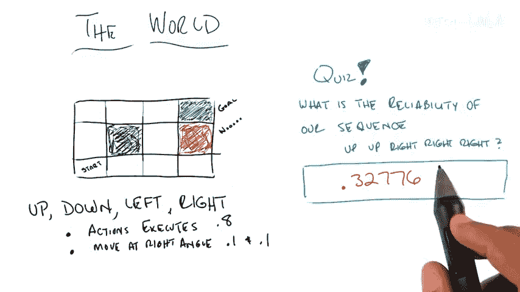
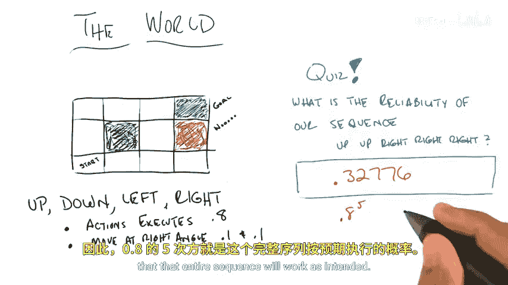
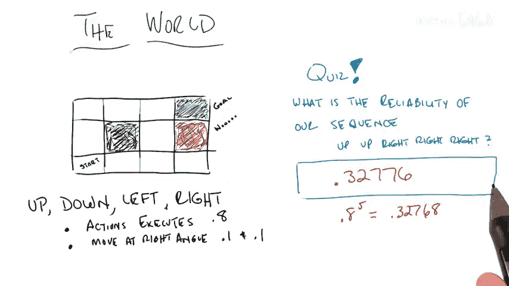

# 强化学习导论：P8：世界-2 解答

在本节课中，我们将学习如何计算一个智能体在随机环境中，通过一系列动作成功到达目标状态的概率。我们将通过一个具体的网格世界示例，详细拆解计算过程。

---

## 问题概述

我们面临一个网格世界问题。智能体从起始状态出发，计划执行一系列动作：`上`、`上`、`右`、`右`、`右`。每个动作有80%的概率按预期执行，有10%的概率会滑向预期方向的左侧，另有10%的概率滑向右侧。我们需要计算智能体最终成功到达目标状态的概率。

## 核心概念与公式

计算的核心是理解**动作执行的概率模型**。每个动作的成功执行是独立事件。因此，如果所有动作都按计划执行，其联合概率是每个动作成功概率的乘积。

**公式**：`P(所有动作均成功) = (成功概率)^(动作数量)`

在我们的案例中，成功概率为 `0.8`，动作数量为 `5`。

## 计算过程详解

上一节我们介绍了问题的基本设定，本节中我们来看看具体的计算步骤。

### 步骤一：计算理想路径的概率

首先，我们计算智能体严格遵循预定路径（`上、上、右、右、右`）且没有任何动作失误的概率。

以下是计算过程：
*   每个动作独立成功的概率是 `0.8`。
*   五个动作都成功的概率是 `0.8` 的五次方。

通过计算，我们得到：
`0.8^5 = 0.32768`

这意味着，有大约 **32.768%** 的概率，智能体会完美地沿着预定路径到达目标。

### 步骤二：考虑意外成功的可能性

然而，计算结果 `0.32768` 与最终答案 `0.32776` 存在微小差异。这提示我们，可能存在其他非预期的动作序列，也能让智能体“意外”抵达目标。

我们需要分析：在执行预定命令序列时，是否可能因为动作的“滑移”（即那20%的意外情况），反而阴差阳错地到达目标？

例如：
*   第一步执行`上`，但有10%的概率滑向`右`。
*   如果第一步滑向了`右`，那么第二步执行`上`时，又有10%的概率再次滑向`右`。
*   ……

这些由“错误”构成的路径，叠加起来，贡献了那微小的额外概率（`0.00008`），使得总概率从 `0.32768` 增加到了 `0.32776`。

## 总结

本节课中我们一起学习了在随机环境中计算路径概率的方法。
1.  **基础计算**：对于独立事件，理想路径的概率是各动作成功概率的连乘，即 `P = (0.8)^5 = 0.32768`。
2.  **全面分析**：在强化学习问题中，需要考虑到所有可能通向目标的状态转移，包括那些由非预期动作构成的路径。将这些小概率事件相加，才能得到精确的总成功概率 `0.32776`。

这个例子强调了在概率性环境中建模时，考虑所有可能状态转移的重要性。