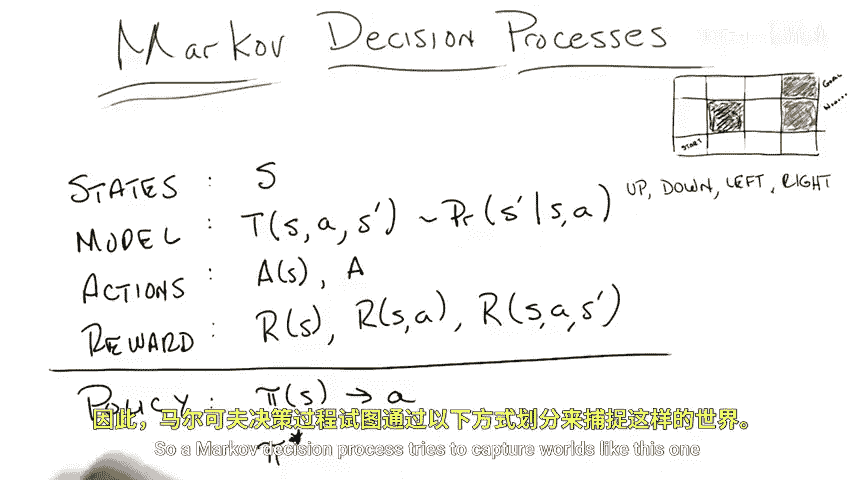
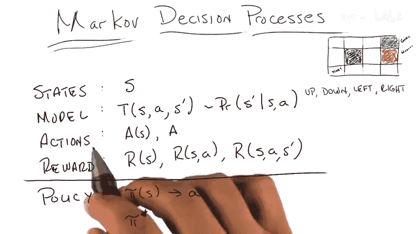
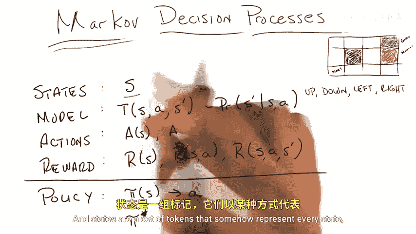
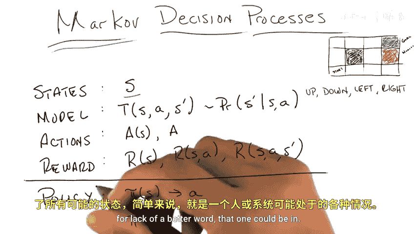
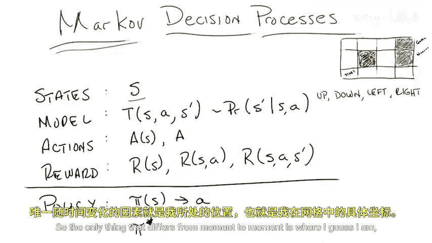
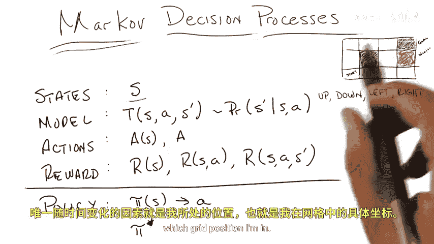
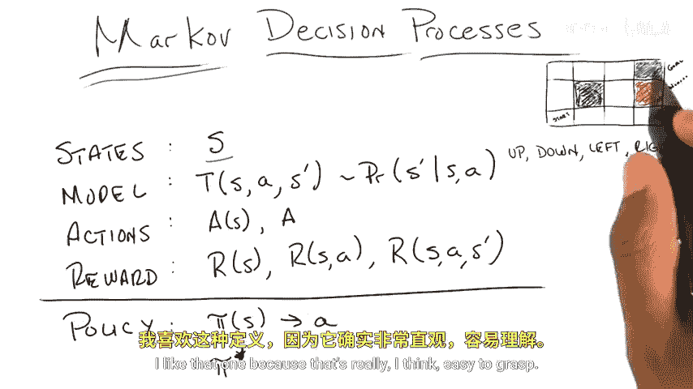
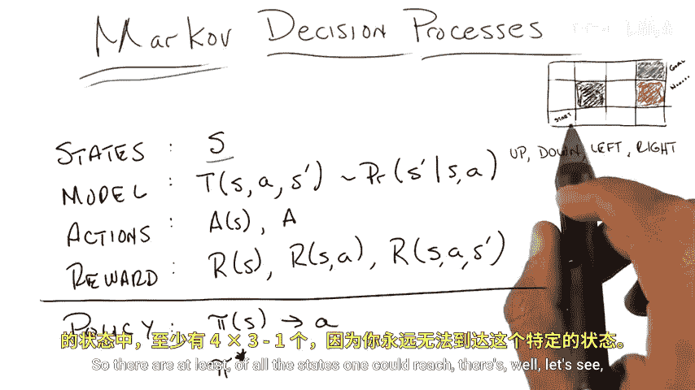

# 佐治亚理工【中英⚡强化学习导论｜CS8803 Introduction to Reinforcement Learning】 p09 P9 Markov Decision Processes - 1 -BV1cJnfzTEBt_p9-

So this is the framework that we're going to be using through most of the discussions that we'll be having。

 at least on reinforcement learning， at least single agent reinforcement learning。

 and it's called the Markov decision process。 this should sound familiar to you， Michael。

 Well you did say we're going to talk about decisions。 That's true。

 And we need a process for making decisions。 and we're going to introduce something called the Markovvi and property as a part of this discussion。

 And I'll tell you exactly what that means at a moment。

 So I'm just going to write out this framework and just and tell you what it is and what the problem it produces for us。

 and then we're going to start talking about solutions through the rest of the discussion。

 So a Markov decision process tries to capture worlds like this one。

By dividing up in the following way。

We say that there are states。And estates are a set of tokens that somehow represent every state for lack of a better word that one could be in。

 So does that make sense to you， Michael。 Yeah， I think so。 Okay。

 so what would the states be in the world that we've been playing around in so far？

 So the only thing that differs from moment to moment is where。

I guess I am like which grid grid position I'm in so I feel like each different grid position I could be in is a state。

 maybe there's a state for。

Being successfully done or unsuccessfully done。 That's possible。 But let's stick with a simple 1。

 I like that one because that's really， I think， easy to grasp so。

There are at least of all the states one could reach， there's， well， let's see。

 there's four times three minus1 since you can never reach the state。

