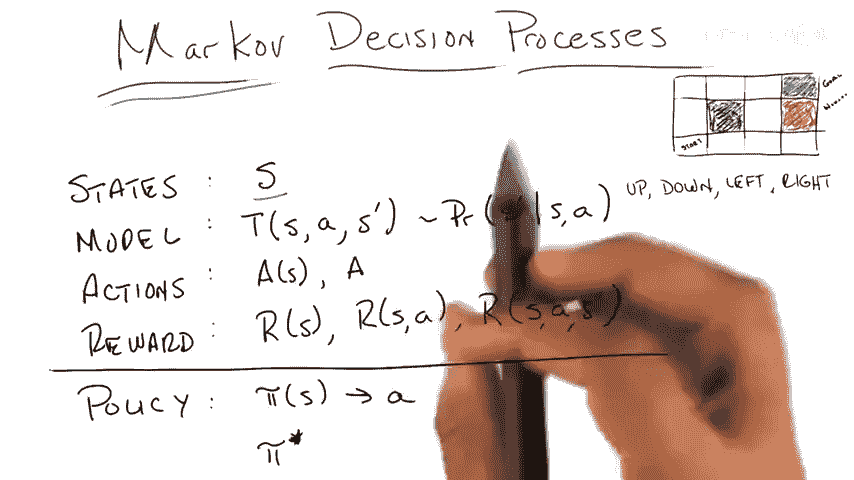
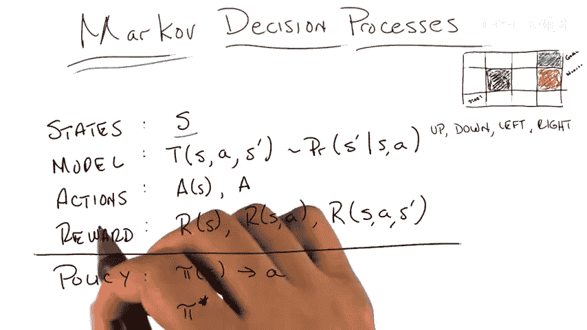
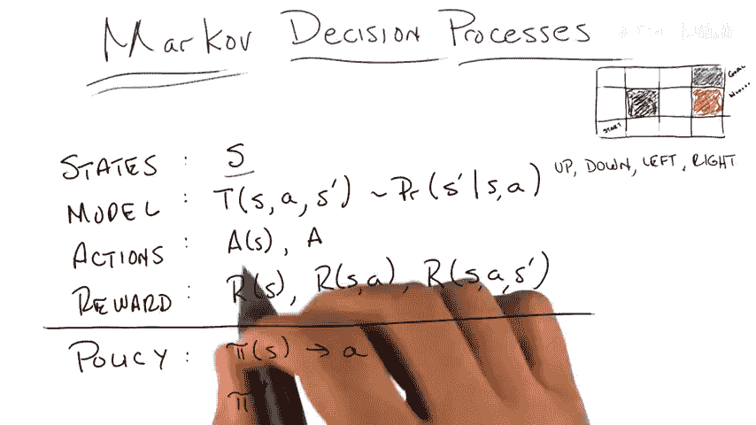
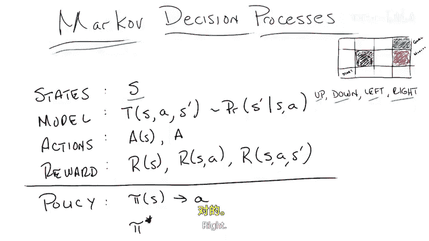
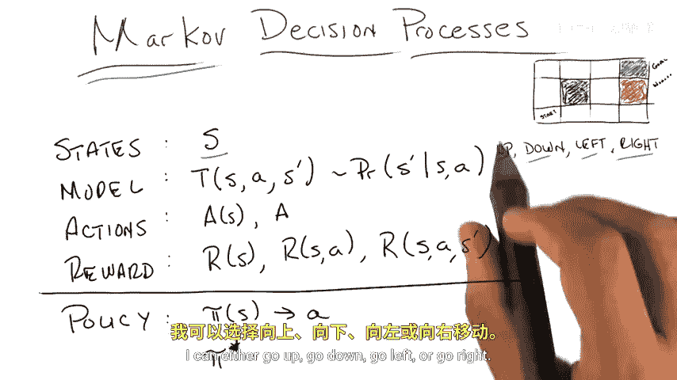
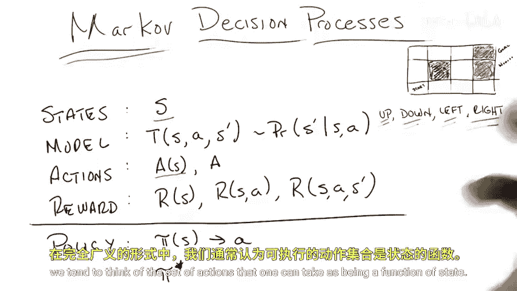
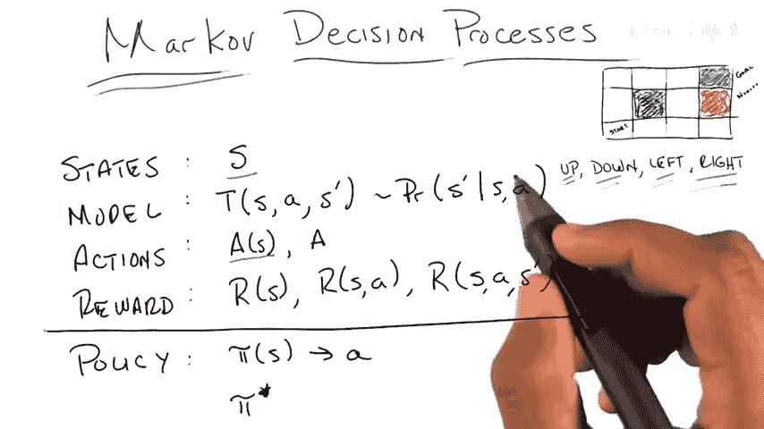
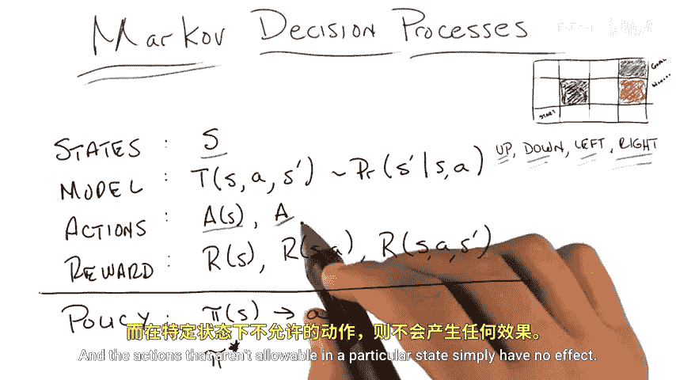

# 佐治亚理工【中英⚡强化学习导论｜CS8803 Introduction to Reinforcement Learning】 p10 P10 Markov Decision Processes - 2 -BV1cJnfzTEBt_p10-

Alright， so we've got states。 So next is what's called the model or the transition model。

 Sometimes people refer to it as a transition function。 And basically。

 it is a function of three variables。 It's a state， an action which I haven't defined for you yet。

 And another state。 In fact， since I haven't defined what an action is for you yet。

 let's skip that and actually do define actions for you。 So the third part of our model or actions。

Actions are the things that you can do in a particular state。

 So what would the actions be in this world Well， the four different decisions I could make were the up down left and right。

Though it's maybe a little confusing because I think those were also the four possible outcomes。

 That's true。 Well， no， there were other outcomes。 You could stay where you were。

So these are actually the actions， these are the things that when I'm in a given state I'm allowed to execute。

 I can either go up， go down， go left or go right， you'll notice that as I described before。

 there was no option not to move。

But there could have been， and there could have been other actions like teleport。

 or there's anything that you can imagine。 But the point is that your action set represents all of the things that the agent。

 the robot， the person or whatever is you're trying to model is allowed to do Now。

 in its full generalized form， we tend to think of the set of actions that one can take as being a function of state because there are some states you can do some things and some states you can't do those things。

 But most of the time people just treated as a set of actions and the actions that aren't allowable in a particular state simply have no effect。

 So we understand states there， the things that describe。

