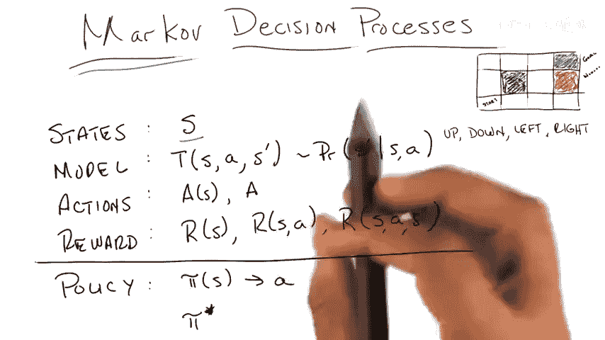
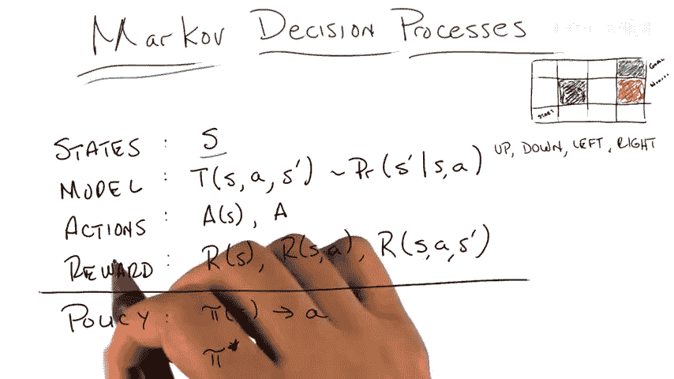
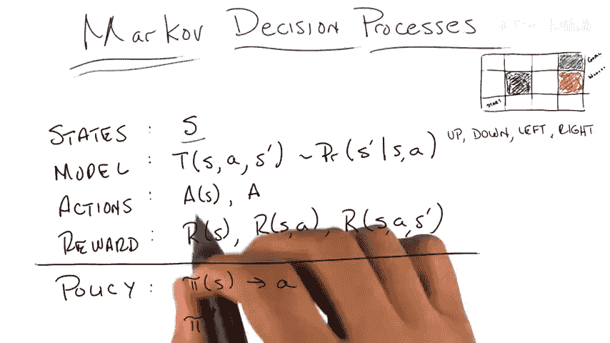
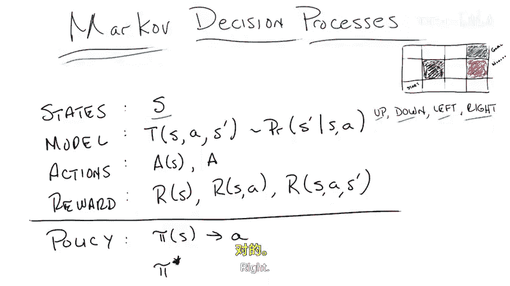
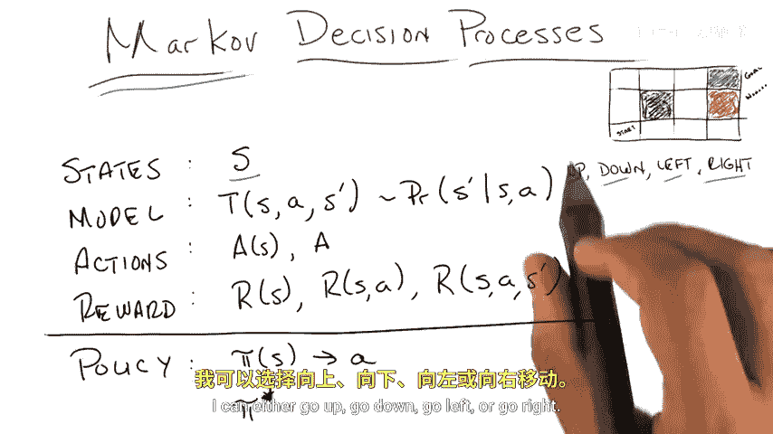
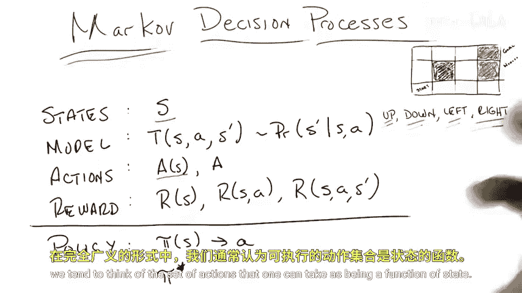
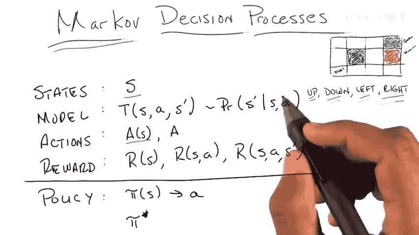
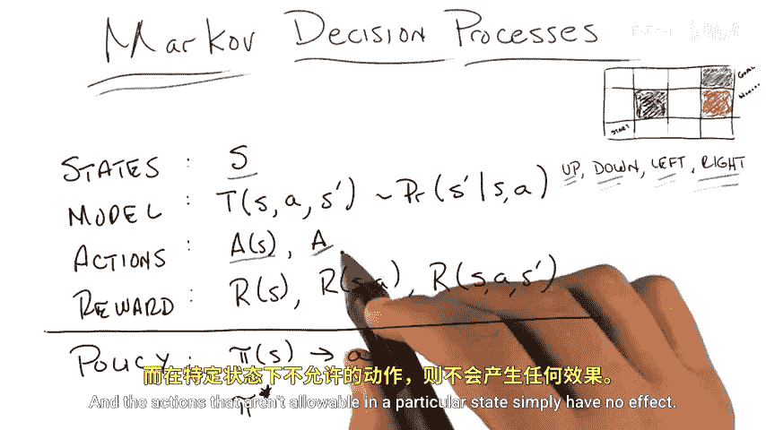

# 强化学习导论：P10：马尔可夫决策过程 - 2

在本节课中，我们将继续学习马尔可夫决策过程的核心组成部分。我们将重点介绍**动作**和**转移模型**这两个关键概念，并理解它们如何共同定义了智能体与环境的交互规则。

上一节我们介绍了**状态**，它是描述环境在特定时刻状况的变量。本节中我们来看看智能体在环境中可以做什么，以及环境如何响应这些行为。

## 动作

**动作**是智能体在特定状态下可以执行的操作。在之前提到的网格世界例子中，智能体在每个格子（状态）中可以做出的决策就是动作。

以下是网格世界中智能体可用的动作集合：
*   向上移动
*   向下移动
*   向左移动
*   向右移动

需要注意的是，在这个例子中，智能体没有“不移动”的选项，但理论上可以存在。动作集合可以包含任何你能想象到的操作，例如“传送”。通常，我们将智能体（机器人、游戏角色等）所有允许执行的操作集合称为**动作集**。

在更一般化的形式中，可执行的动作集可能是状态的函数，因为在某些状态下某些动作可能不被允许。但大多数情况下，我们将其视为一个固定的动作集合，那些在特定状态下无效的动作会被简单地视为没有效果。

## 转移模型

理解了状态和动作后，我们来看**转移模型**，有时也称为**转移函数**。它定义了环境动态变化的核心规则。

转移模型本质上是一个关于三个变量的函数：当前状态 `s`、执行的动作 `a` 和下一个可能的状态 `s‘`。其数学形式可以表示为：
`T(s, a, s') = P(s' | s, a)`
这个公式表示：在状态 `s` 下执行动作 `a` 后，环境转移到状态 `s‘` 的概率。

在之前的网格世界例子中，当我们执行“向上”动作时，有多个可能的结果（转移到上方格子、留在原地或滑向两侧），转移模型就精确地描述了每种结果发生的概率。

本节课中我们一起学习了马尔可夫决策过程的两个基本要素：**动作**和**转移模型**。动作定义了智能体的选择空间，而转移模型则量化了环境对这些选择的随机响应。它们是构建智能体决策逻辑和理解环境动态的基础。下一节，我们将在此基础上引入**奖励**函数，它定义了智能体行为的目标。