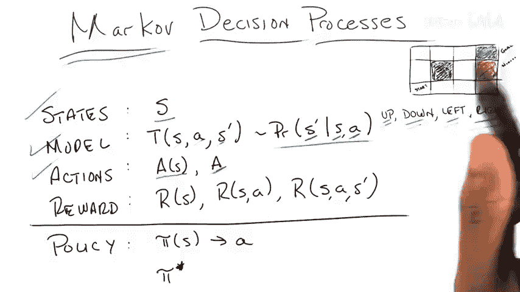
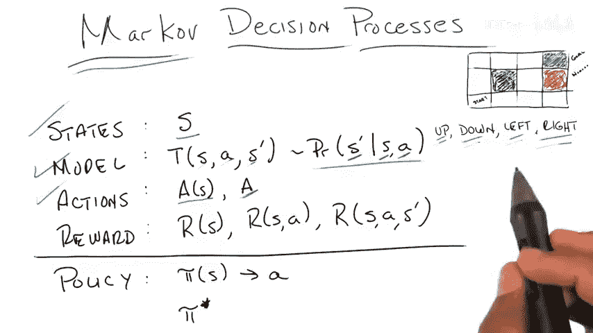
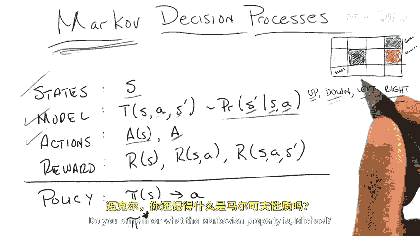
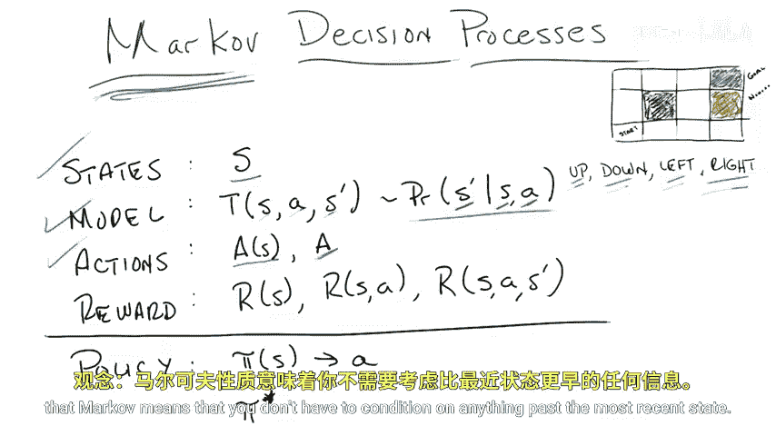
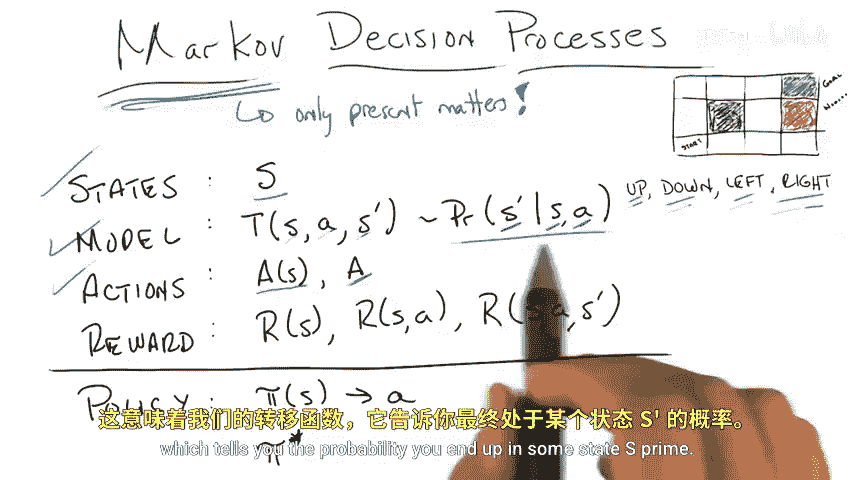
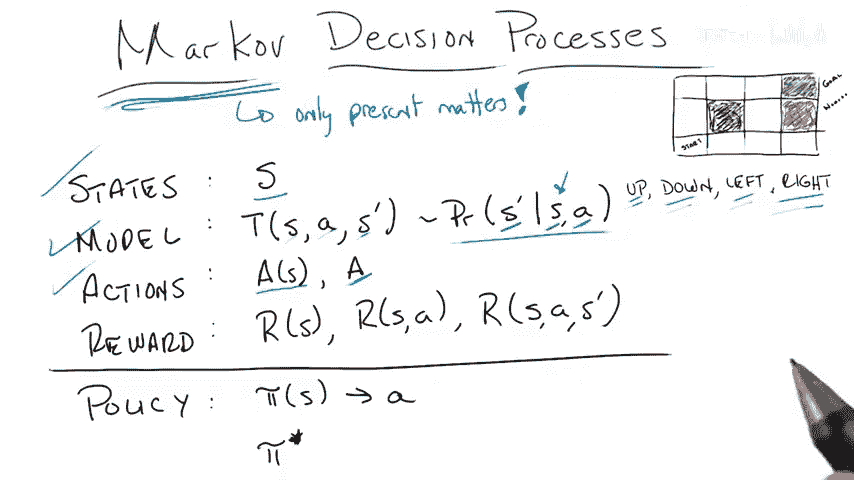
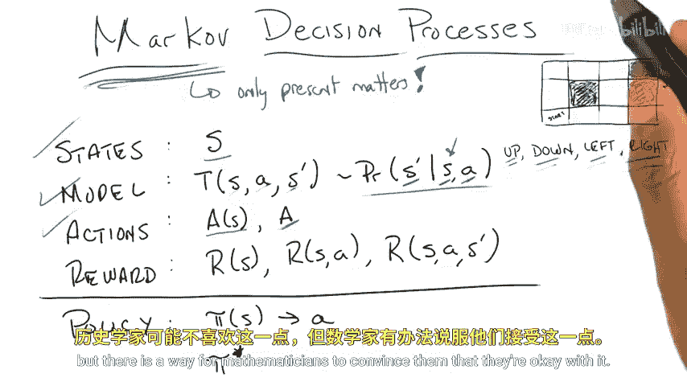

# 佐治亚理工【中英⚡强化学习导论｜CS8803 Introduction to Reinforcement Learning】 p11 P11 Markov Decision Processes - 3 -BV1cJnfzTEBt_p11-

Now， I actually snuck something important in here。 I actually stuck two things that are important in here。

 The first is the what's called the Marovan property。 Do you remember what the Marovian property is。

 Michael。

From what。From， I don't know。 actually， where does the Bovvian property come from。

 I'm going to say Russia， Okay， yeah， from the from the Russian。 Yeah。

 so I have Russian ancestors and they passed on to me this idea that Markoff means。

That you don't have to condition on anything past the most recent state。 That's exactly right。

 The Marovviian property is that only the present matters。

And they had to pass that down to me， you know， one generation at a time， because。You know。

 Markov property， that's exactly right， That was very good， Michael。So what does this mean。

 What this means is our transition function， which tells you the probability you end up in some state S prime。

 given that you were in state S and took action A only depends upon the current state S。

If it also depended upon where you were 20 minutes before， then you would have to have more ss here。

 and then you would be violating the Marovian property。So it's just like， do historians hate this。

 Well， you know， one never learns anything from history。 No。

 you're supposed to learn from history or you're doomed to， I don't know。 Let me make something up。

 Repe it。

Fair enough， historians probably don't like this， but there is a way for mathematicians to convince them that they're okay with it。

 And the way that you mathematicians convince you that you're okay with it is to point out that you can turn。

