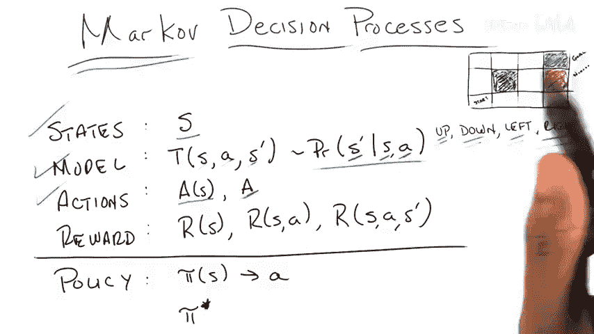
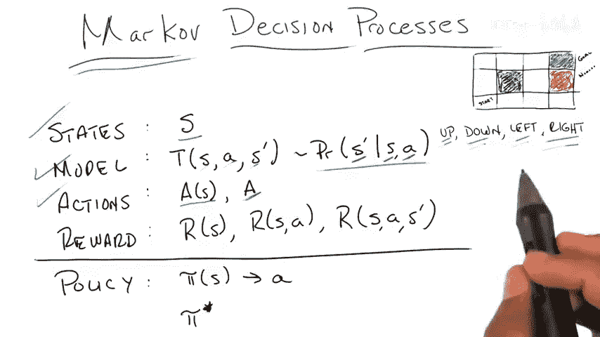
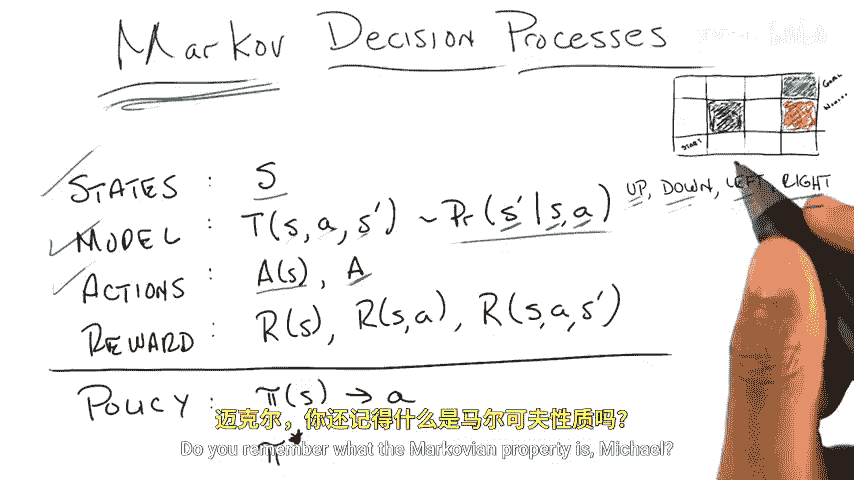
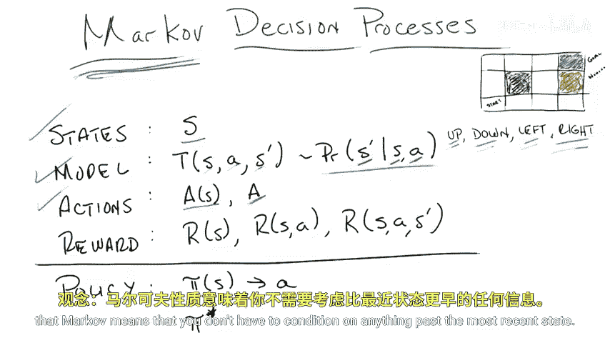
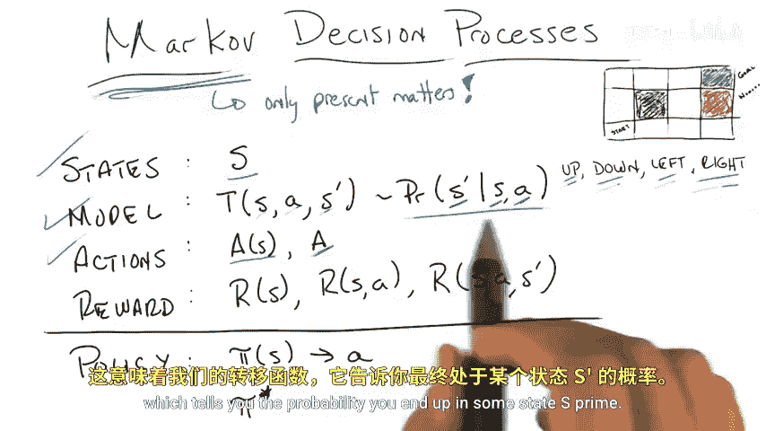
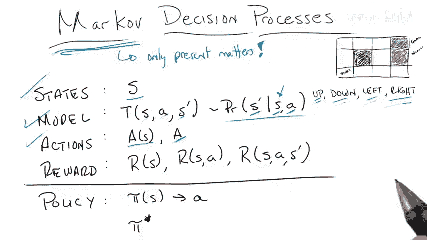
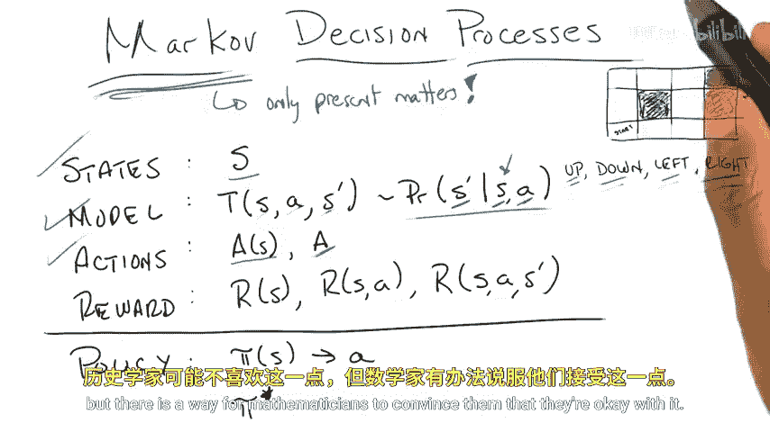

# 强化学习导论：P11：马尔可夫决策过程 - 3

在本节课中，我们将要学习马尔可夫决策过程（MDP）中的一个核心概念——**马尔可夫性质**。我们将探讨它的定义、重要性，以及它如何简化我们对状态转移的建模。

---

上一节我们介绍了MDP的基本框架，本节中我们来看看一个嵌入其中的关键特性。

现在，我在这里实际上隐含了两个重要的点。第一个就是所谓的**马尔可夫性质**。你还记得马尔可夫性质是什么吗，Michael？

马尔可夫性质意味着，你**无需**考虑过去任何比最近状态更早的信息。这完全正确。马尔可夫性质就是**只有当前状态是重要的**。

这个性质必须一代一代地传给我，因为……你知道的。马尔可夫性质，完全正确，说得很好，Michael。那么这意味着什么呢？

这意味着我们的**转移函数**，它告诉你给定当前状态S并采取动作A后，你进入某个状态S‘的概率，**只依赖于当前状态S**。

如果它还依赖于你20分钟前的状态，那么你就必须在这里加入更多的S，那样你就违反了马尔可夫性质。这就像……历史学家会讨厌这个吗？嗯，你永远无法从历史中学到任何东西？不，你应该从历史中学习，否则注定会……我也不知道。让我编点什么。重复它。

说得对，历史学家可能不喜欢这个，但数学家有办法让他们接受。数学家让你接受它的方式是，指出你可以通过**状态扩展**将非马尔可夫过程转化为马尔可夫过程。

---

本节课中我们一起学习了**马尔可夫性质**。我们明确了它的定义：系统的未来状态仅依赖于当前状态，而与过去状态的历史无关。这个性质是马尔可夫决策过程建模的基石，它极大地简化了状态转移概率 `P(s' | s, a)` 的描述，使我们能够专注于当前状态和动作，而不必追踪冗长的历史序列。理解这一点对于后续学习价值函数和最优策略至关重要。