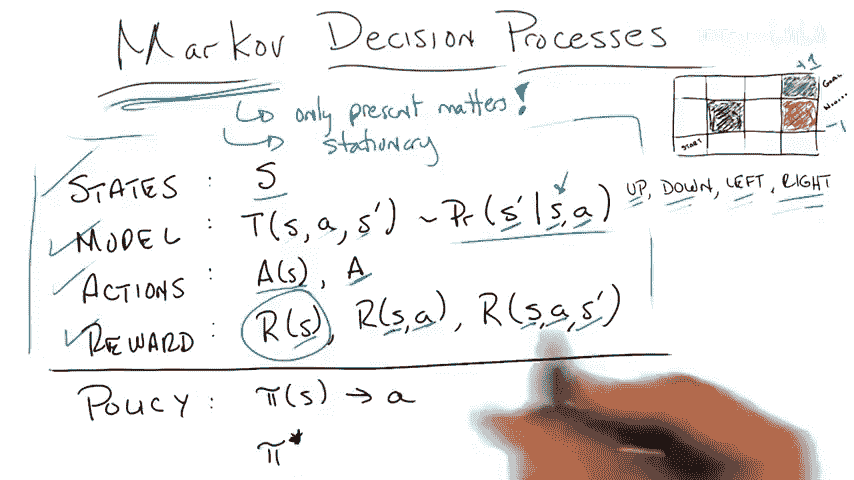

# 佐治亚理工【中英⚡强化学习导论｜CS8803 Introduction to Reinforcement Learning】 p12 P12 Markov Decision Processes - 4 -BV1cJnfzTEBt_p12-

Speaking of solutions， this is the last little bit of thing that you need to know。

 and that is this defines a problem， but what we also want to have whenever we have a problem is a solution。

So the solution to a Markov decision process is something called a policy。

 And what a policy does is it's a function that takes in a state and returns an action。

 In other words， for any given state that you're in， it tells you the action that you should take。

 Like as a hint。 No， it just tells you this is the at wealth。 I mean。

 I suppose you don't have to do it。 But the way we think about Markov decision processes that this is the action that will be taken。

I see。 So it's more more of an order。 Yes， it's a command。OkaySo that's all a policy is。

 a policy is a solution to a Markov decision process， and there's a special policy。

 which I'm writing here is policy star or the optimal policy。

 and that is the policy that maximizes your long term expected reward。

So if all the policies you could take of all the decisions you might take。

 this is the policy that optimizes the amount of reward that you're going to receive or expect to receive over your lifetime。

So like at the end。 Well， yeah， at the end， or at any given point in time。

 how much rewards you're receiving from the Mark of decision process point of view。

 there doesn't have to be an end。Okay， though in this example， you don't get anything。

 And then at the end you get paid off right or unpaid off right if you fall into the red square。

 So actually， your question points out something very important here。

 I mentioned early when I talked about the three kinds of learning that。

