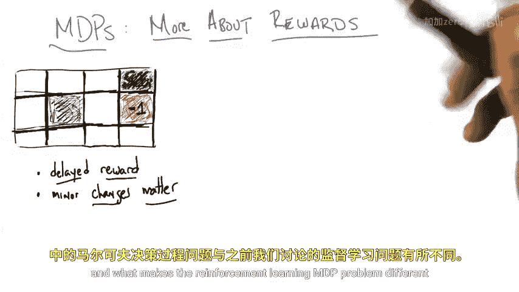
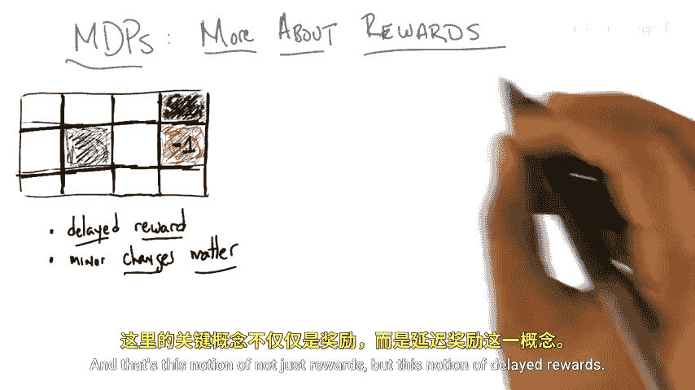
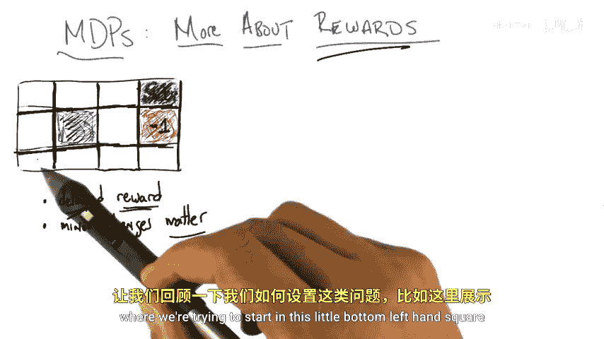
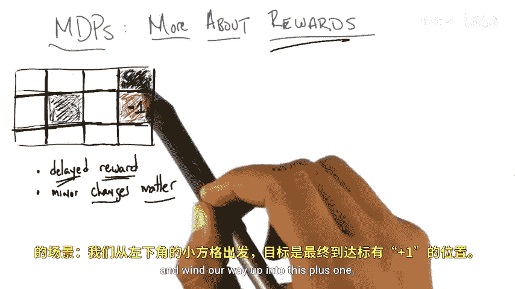
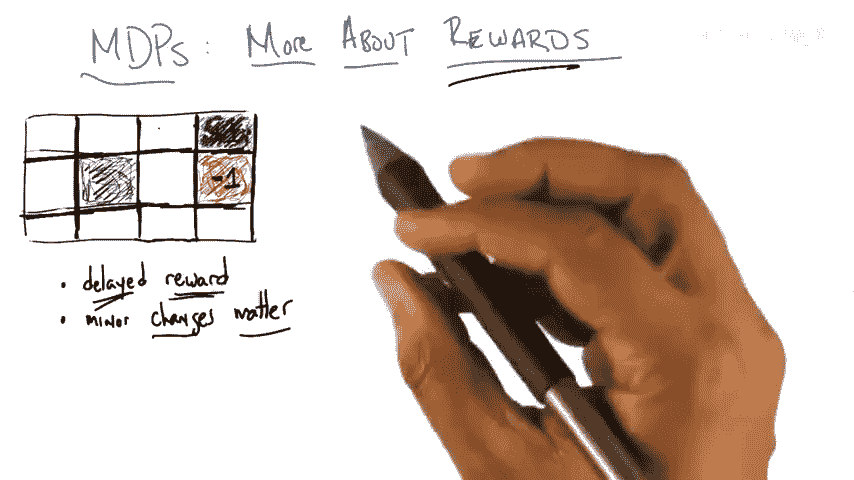
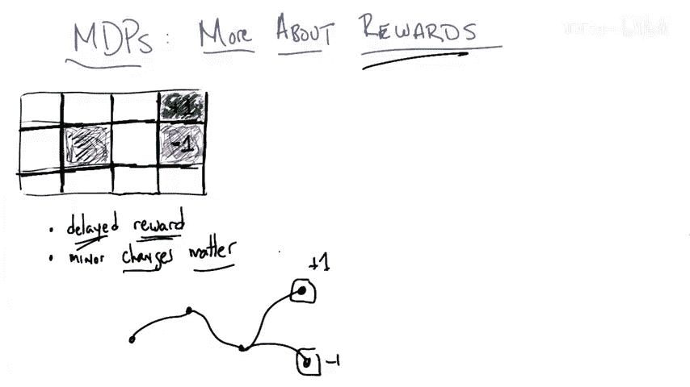

# 佐治亚理工【中英⚡强化学习导论｜CS8803 Introduction to Reinforcement Learning】 p13 P13 More About Rewards - 1 -BV1cJnfzTEBt_p13-

Okay， so I want to talk about two things on this little slide here。

 the first one is kind of a general observation about rewards and what makes the reinforcement learning MDP problem different from the supervised learning problems that we did before and that's this notion of not just rewards but this notion of delayed rewards。

So what do I mean by that， Well， so if you think about the way we've set up this kind of problem like like we have here。

 where we're trying to start in this little bottom left hand square and wind our way up into this plus one。

 there's really this notion of sequences of actions。

 So in the reinforcement learning context and all the things that we're talking about。

 at least in the foreseeable future， there's this sort of problem where you take some action。

And that puts you in some place， and then you take another action and that puts you in some place。

 and then you take another action and that puts you in some place。

 and maybe it puts you at a place where you get plus one。

Or maybe it puts you at a place where you get minus1。

And what really is going on here is this idea that you take actions that will set you up for other actions that will set you up for other actions。

 and only then do you know how good those particular actions you took were So this reward is not just an idea of getting a reward at every state。

 It's an idea of getting delayed reward so you don't know how your immediate action is going to lead to things down the road So let me give a concrete example about that。

 So if you ever played chess Sure， so let's say we played a long game of chess。

 and maybe it took 6061， 62 moves。

