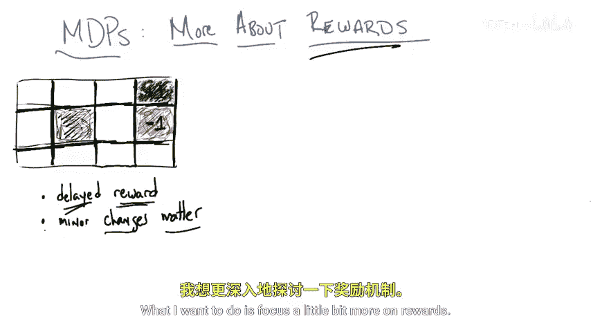
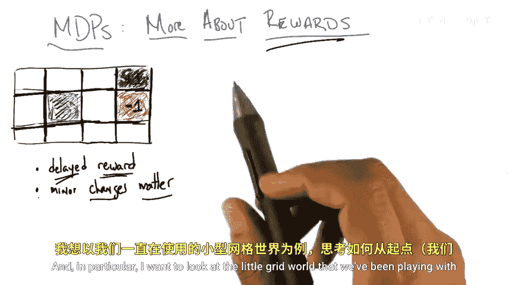
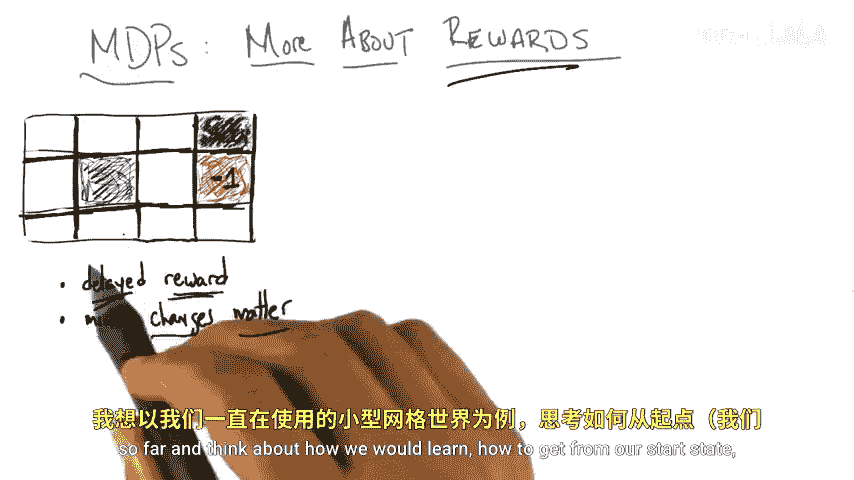
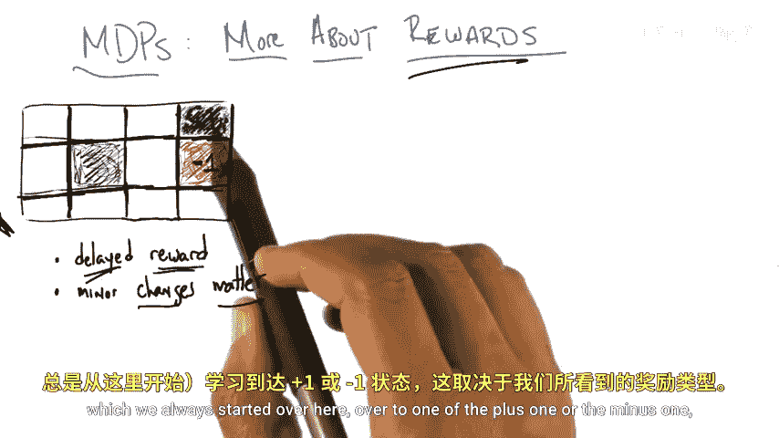
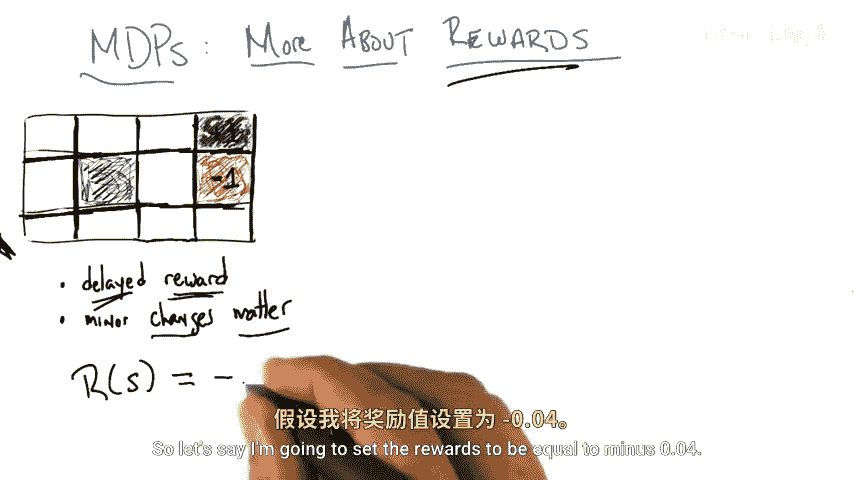
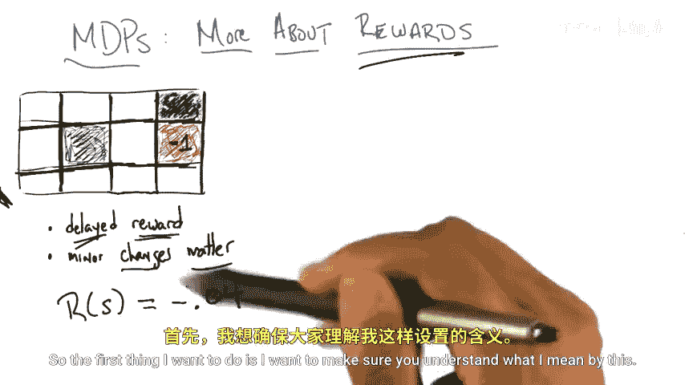
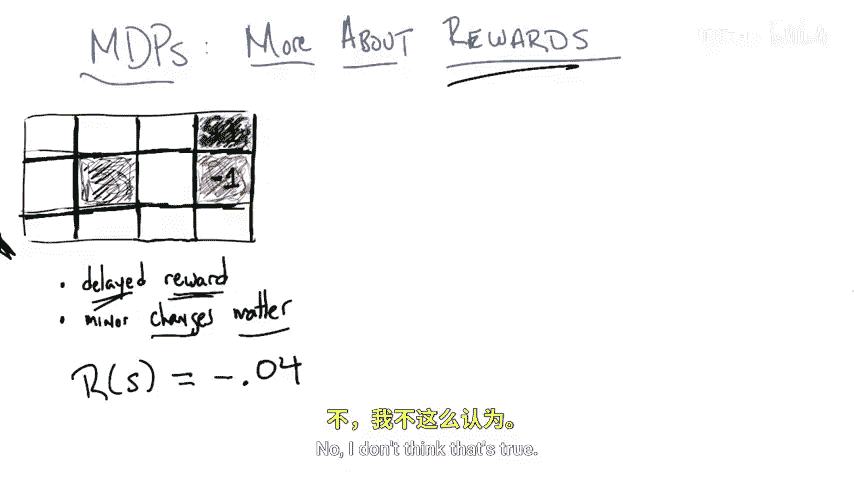
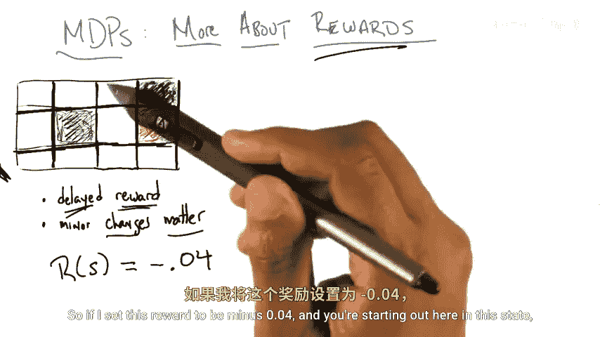

# 佐治亚理工【中英⚡强化学习导论｜CS8803 Introduction to Reinforcement Learning】 p14 P14 More About Rewards - 2 -BV1cJnfzTEBt_p14-

We're really interested in solving this simple credit assignment problem， as we will see。

 as we talk later on in the course， this sort of issue comes up again and again and again。

 but I didn't really want to talk about that in any great detail。

 I just wanted to make certain that people saw the difference between supervised learning and the sort of problems that we're trying to solve now that really it has to do with sequences and Tod what I want to do is focus a little bit more on rewards and in particular。

 I want to look at the little grid world that we've been playing with so far and think about how we would learn how to get from our start state。

 which we always started over here over to one of the plus one or the  minus-1 depending upon the kind of rewards that we see。

 So let's push on this rewards notion for a minute if we think about how MDps are made up。

 And I'm just going to write down for you what the reward is for the states in this particular grid world okay。

So let's say I'm going to set the rewards to be equal to minus 0。04。

So the first thing I want to do is I want to make sure you understand what I mean by this。

 So what I mean when I write this down for this particular example is that the reward that I'm going to receive in every single state is。

04， except， of course， for these two states， which I've already labeled as plus 1 and-1 All right so it seems like you should just never ever move then right No。

 I don't think that's true， let's think about that for a little while。

 So if I set this reward to be 0。04。

And you're starting out。