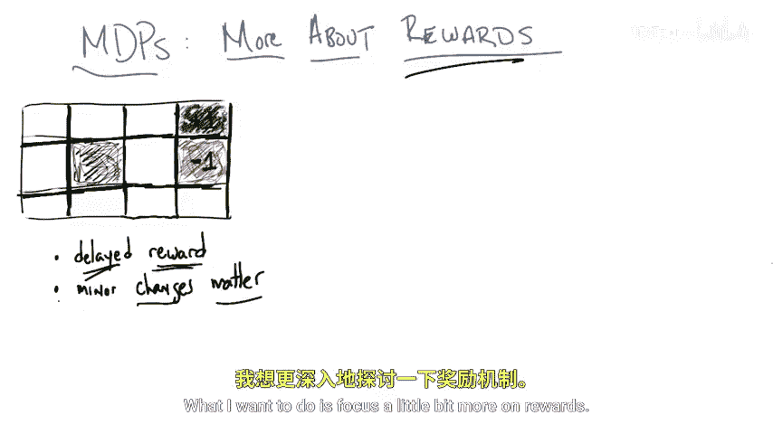
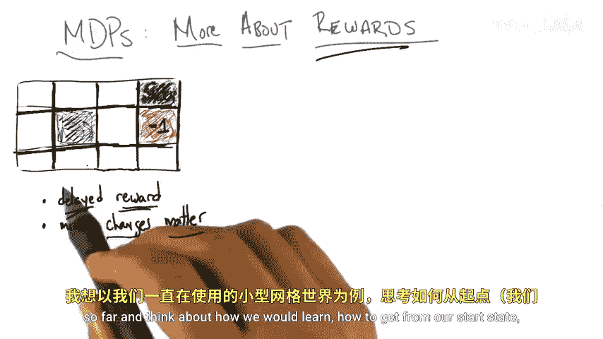
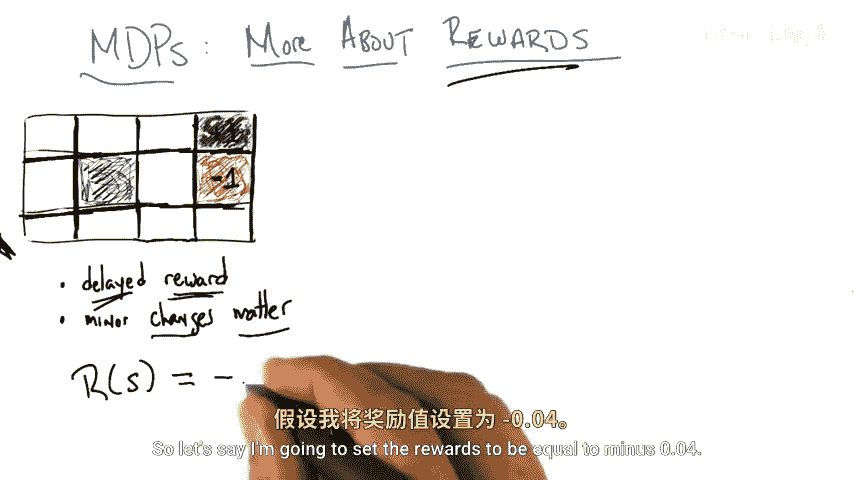
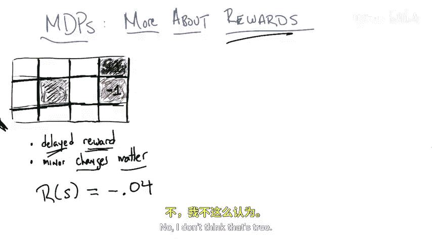

# 强化学习导论：P14：深入理解奖励 - 2

在本节课中，我们将更深入地探讨马尔可夫决策过程中的奖励概念。我们将通过一个具体的网格世界示例，分析如何设置奖励以引导智能体学习到达目标状态，并理解即时奖励与长期回报之间的关系。

上一节我们介绍了信用分配问题，本节中我们来看看如何通过设计奖励函数来解决这类问题。

## 奖励函数的设计

在网格世界的例子中，我们通常从起点状态出发，目标是到达标有+1或-1奖励的终止状态。为了引导智能体学习，我们需要为所有非终止状态设置奖励。

以下是为网格世界设置奖励的一种常见方式：

*   **非终止状态奖励**：`R(s) = -0.04`（对于所有非终止状态`s`）
*   **终止状态奖励**：`R(目标+) = +1`， `R(目标-) = -1`

这意味着，除了两个已标记的终止状态，智能体在**每一个**其他状态都会收到一个微小的负奖励（-0.04）。

## 理解负奖励的作用

你可能会想，如果每一步都有惩罚，那么最好的策略是不是永远不动？答案是否定的。

让我们思考一下：虽然每一步都有-0.04的小惩罚，但停留在非目标状态意味着永远无法获得终止状态的大额正奖励（+1）。智能体的目标是最大化从起点开始累积的**总回报**，而不仅仅是避免即时的小惩罚。

因此，为了获得最终的+1奖励，智能体愿意承受路径上的一系列小负奖励。这个微小的负奖励（通常称为“生存成本”或“步进惩罚”）起到了关键作用：它鼓励智能体寻找**最短路径**到达目标，而不是漫无目的地徘徊。

本节课中我们一起学习了如何通过设计奖励函数（包括生存成本）来引导智能体高效学习。我们明白了即时的小额负奖励可以激励智能体尽快找到到达高奖励目标状态的路径，这是解决序列决策问题的基础。在后续课程中，我们将看到这类信用分配和奖励设计问题会反复出现。