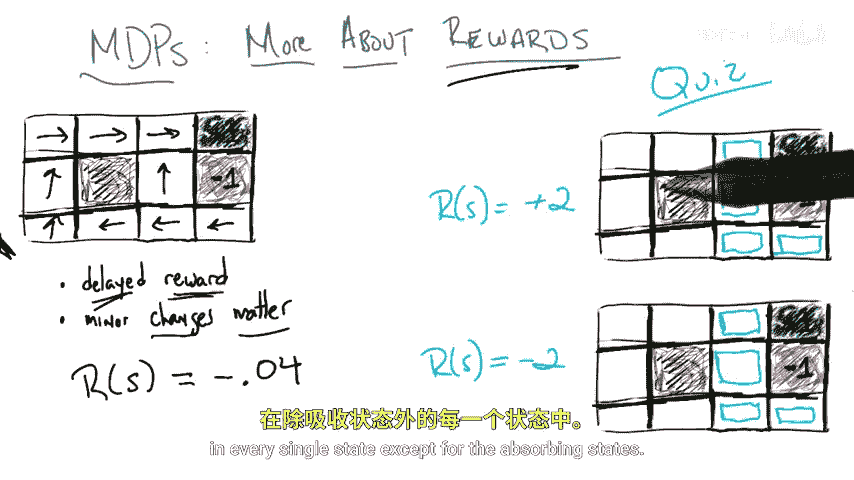
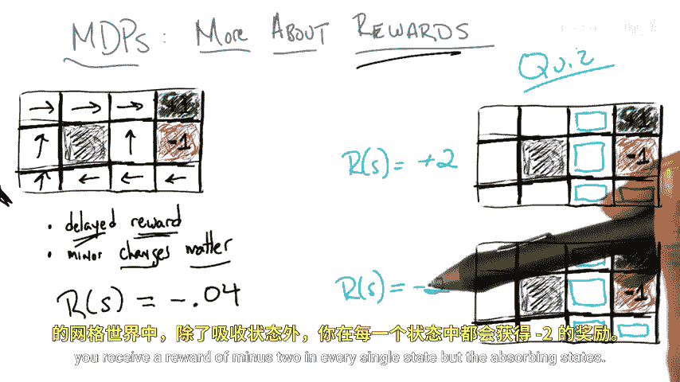
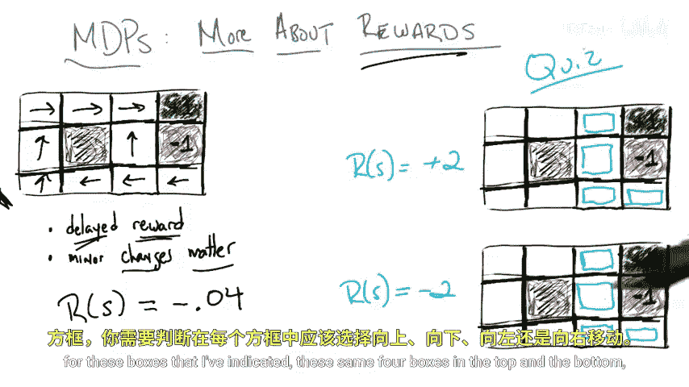
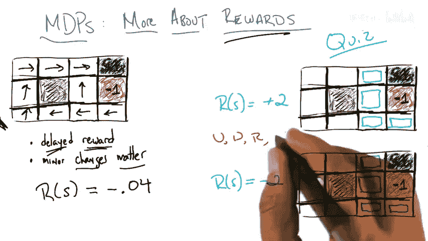
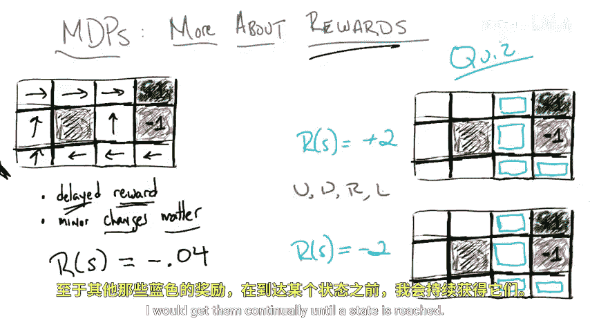

# 佐治亚理工【中英⚡强化学习导论｜CS8803 Introduction to Reinforcement Learning】 p15 P15 More About Rewards - 3 -BV1cJnfzTEBt_p15-

Okay， Michael， so here's the quiz。 Are you ready， sure。Okay， so here's what's going on。

 I have copied over our little grid world over here twice。So it's the same grid world。

 except I have changed the rewards that you will receive in all of the states other than the two absorbing states。

 so for the top one you get a reward of plus two。In every single state。

 except for the absorbing states， and in the bottom one。

 you receive a reward of minus2 in every single state， but the absorbing states got it。

Interesting。So what I'm going to want you to do is I'm going to want you to fill in for these boxes that I've indicated these same four boxes in the top and the bottom。

 whether you should go up down， left or right。 So enter into each one of them either up U D down R right。

 L left， okay。

Yeah， I appreciate you making the numbers nice and big because I was worried you were going to say something like minus point。

1，3。But this I think， no， no， no， that wasn't a suggestion。Yeah， let's go with the plus2 and minus2。

 I feel like there's a better chance I might be able to get it。Okay。

 but so you think you got the what we're trying to do here I do now just to just to keep just to make sure that I'm there。

 the plus one and the minus one end the game and there's no more reward after that's like zero forever and the other things the bluish rewards I would get them continually until a state is reached right exactly where the。

