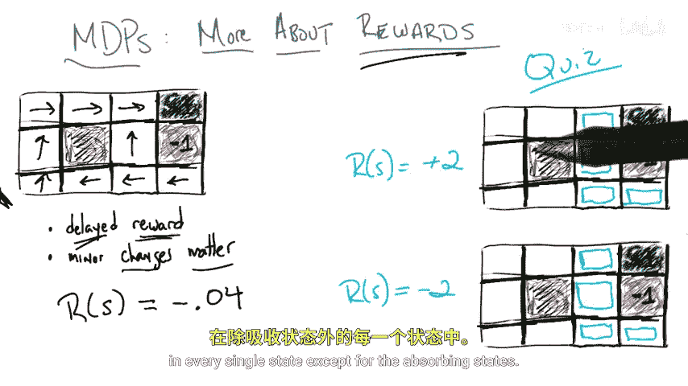
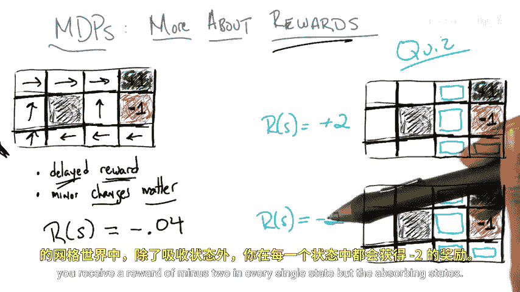
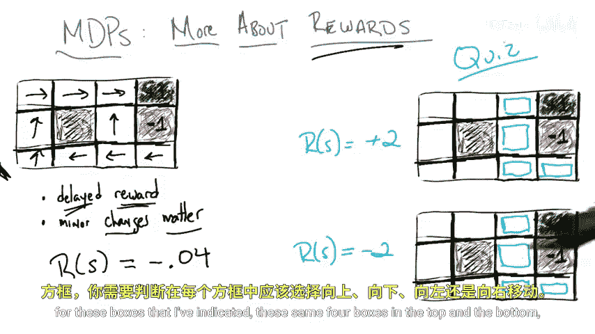
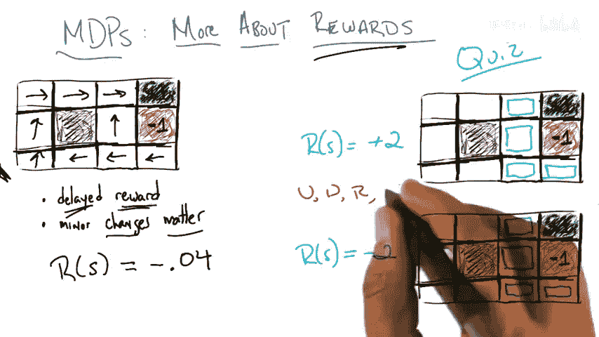
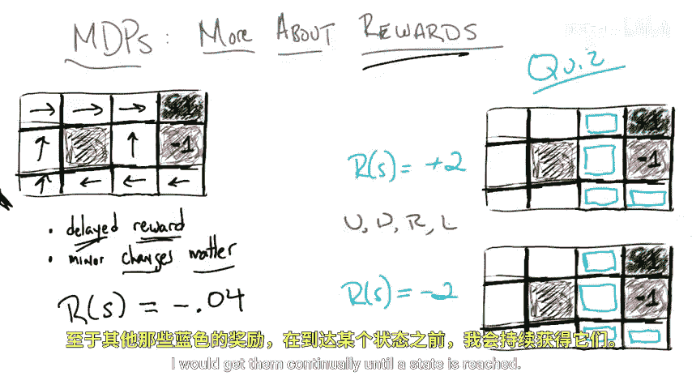

# 强化学习导论：P15：更多关于奖励 - 3

在本节课中，我们将通过一个具体的网格世界示例，探讨不同奖励设置对最优策略的影响。我们将分析在两种不同奖励结构下，智能体应如何选择行动。

## 概述

我们有两个相同的网格世界环境，但它们的奖励结构不同。除了两个终止状态（吸收状态）外，其他所有状态的即时奖励被改变了。我们的任务是分析在这两种情况下，智能体在特定位置应选择的最佳行动方向。

## 问题设置

以下是两个网格世界的图示。它们共享相同的布局，但非终止状态的奖励值不同。

*   **顶部网格世界**：在所有非终止状态中，智能体每步获得 **+2** 的奖励。
*   **底部网格世界**：在所有非终止状态中，智能体每步获得 **-2** 的奖励。
*   **共同点**：两个网格世界都有两个终止状态（吸收状态），分别提供 **+1** 和 **-1** 的奖励，之后游戏结束，不再获得任何奖励。

我们的目标是：为图中标出的四个相同位置（分别在上下两个网格中），判断智能体应该选择的最佳移动方向（上 `U`、下 `D`、左 `L`、右 `R`）。

## 核心概念分析

要解决这个问题，我们需要理解强化学习的核心目标：最大化**累积奖励**。智能体的决策不仅考虑即时奖励，更要考虑长期回报。

上一节我们介绍了奖励函数的基本概念，本节中我们来看看如何通过权衡即时与未来奖励来制定策略。

智能体的目标是最大化期望回报 `G_t`，其通用公式为：
`G_t = R_{t+1} + γ * R_{t+2} + γ^2 * R_{t+3} + ...`
其中 `γ` 是折扣因子（通常 0 ≤ γ < 1），`R` 是奖励。

在这个问题中，我们假设折扣因子 `γ` 小于1（例如 γ=0.9）。这意味着未来的奖励不如当前的奖励有价值。

## 策略推理

基于以上概念，我们可以对两种情况进行推理：

**对于顶部网格（每步+2奖励）**：
*   智能体在到达终止状态前，每一步都能获得正奖励（+2）。
*   因此，智能体的最优策略是**延迟**到达终止状态，以收集尽可能多的+2奖励。
*   具体到行动选择，智能体应**避开**直接通往终止状态的路径，选择绕行以延长在非终止状态的停留时间。

**对于底部网格（每步-2奖励）**：
*   智能体在到达终止状态前，每一步都会获得负奖励（-2）。
*   因此，智能体的最优策略是**尽快**到达一个终止状态，以停止累积负奖励。
*   考虑到两个终止状态的最终奖励不同（+1 和 -1），智能体会选择**尽快到达+1的终止状态**。

以下是针对图中四个位置的具体行动建议分析：

**位置A（左上角附近）**：
*   **顶部（+2）**：应选择远离终止状态的方向，例如向右或向下移动，以在网格中继续徘徊。
*   **底部（-2）**：应选择能最快到达+1终止状态的方向。根据网格布局，这通常是向右移动。

**位置B（中上偏右）**：
*   **顶部（+2）**：应避免直接进入下方的终止状态，可能选择向左或向上移动以延长路径。
*   **底部（-2）**：应直接向下移动，以最快速度进入+1终止状态。

**位置C（中下偏左）**：
*   **顶部（+2）**：应避开右边的终止状态，可能选择向上或向左移动。
*   **底部（-2）**：应向右移动，直接进入+1终止状态。

**位置D（右下角附近）**：
*   **顶部（+2）**：应避开上方的终止状态，可能选择向左或向下移动（如果可能）以继续徘徊。
*   **底部（-2）**：已经非常接近+1终止状态，应直接向上移动进入。

## 总结

本节课中我们一起学习了奖励结构如何根本性地影响强化学习智能体的最优策略。
*   当非终止状态提供**正奖励**时，智能体会倾向于**延迟**达成终止目标，以收集更多即时收益。
*   当非终止状态提供**负奖励**（或成本）时，智能体会倾向于**加速**达成终止目标，特别是回报更高的目标，以最小化累积成本。
这个例子清晰地展示了，智能体的行为不仅由最终目标驱动，更由达成目标**路径上**的体验所塑造。理解这一点对设计合理的奖励函数至关重要。