# 佐治亚理工【中英⚡强化学习导论｜CS8803 Introduction to Reinforcement Learning】 p16 P16 More About Rewards - 3 Solution -BV1cJnfzTEBt_p16-

Okay， Mar， you got answers for me Sure which should I do I need to make any assumption or can I make any assumptions I want about the non blue states no。

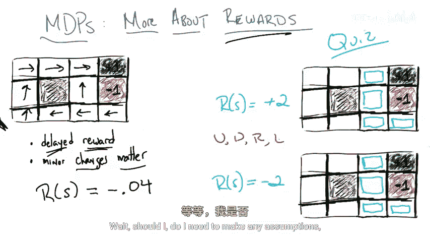

It doesn't matter， actually。So the answer is maybe does。 The answer is no。

 but it doesn't actually matter because remember it's all very stationary and Markovviian。

 So the only thing that matters is where you are。 You're stationary， Markovviian。 All right so。

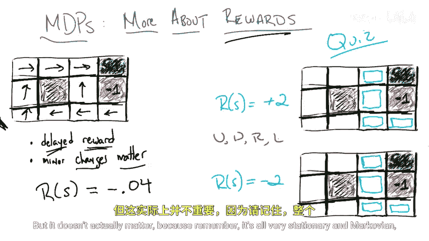

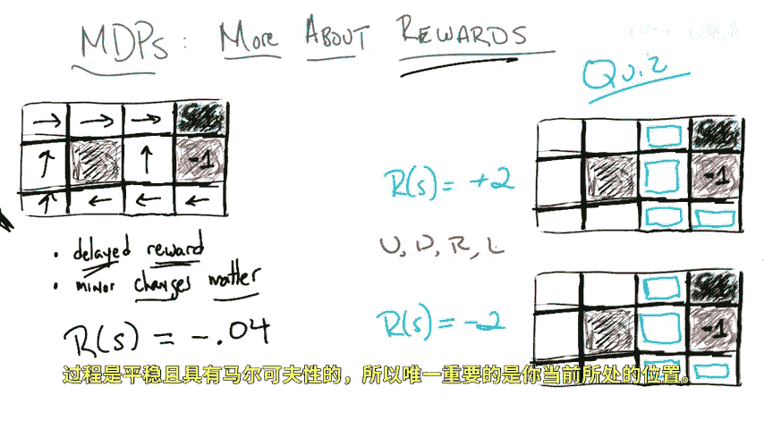

I I think， okay， so let's， let's do the first one then。 So so this is， this is pretty cool。

 So by changing the reward the way that you did， it is now it's not a hot beach anymore。 It's like。

 you know， like super awesome money beach。 Yes， it's like a beach made a bacon。😊。

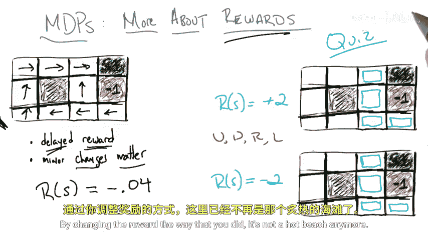

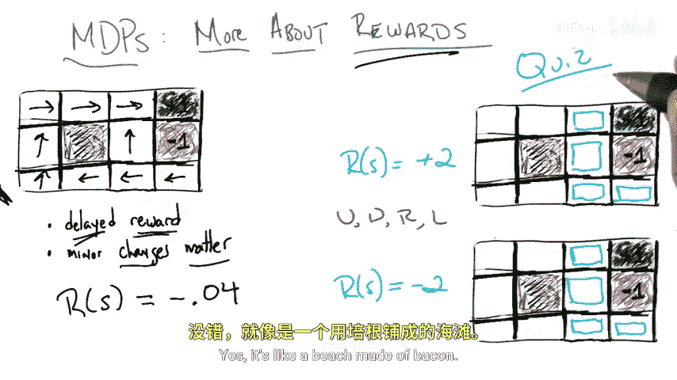

Sure， okay， let's think of it that way， though neither of us are eating bacon at the moment at the moment。

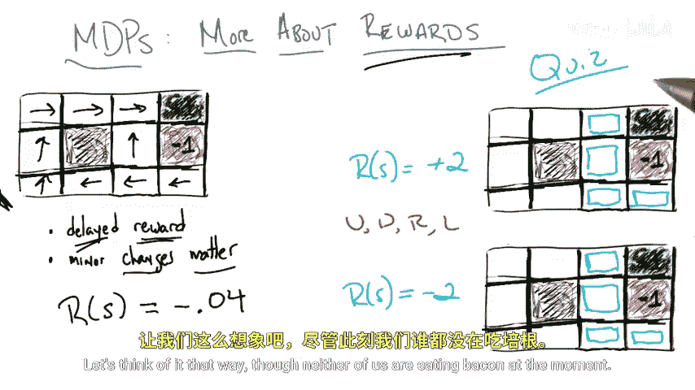

I do because because then our mouths would be full and it would be very difficult to give this lecture。

 Alright， so， no， no， no， no， no， I mean， like even。

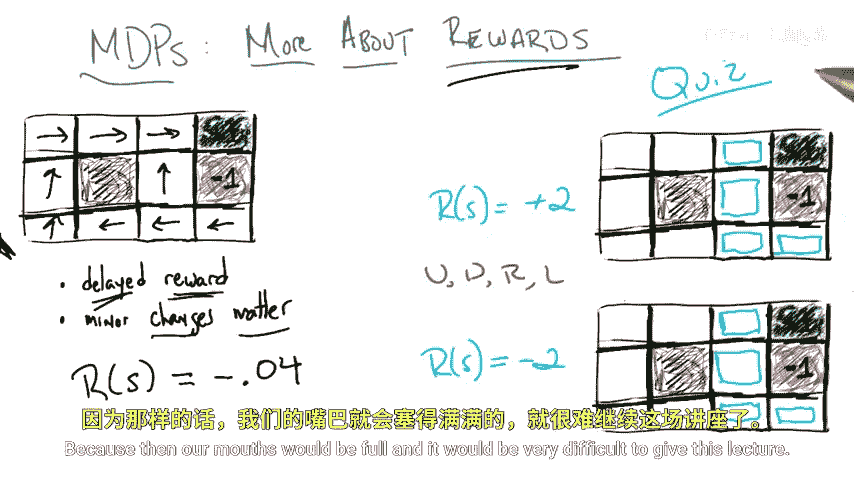

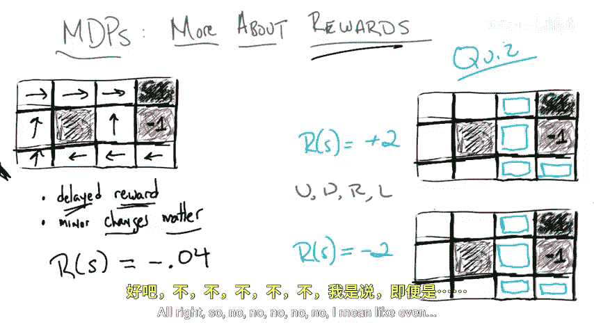

All right， Never mind。 The point is that it's awesome and there's like diamonds。 I don't know。

 I just saw the Hobbit movie and there was a room filled entirely with treasures。

 And so this is kind of like that。 And so now the question is what should I be doing like I should never go to the plus one or the minus one because that ends my treasure gathering。

😊。

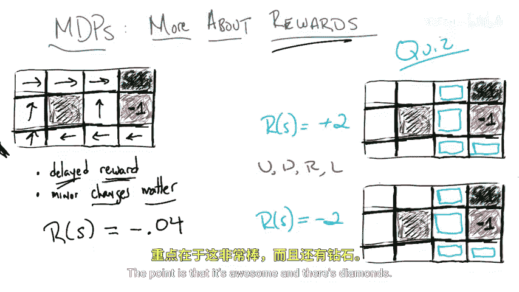

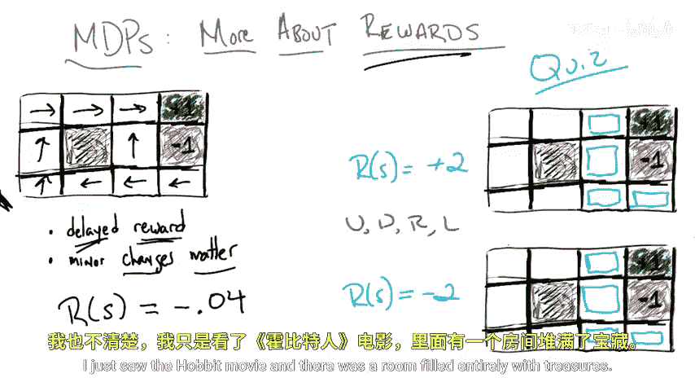

I should just continue to stay in states that aren't those states okay。

 so I would say left for the top state。

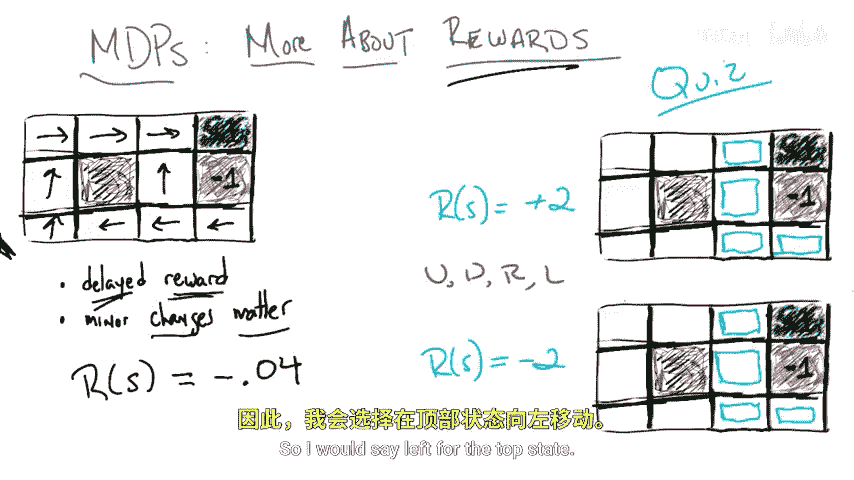

Let's say left for the bottom state。 this one， though yes， I'ming。

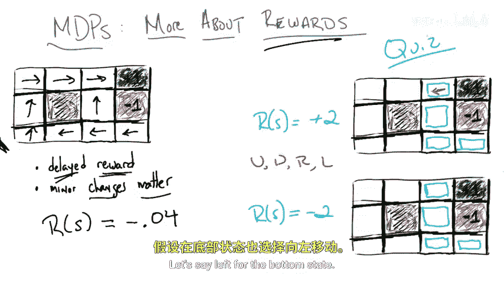

And the。