# 强化学习导论：P16：关于奖励的更多讨论 - 3 解决方案

在本节课中，我们将深入探讨一个具体的强化学习问题，分析如何通过改变奖励函数来影响智能体的最优策略。我们将通过一个网格世界的例子，理解奖励设计如何从根本上改变智能体的行为目标。

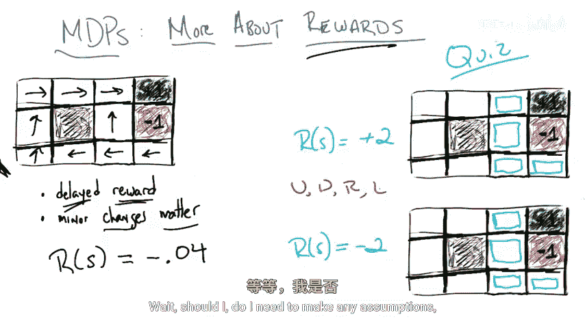

---

好的，Mar，你有答案给我吗？当然，我应该怎么做？我需要做出任何假设吗？或者我可以对非蓝色状态做出任何我想要的假设吗？不。

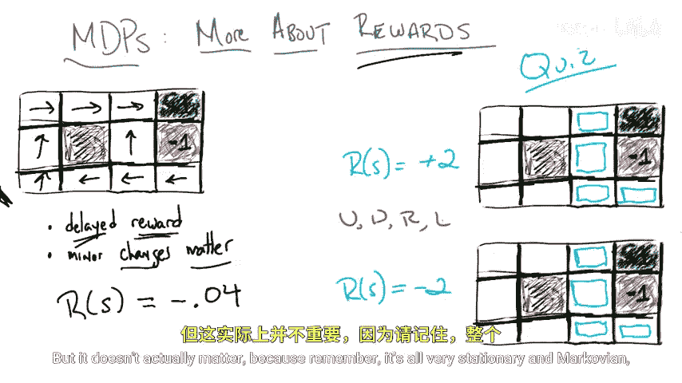

实际上，这并不重要。所以答案是“也许吧”。但答案其实是“不”。

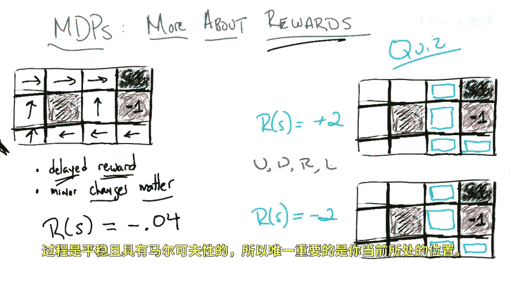

但这实际上并不重要，因为请记住，整个过程是平稳且具有马尔可夫性的。所以唯一重要的是你当前所在的位置。过程是平稳的、马尔可夫性的。好的。

那么，我认为，好吧，我们先来看第一个问题。这其实挺酷的。

通过像你那样改变奖励函数，现在它不再是一个“烫脚沙滩”了。它变成了一个，你知道的，像超级棒的“金钱沙滩”。是的，就像一个由培根铺成的沙滩。

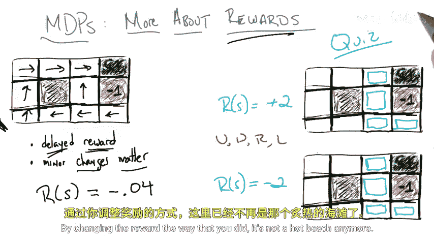

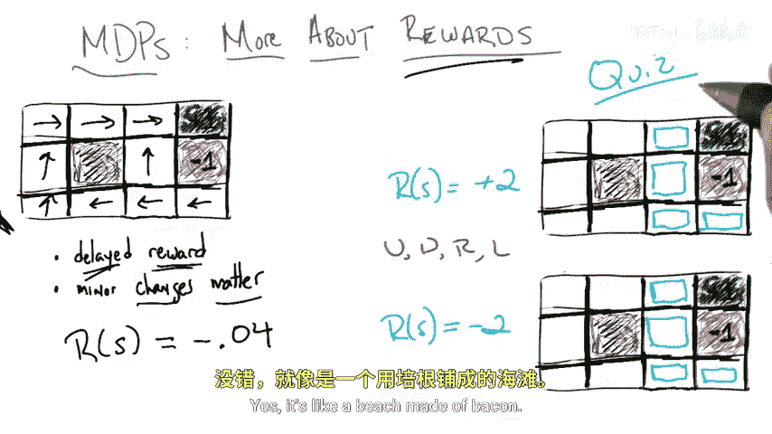

当然，好吧，让我们这样想，尽管此刻我们俩都没有在吃培根。

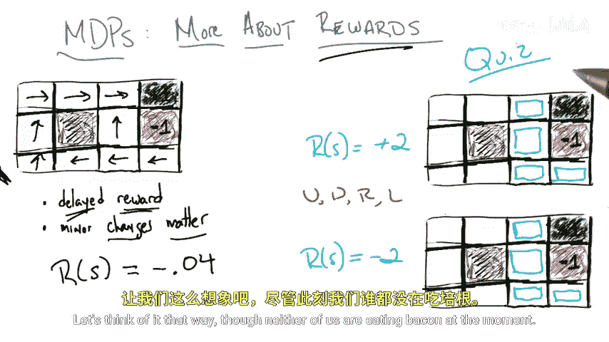

我确实这么想，因为那样的话我们的嘴里就会塞满食物，就很难进行这次讲座了。好吧，不，不，不，不，我的意思是，即使……

好吧，算了。重点是它现在棒极了，而且有像钻石一样的东西。我不知道，我刚刚看了《霍比特人》电影，里面有一个堆满宝藏的房间。所以这有点像那样。

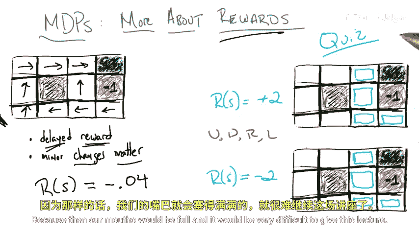

那么现在的问题是，我应该怎么做？我绝不应该去+1或-1状态，因为那会结束我的寻宝之旅。

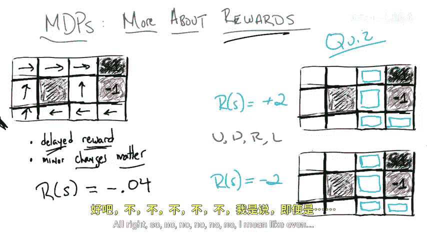

我应该继续停留在那些状态以外的状态。好的。

所以对于顶部的状态，我会选择向左。

对于底部的状态，也选择向左。

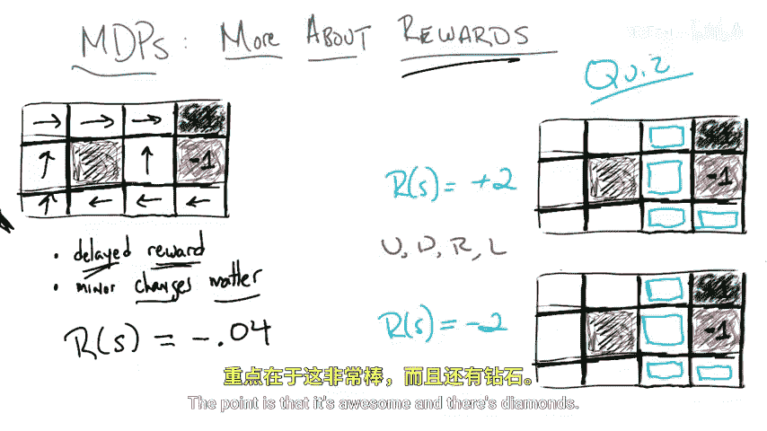

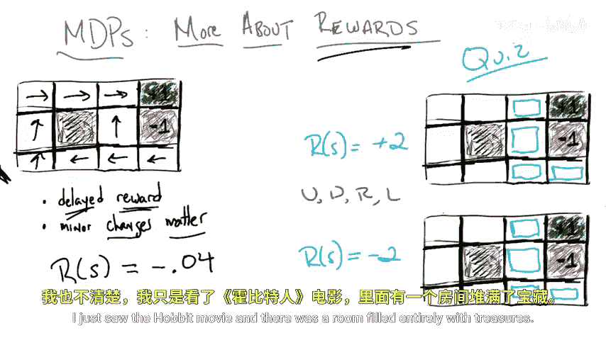

至于这个状态，是的，我正在思考。

---

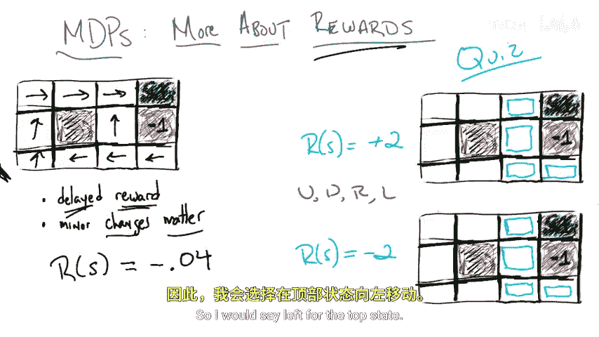

## 总结

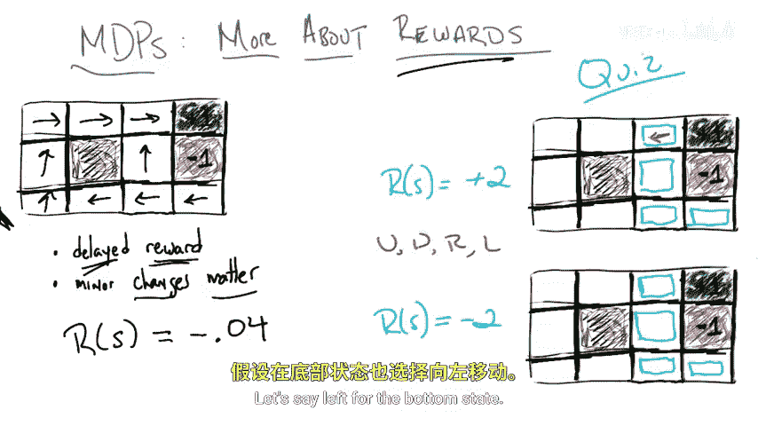

本节课中我们一起学习了奖励函数设计的核心影响。通过一个简单的网格世界案例，我们看到，仅仅改变非终止状态的即时奖励（从负值变为正值），就能将智能体的目标从“尽快逃离”转变为“尽可能久地停留”。这清晰地展示了奖励函数在定义强化学习任务目标中的决定性作用。智能体的最优策略完全取决于我们通过奖励函数所传达的“好”与“坏”。