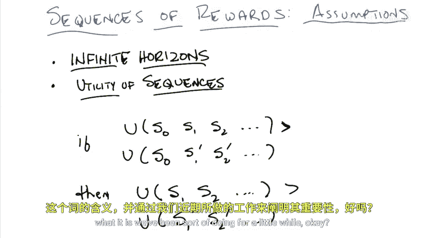
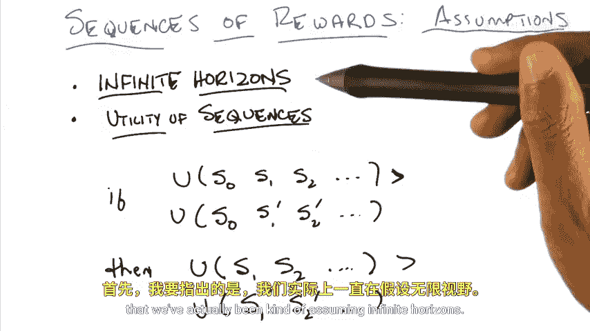
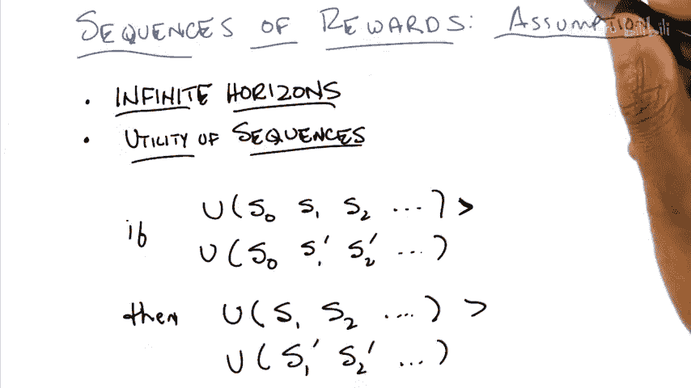
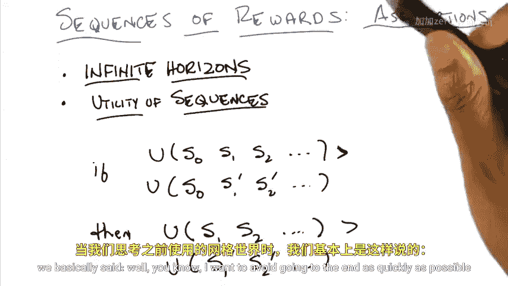
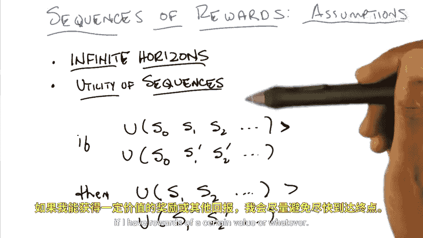
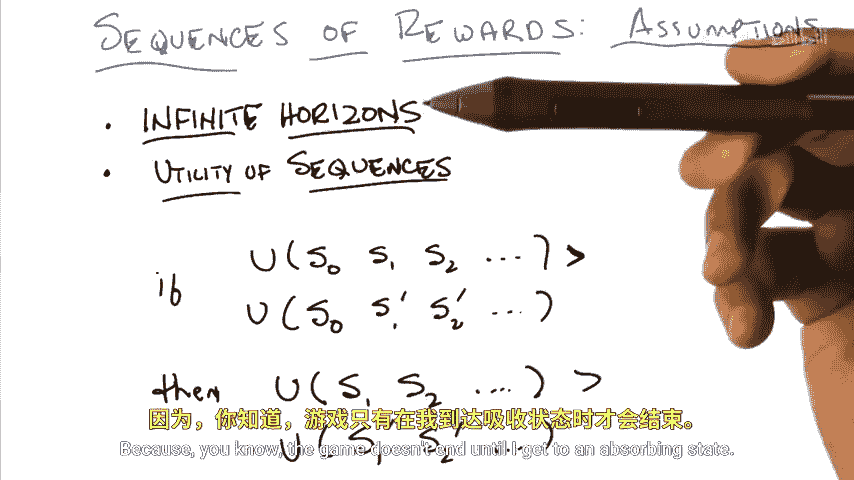
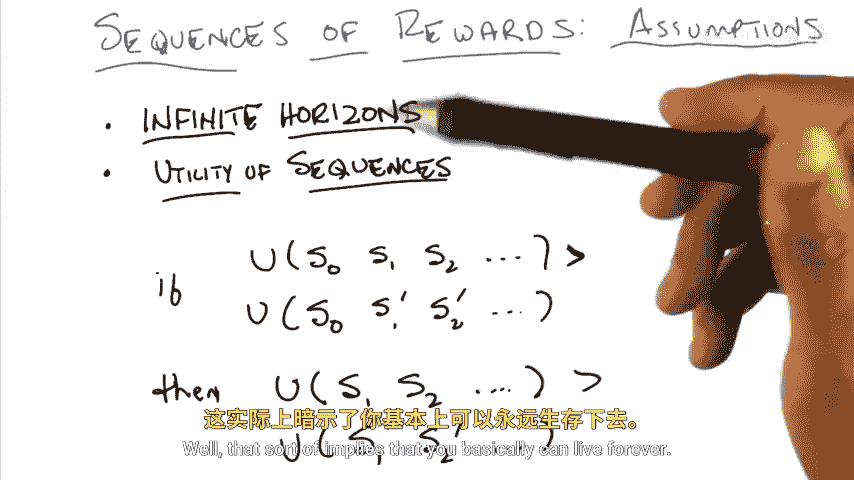
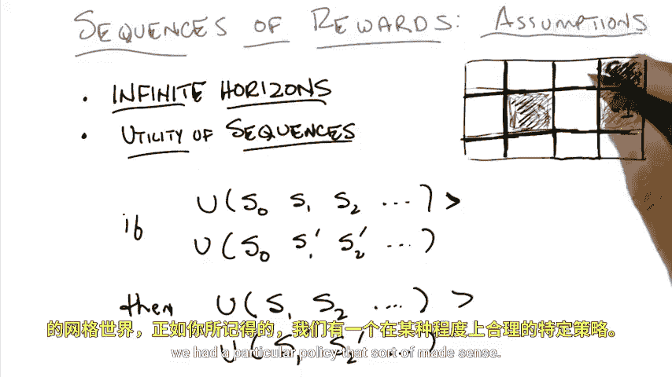
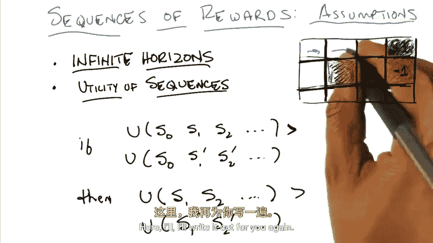
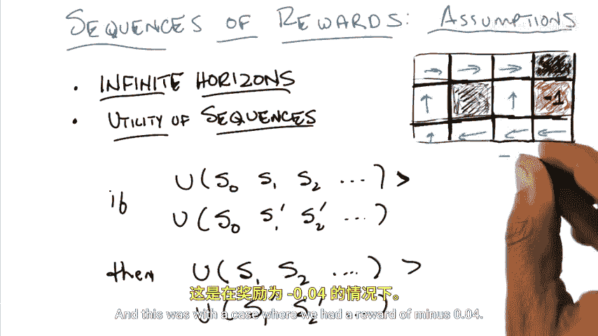

# 佐治亚理工【中英⚡强化学习导论｜CS8803 Introduction to Reinforcement Learning】 p17 P17 Sequences of Rewards - 1 -BV1cJnfzTEBt_p17-

All right， so so having gone through that exercise， Michael。

 I think it' it's worthwhile to step back a little bit and think about the assumptions that we've been making that have been mostly unspoken。

 And I'm going to say that the main assumption that we've been making in some sense。

 boils down to a single word And that word is stationity。 So let me tell you what I mean by that。

 And why if by kind of illustrating what it is we've been sort of doing for a little while。 Okay。

 okay， so the first thing I'm going to say is that we've actually been kind of assuming infinite horizons。

 So what I mean by that。 when when we think about the last grid world that we were playing with。

 we basically said， well， you know， I want to avoid going to the end as quickly as possible。

 if I have rewards of a certain value or whatever， because you know。

 the game doesn't end until I get to an absorbing state。 Well。

 that sort of implies that you basically can live forever。

 that you have an infinite time horizon to work with。

Now can you can you imagine why if you didn't have an infinite time horizon to work with。

 you might end up doing something very different different than what we were doing in the grid world right so here let let me show you the game that we were the grid world we were doing before might help you to think about it。

 So here's the grid what we had before and as you'll recall we had a particular policy that sort of made sense here I'll write it out for you again And this was with a case where we had a reward of 0。

04 remember we just did this remember。

