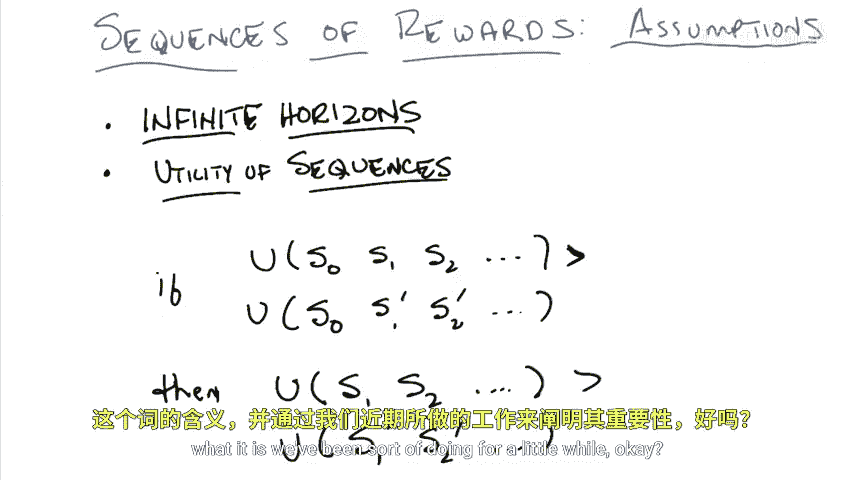
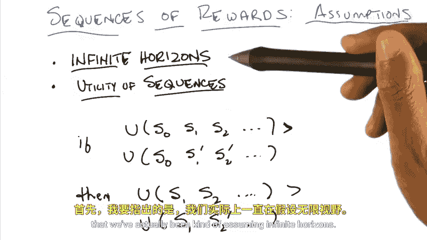
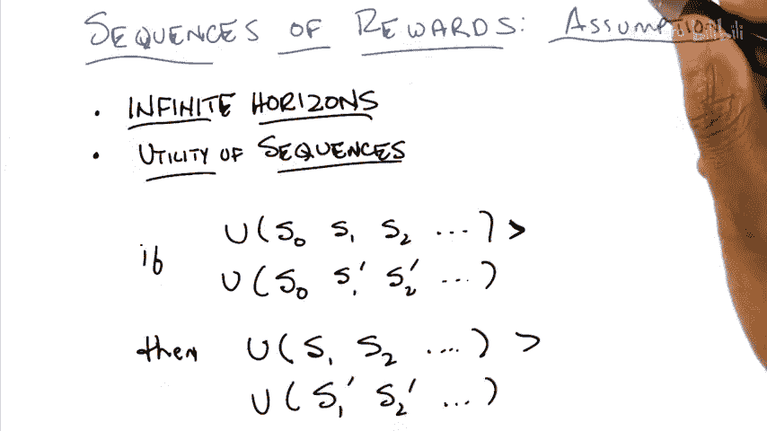
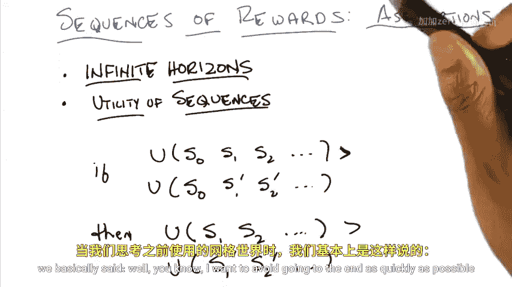
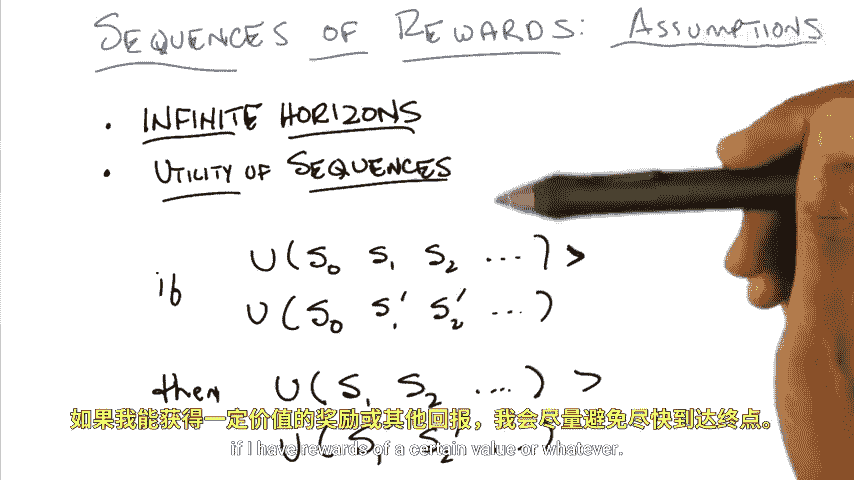
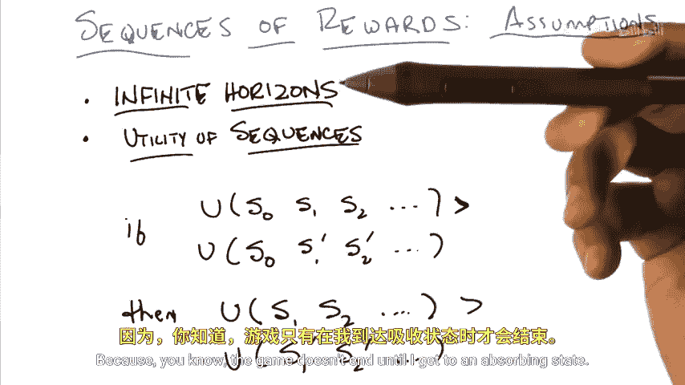
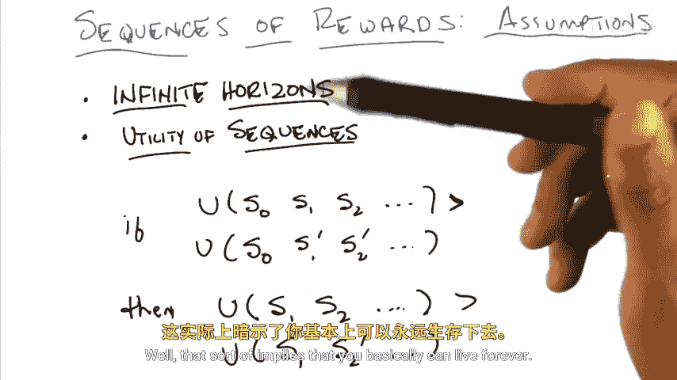
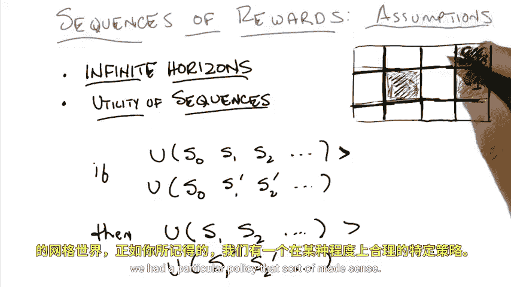
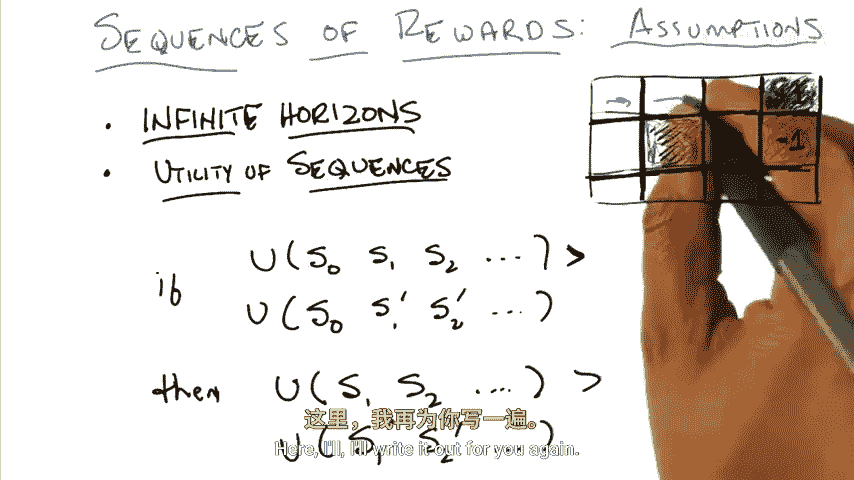
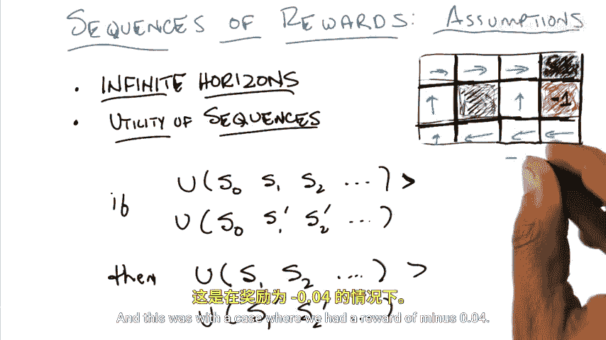

# 强化学习导论：P17：奖励序列 - 1

在本节课中，我们将要学习强化学习中的一个核心假设：**平稳性**。我们将探讨这个假设的含义，并分析当时间视野从无限变为有限时，智能体的行为策略会发生怎样的变化。

上一节我们介绍了在网格世界中进行策略评估和优化的练习。本节中，我们来看看这些练习背后一个未曾明言的核心假设。

这个核心假设可以归结为一个词：**平稳性**。接下来，我将解释这个词的含义，并通过回顾我们之前的做法来阐明这一点。

首先，我们实际上一直在假设一个**无限时间视野**。这是什么意思呢？回想一下我们之前使用的网格世界，我们说过，如果某个状态的奖励值不够高，智能体可能会尽量避免快速到达终点。这是因为游戏只有在到达吸收状态时才会结束。这种设定暗示了智能体可以“永远”存在，拥有无限的时间去行动。

现在，请思考一下，如果智能体没有无限的时间视野，它的行为可能会与我们之前在网格世界中的做法截然不同。为了帮助你理解，让我们回顾一下之前的网格世界示例。

以下是之前使用的网格世界。你会记得，在奖励值为 **0.04** 的情况下，我们推导出了一个特定的、看似合理的策略。让我再次为你写出这个策略。

本节课中我们一起学习了平稳性假设及其在无限时间视野下的体现。我们通过回顾网格世界的例子，初步理解了时间视野对策略选择的重要性。在接下来的课程中，我们将深入探讨有限时间视野会带来哪些不同的挑战和解决方案。