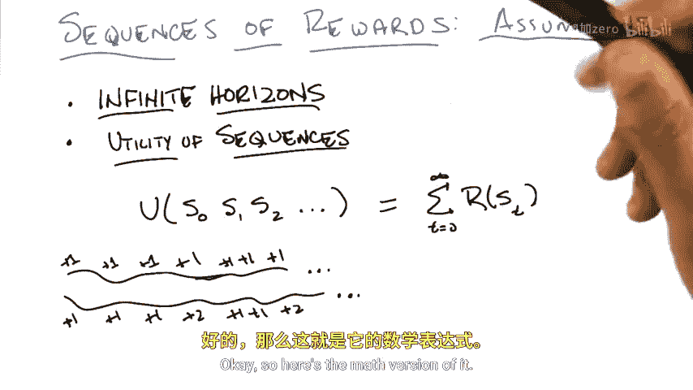
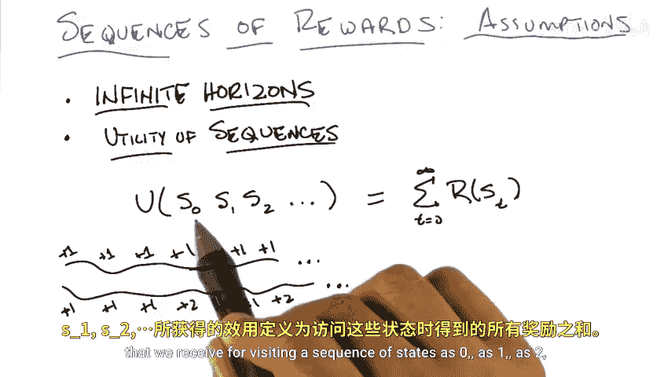
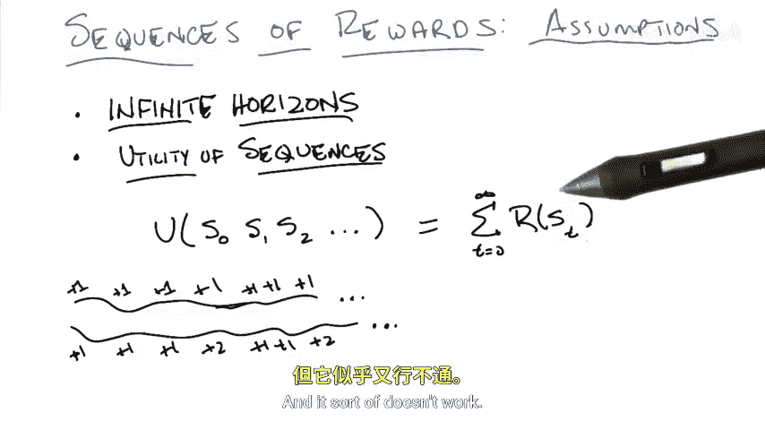

# 佐治亚理工【中英⚡强化学习导论｜CS8803 Introduction to Reinforcement Learning】 p18 P18 Sequences of Rewards - 2 -BV1cJnfzTEBt_p18-

All right， Michael， so let's write that down in math。Okay， you like math， right？ I do。 Okay。

 So here's the math version of it。 I'm going to just say that the utility that we receive for visiting a sequence of states as 0 as  one as 2 ellipsis is simply the sum of all the rewards that we will receive for visiting those states。

 Sure， Does that make sense， Yeah， Does that consistent with what you were doing when you were thinking about the grid world。

 Yeah， exactly。 But I thought we were going。😊。

Make that not definitional。 We were going to derive that it had to be that way。No， we're not。

 The They can read about it。 It take me like an hour and a half to do。 right。

 and I'm already losing my voice， but。What I do want people。

 I want you to believe is that the utility of the sequence of states thinking of it as the sum of all the rewards makes sense。

 right， And nothing else。 at least it makes it's consistent with what you've been doing as we've been talking about this gridid world。

 Yeah， absolutely。 I mean， it also kind of makes me think about money。 Go on。 Well， so， so， I mean。

 that's sort of how money works。 If we get some kind of payoff each day。

 those payoffs get added to each other。 They don't get， you know。

 subtracted or multiplied or square rooted or whatever。 They just， you know。

 they go into your bank account and things add。 So this feels like kind of like that。

 what's like money in my pocket。 Sure， if you have a big enough pocket。 Okay， I'm with you on that。

 All right， so I'm gonna say that this all makes sense， it's really awesome and。😊。

It sort of doesn't work。 And to illustrate why this doesn't work， I'm going to give you a。

