# 佐治亚理工【中英⚡强化学习导论｜CS8803 Introduction to Reinforcement Learning】 p20 P20 Sequences of Rewards - 3 Solution -BV1cJnfzTEBt_p20-

Okay， Michael， I think't give you as much time as I normally do。

 because you think you already know the answer。So what's the answer， So， you know。

 I'd rather get the plus twos occasionally。 So I'll say the bottom one。 No， wait what。

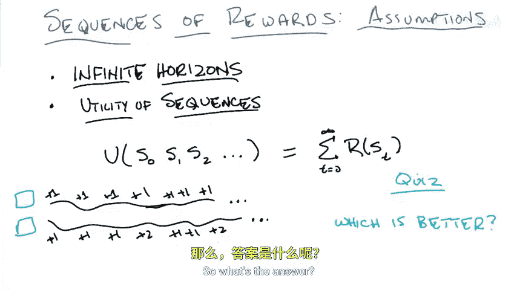

You're not going to tell me the top ones better。 No， it's not。Okay。

 then that feels like a trick question。

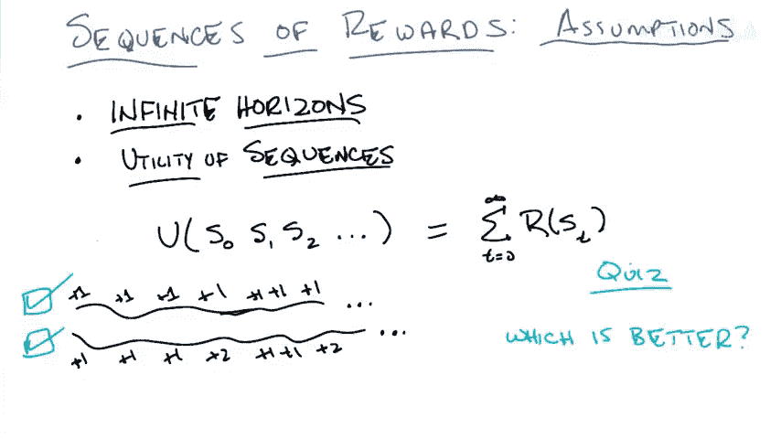

It's not a trick question。 The answer is neither one is better than the other。 Oh。

 so I had to give neither or both， which is better。 And I can click on neither。

 or you could click on both。 Okay， so you thought that the bottom one was better。

 What was your reasoning for that， Because sort of moment to moment， Sometimes I'm getting plus ones。

 And that matches what I would have gotten。 if I had been on the other bank。

 But then sometimes I get plus twos， which is actually better than what I would have gotten on the other bank。

 And so I never feel any regret being on the bottom bank， I only feel regret being on the top bank。

 That's fine。 So what would you say the utility of the sequence along the bottom actually is。

1 plus1 plus2 plus1 plus1 plus2 plus dot dot dot， which is equal to infinity， I guess That's right。

 What about the utility of the top11 plus1 plus1 that's also infinity， Y。

 so the utility of both of those sequences is equal to infinity。

 Do you think one of them is bigger than the other， you drew the bottom one a little bit larger。

 I did or longer anyway。

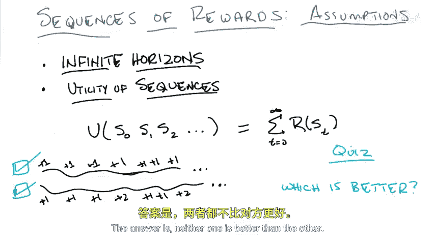

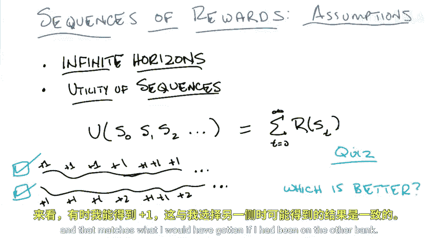

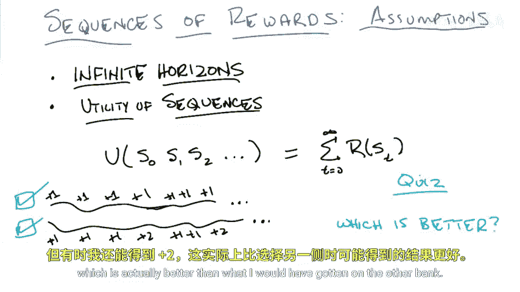

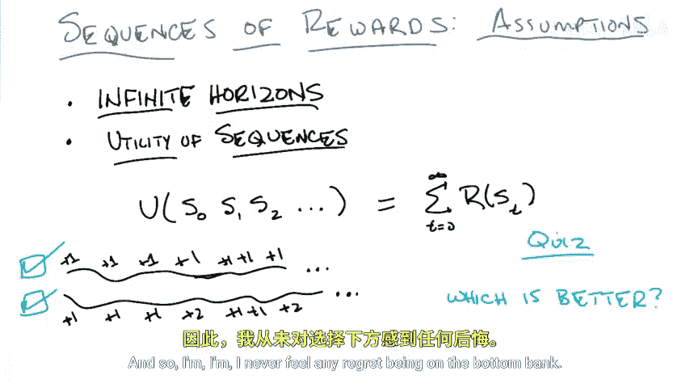

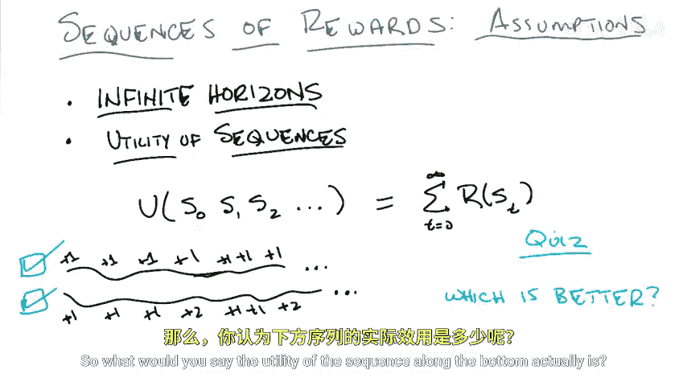

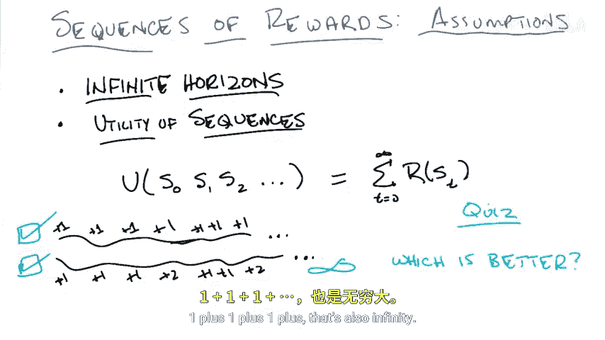

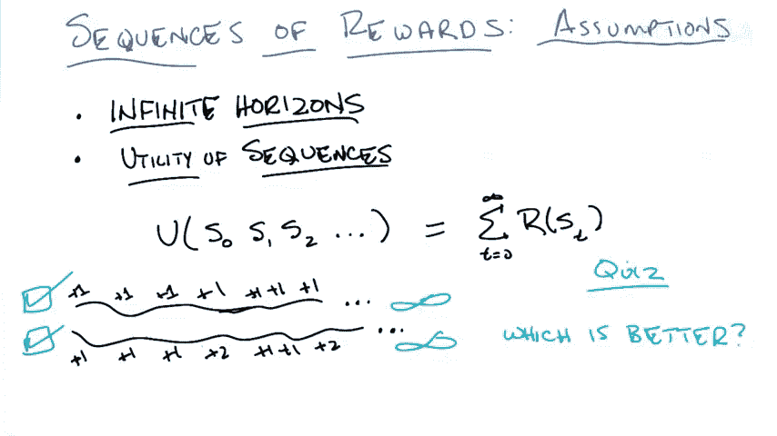

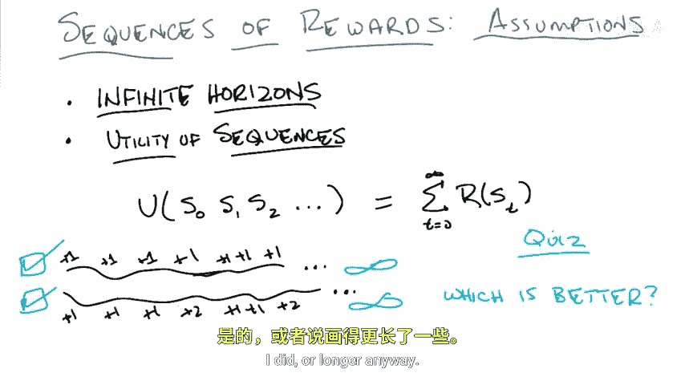

In the end， the sum of the rewards that you get are both going to be infinity。 So the truth is。

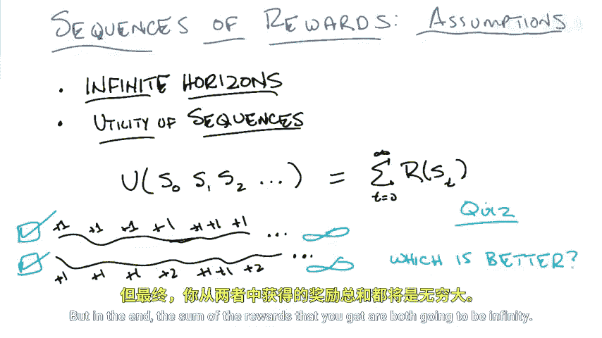

Neither one of them is better than the other。 I still don't think you can say that both are better。

 You can't get around that if but yeah， I see， I see。

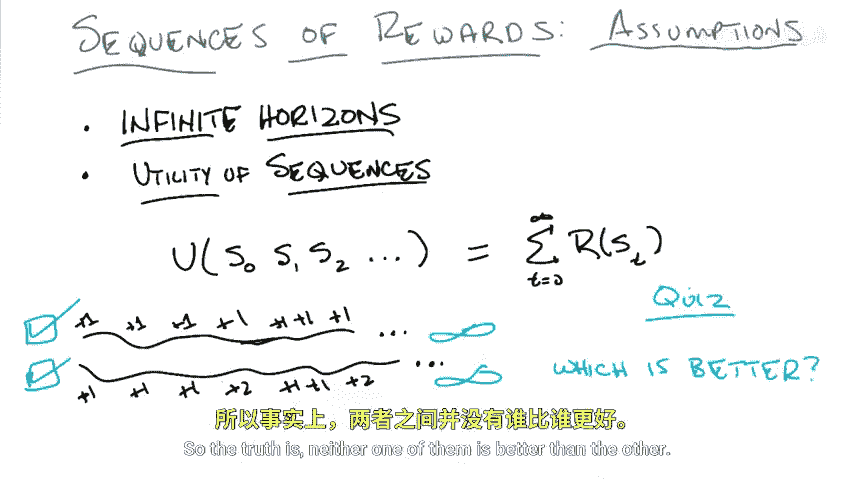