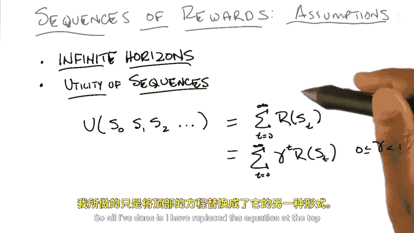
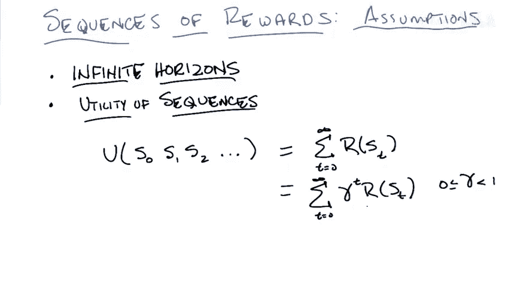
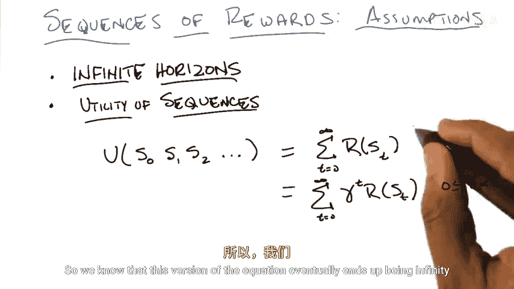
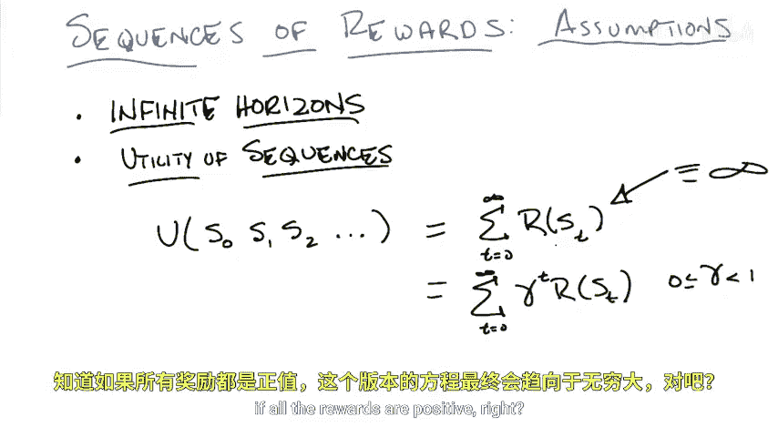

# 佐治亚理工【中英⚡强化学习导论｜CS8803 Introduction to Reinforcement Learning】 p21 P21 Sequences of Rewards - 4 -BV1cJnfzTEBt_p21-

Okay， Michael， so here's the little trick。 So all I've done is I have replaced the equation at the top。

With an alternate version of the equation。 Okay， it looks so it looks like there's you're now exponentially blowing up the reward。

 I am not exponentially blowing up the reward。 Instead what I've done is I've added up the the rewards that I'm going to see for the states that I'm going to see。

And I multiplied it by gamma to the T， but gamma is between0 and1。 I see。

So do you well kind of so so it doesn't exponentially blow up。

 It exponentially implodes right So things that are like1 thousand steps in the future。

 if we multiply， if we take something that's less than one and we raise it to that power。

 It goes essentially to zero。 So it's like it starts off the rewards are kind of substantial。

 and then they get they trail off quickly right， And in fact。

 we can write down mathematically what this is， you actually， if you stared at it long enough。

 and you remembered your intermediate algebra or calculus or wherever it is you learned this stuff。

 you would probably recognize this as a special kind of sequence or series。

 Do you remember what it is television series， No， but that's remarkably close。

 So let's see if we can bound this particular equation。

 So we know that this version of the equation eventually ends up being infinity if all the rewards are positive right。

So what does this end up being？