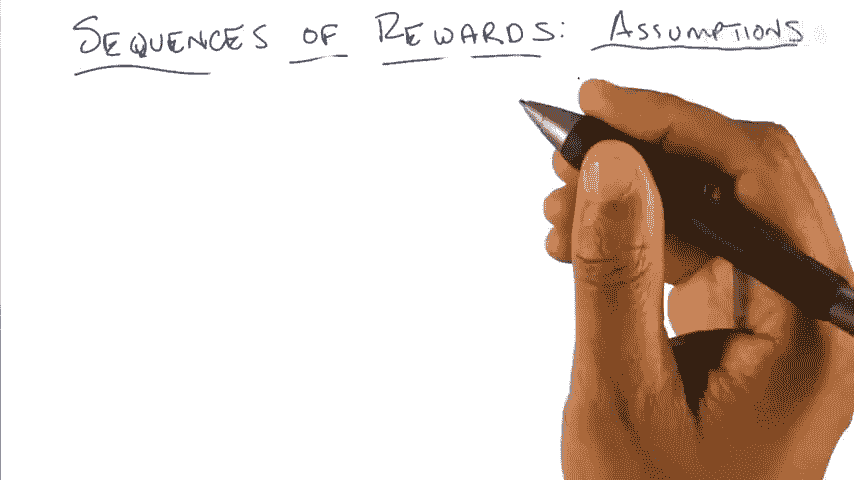
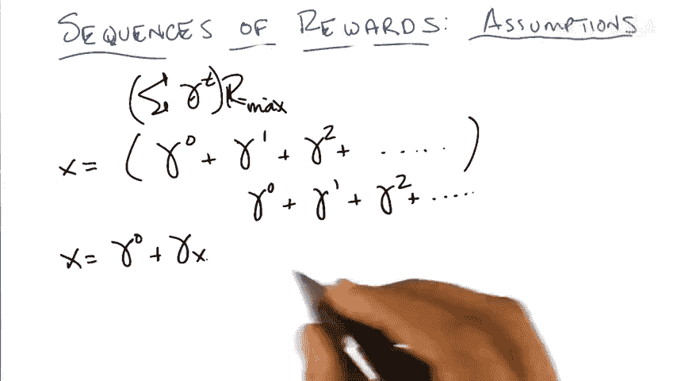

# 佐治亚理工【中英⚡强化学习导论｜CS8803 Introduction to Reinforcement Learning】 p22 P22 Assumptions -BV1cJnfzTEBt_p22-

So if we think about the equation that we were doing before， which was。

 you know the sum of all these gammas。Times some R max。 we can basically take out the R max。

 And what we end up with is something that looks like that， right。

 You're summing together a bunch of gammas and then multiplying the result by R max。

 So what does that actually look like， Well， it looks like this gamma to the zero plus gamma to the1 plus cama squared plus dot dot dot dot eventually multiplied by。

Rax， right？So let's call this x， does x include the RX or not？No。

So we'll just call the little sequence of of it's going to turn out not to matter。

 but let's just call the the sequence of gammas that we're adding together。

 let's just call that x well， if you look at it， this is actually recursive， right？

Because it's an infinite sequence， if you sort of shifted it one over in time。

 you would end up with just the repeated sequence again。

 which means that we can write x in terms of itself。 x equals gamma 0 plus。Gamma times x。

I see so it's shifted over， but then you have to multiply it again by gamma to get up to gamma 1 gamma 2 exactly so this is just。

 you know， it's just math， that's just all it is， so we can try to solve for x and figure out what x is。

