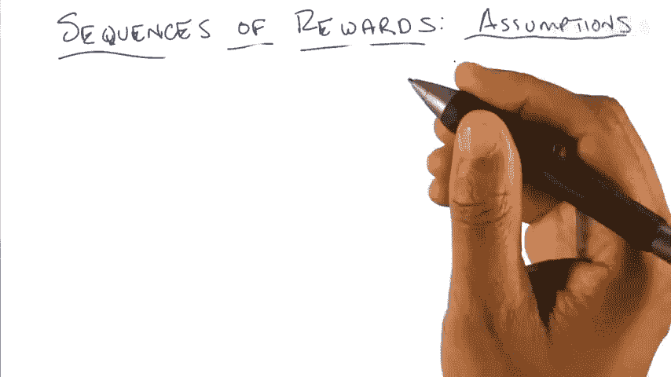
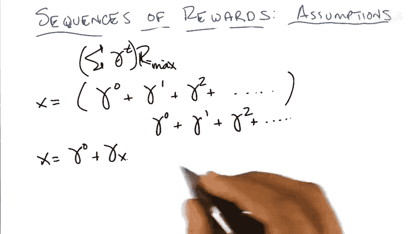

# 强化学习导论：P22：假设

在本节课中，我们将学习如何推导无限折扣回报序列的求和公式，这是理解强化学习中价值函数收敛性的重要基础。

## 无限序列求和推导

上一节我们讨论了回报的边界问题，本节中我们来看看如何具体计算一个无限折扣回报序列的和。

我们之前讨论的公式是：所有未来折扣回报的和，乘以一个最大奖励值 **R_max**。我们可以将 **R_max** 提取出来。

得到的结果形式如下：将一系列折扣因子 **γ** 的幂次相加，然后将结果乘以 **R_max**。

具体形式为：**γ⁰ + γ¹ + γ² + ...**，最终乘以 **R_max**。

让我们将这一系列 **γ** 的幂次和记为 **x**。注意，**x** 本身不包含 **R_max**。

观察这个序列，你会发现它是递归的。因为它是一个无限序列，如果你将其在时间上整体向后移动一步，你会得到几乎相同的序列。

这意味着我们可以用 **x** 自身来表示 **x**。移动后的序列从 **γ¹** 开始，即 **γ * (γ⁰ + γ¹ + γ² + ...)**，也就是 **γ * x**。

因此，原始的 **x** 可以表示为第一项 **γ⁰**（即1）加上移动后的序列 **γ * x**。

于是我们得到方程：**x = 1 + γ * x**。

这只是数学推导。接下来我们可以尝试解这个方程，求出 **x** 的值。

通过移项，我们可以解出 **x**：
**x - γx = 1**
**x(1 - γ) = 1**
**x = 1 / (1 - γ)**

所以，无限折扣序列 **γ⁰ + γ¹ + γ² + ...** 的和等于 **1 / (1 - γ)**。

因此，之前我们讨论的无限折扣回报总和的上界就变成了 **R_max / (1 - γ)**。这个公式在分析强化学习算法的收敛性时非常关键，它保证了在折扣因子 **γ < 1** 的情况下，累积回报是一个有限值。

本节课中我们一起学习了如何推导无限折扣回报序列的求和公式 **∑ γᵏ = 1/(1-γ)**，并理解了它是如何用于确定价值函数边界的。这是强化学习理论中一个基础且重要的结论。