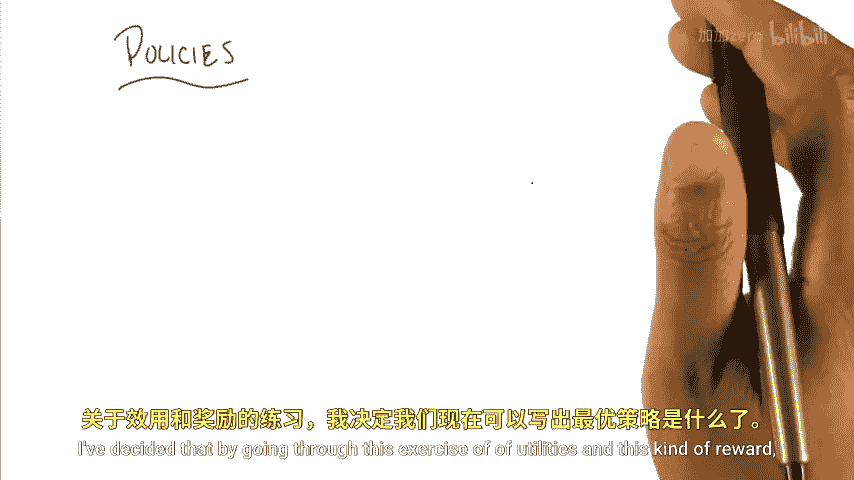
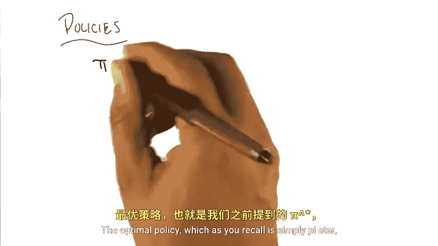
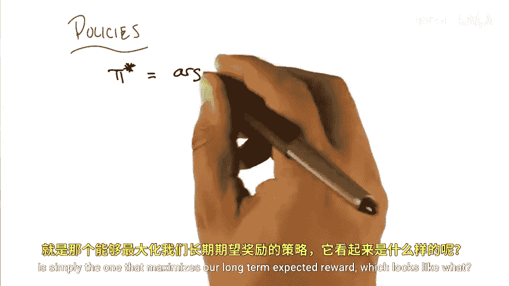
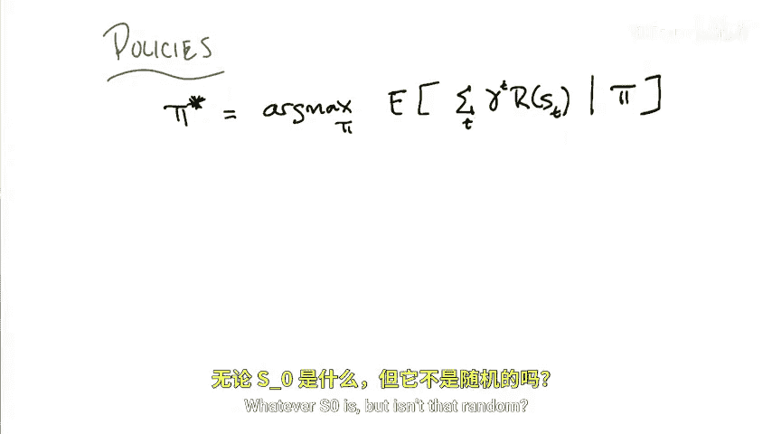
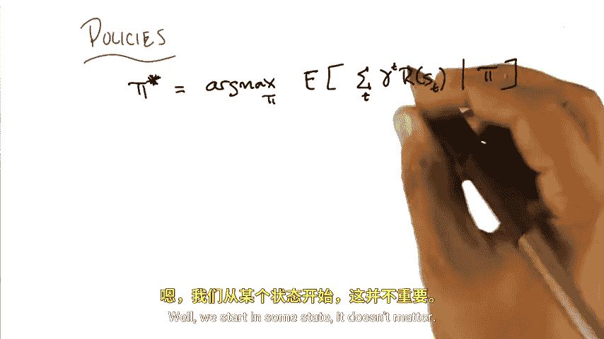
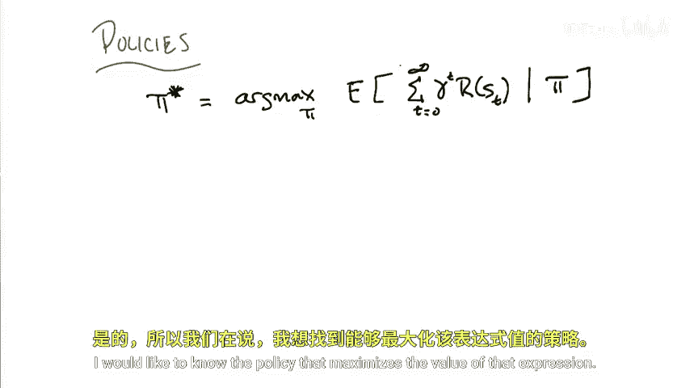

# 佐治亚理工【中英⚡强化学习导论｜CS8803 Introduction to Reinforcement Learning】 p23 P23 Policies - 1 -BV1cJnfzTEBt_p23-

Okay， so Michael， in the spirit of what we just went through in deriving the geometric series。

 I'm now going to write down a bunch of math。 And what I'm going to do is I'm just going to say it at you and you're going to interrupt me if it doesn't make sense。

 Okay， that makes sense。It does。 Okay， so here's the first thing I'm going to write down。

 I've decided that by going through this exercise of。Of utilities and this kind of reward。

 we can now write down what the optimal policy is。 The optimal policy， which， as you recall。

 is simply pi star。 is simply the one that maximizes our long term expected reward。

 which looks like what。 well， looks like this。 There is that since Let me think so。

We have an expected value of the sum of the discounted rewards a time T and given pi。

 meaning that we're going to be following pi， so these are the sequence of states we're going to see in a world where we follow pi。

And it's an expectation because things are non deterterministic or maybe nondeterministic。

 And do we know which state we start in， it doesn't matter。 It's whatever S0 is。

 I see whatever S0 is， but isn't that random， I mean S1 and S2 S3， those are all random。

Well， we start in some state， It doesn't matter。 So T is starting out。

At zero and going to infinity。 Okay， does this make sense。 Yeah。

 so then so we're saying I would like to know the policy that maximizes the value of that expression。

 So it gives us the highest expected reward。 Yeah， that's the kind of policy I would。

