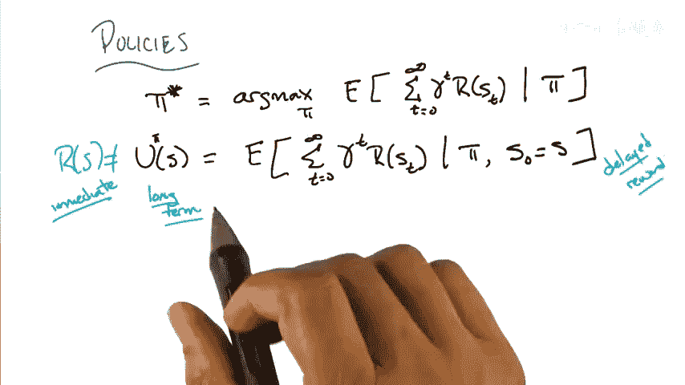
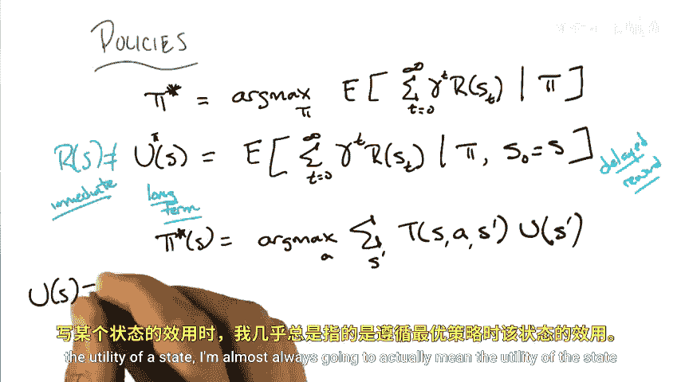
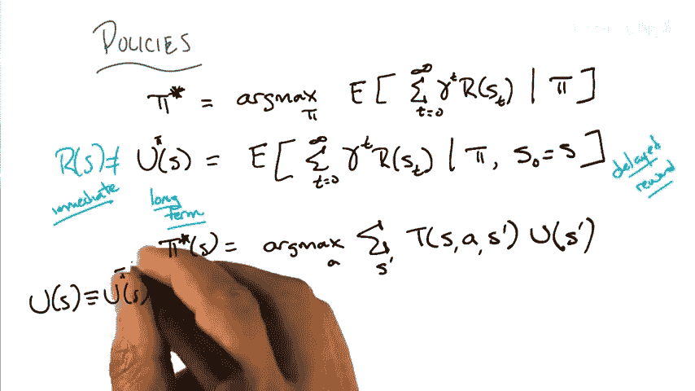
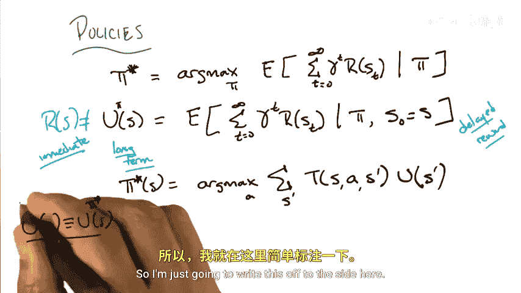
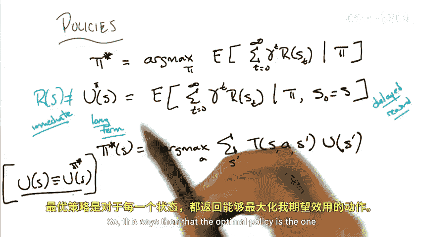
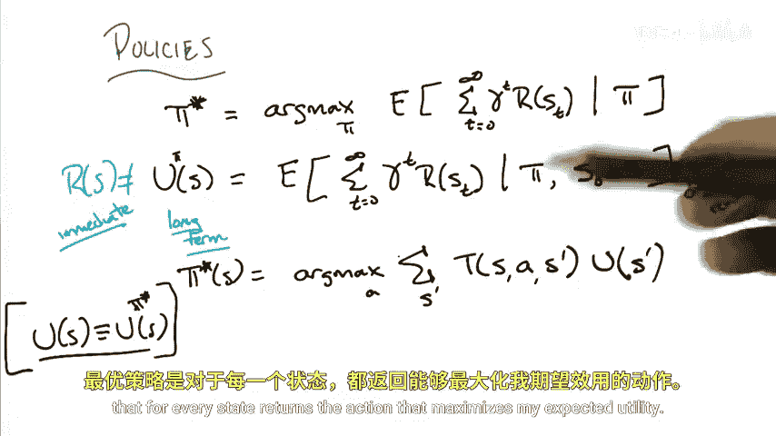

# 佐治亚理工【中英⚡强化学习导论｜CS8803 Introduction to Reinforcement Learning】 p24 P24 Policies - 2 -BV1cJnfzTEBt_p24-

So now that we've got utility defined and we've got this pi star defined。

 we can actually do an even better job of writing out pi star and let me do that。Al right。

 so does this equation make sense， Michael， Let's see。 So the policy。

Is that a star again or is that a kid that's a star， so it's the optimal policy？All right。

 the optimal action to take at a state is well， look over all the actions and sum up over all the next states。

 the transition probability right， so that's like the probability that we end up in state as prime。

And now we have the utility of S prime。 The problem being that that's not defined。 Well。

 it sort of is we've defined it immediately above， at least with respect to some policy。Yeah。

 but that's concerning because we don't know， I mean the policy that you want to put in there is got to be the policy that you're trying to find right so in fact。

 implicitly what I mean here is pi star so yeah in fact。

 let me write that down that whenever you see me right from now on the utility of a state。

I'm almost always going to actually mean the utility of the state if I follow the optimal policy。

 we might call this the true utility of a state。

So I'm just going to write this off to the side here as something for you to remember so this says then that the optimal policy is the one that for every state returns the action that maximizes my expected utility with regard to the optimal policy。

 it feels rather circularrculated。

