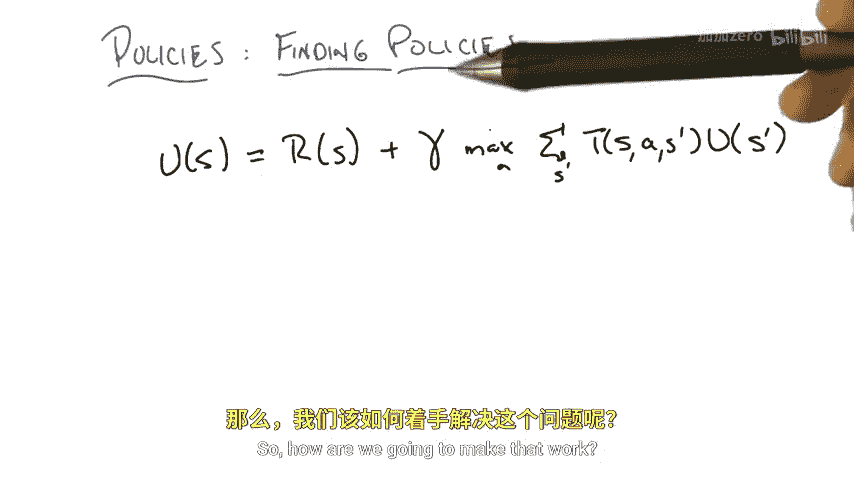
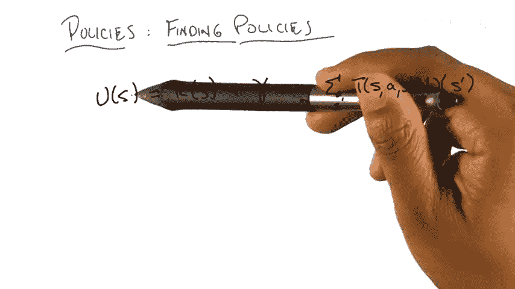
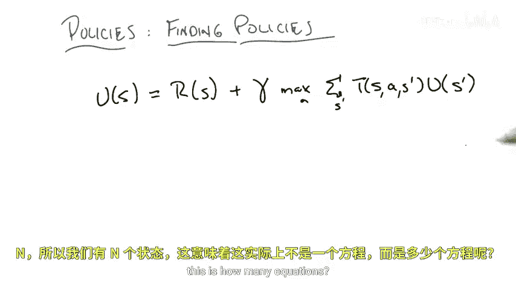
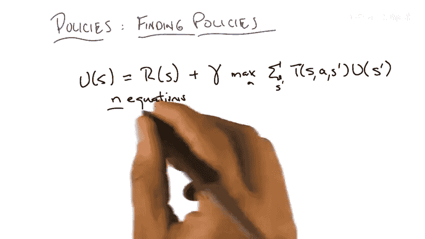
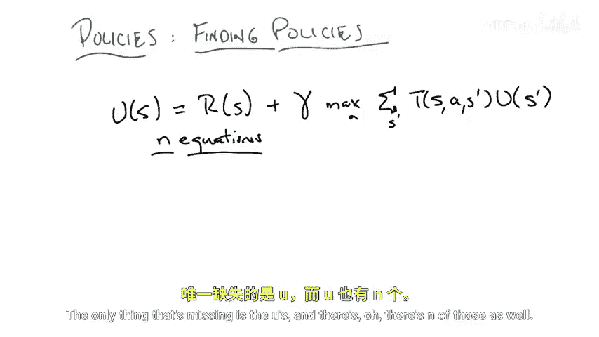
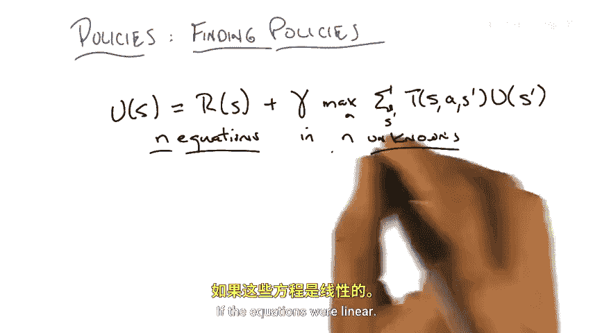
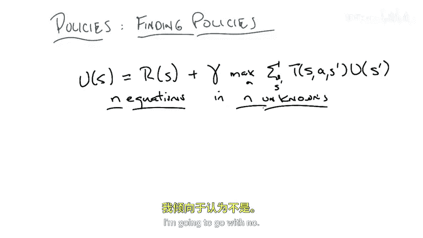
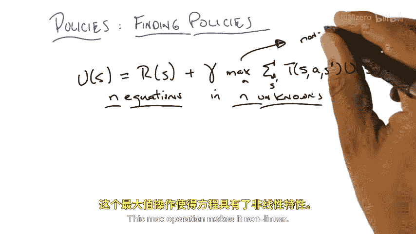
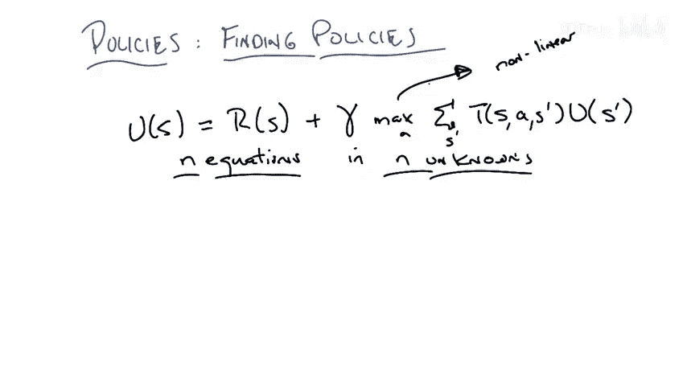

# 佐治亚理工【中英⚡强化学习导论｜CS8803 Introduction to Reinforcement Learning】 p25 P25 Finding Policies - 1 -BV1cJnfzTEBt_p25-

Okay， Michael， so I've erased the screen and kept Bellman's equation。

 the most important equation ever。 And we are going to solve it。 So how are we gonna make that work。

 Okay， so how many， so we wrote this down as a utility of S。

How many Ss are there， S N M， I don't know， big a letter N N。 so we have n states。

 which means this isn't really one equation， this is how many equations。

And yes， it's in equations。 How many unknowns are there。

Well， we have a U， the R's are known， the T's are known。

 the only thing that's missinging is the U' and there's oh， there's n of those as well， right。

 so there's in equations in a no。

So we're done Yes， because we know how to solve in equations and inuns， right。

 if the equations were linear。

If the equations are linear， are these equations linear， I'm going to go with no， Why not。

 because the max is problematic， That's right。 This max operation makes it nonlinear。

 So it looks really good for a moment there。 we've got in equations in unknowns。

 we know how to solve that。 but max makes for a very， very， very weird non nonlinearity。

 And there's kind of no nice way to deal with this。 Actually， one day， Michael， if you ask me。

 there is a cute little aside you can do where you can turn max into something that's differentiable。

But that doesn't actually help us here。 So I'm not going to go off on that aside yet。

 but even differentiable wouldn't quite be linear。 it's right。 And it wouldn't help us in this case。

 That's exactly right。 But the fact that you can have differentiable maxs is， I think。

 actually rather cute， but also unimport for what。

